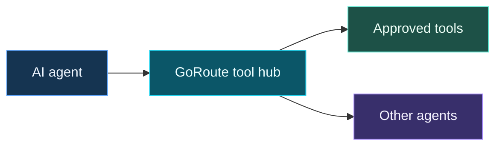
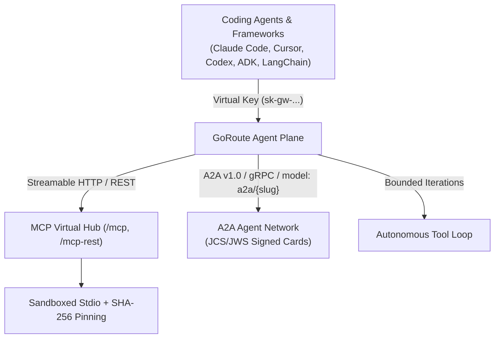

# AI Agent Management: MCP, Tools & Agent Access

Connect AI agents to tools and other agents through GoRoute. The gateway can bring tools from multiple MCP servers together, limit which callers can use them, and support communication through MCP and A2A. Start with the protocol overview that matches your setup, then follow the related configuration guides.

---

## Core Capabilities

| Capability | Implementation | Guide |
| :--- | :--- | :--- |
| **MCP 2026-07-28 Virtual Hub & REST Bridge** | Aggregates upstream MCP servers into `/mcp`, scoped `/mcp/{serverSlug}`, curated `/mcp/toolsets/{toolsetSlug}`, and REST endpoints (`/mcp-rest/tools/list`, `/mcp-rest/tools/call`). | [MCP Overview](/docs/agents/mcp-overview) · [MCP Hub & REST](/docs/agents/mcp-hub-and-rest) |
| **Progressive Tool Discovery** | Serves `/v1/goroute/mcp/registry` so agents load only relevant tool schemas on demand, preventing context-window bloat. | [Progressive Discovery](/docs/agents/mcp-progressive-discovery) |
| **Sandboxed Stdio & SHA-256 Tool Pinning** | Runs local Stdio MCP servers in isolated subprocess sandboxes and pins tool definitions via SHA-256 hashes to prevent rug-pull schema mutations. | [Stdio Sandboxing](/docs/agents/mcp-stdio-sandboxing) |
| **MRTR AEAD Tokens** | Multi-hop tool routing tokens encrypted with AEAD preserve caller identity and permissions across delegated MCP invocations. | [MCP Overview](/docs/agents/mcp-overview) |
| **A2A v1.0 Signed Agent Cards & gRPC** | Serves JCS/JWS-signed Agent Cards (`/.well-known/agent-card.json`), task lifecycle endpoints (`/a2a/v1/agents/{agentSlug}/tasks*`), native gRPC (`server.grpc_port`), and OpenAI bridge (`model: "a2a/{slug}"`). | [A2A Overview](/docs/agents/a2a-overview) · [Agent Cards](/docs/agents/a2a-agent-cards) · [Bridge & gRPC](/docs/agents/a2a-bridge-and-grpc) |
| **Autonomous Multi-Turn Tool Loop** | Executes server-side multi-turn tool-calling loops with bounded iteration budgets and guardrail inspection on every turn. | [Autonomous Tool Loop](/docs/gateway/endpoints/autonomous-tool-loop) |
| **Coding-Agent & Framework Governance** | Connects Claude Code (`/anthropic`), Cursor, Continue, Cline, Codex CLI, Gemini CLI, OpenWebUI, LangChain, OpenAI Agents SDK, and Google ADK under Virtual Key RBAC. | [Claude Code Integration](/docs/integrations/claude-code) · [Integrations Overview](/docs/integrations/overview) |

---

## Agent & Tool Execution Plane

---

## Explore Agent Management Guides

- **MCP**: [MCP Overview](/docs/agents/mcp-overview) · [MCP Hub & REST](/docs/agents/mcp-hub-and-rest) · [Progressive Discovery](/docs/agents/mcp-progressive-discovery) · [Stdio Sandboxing](/docs/agents/mcp-stdio-sandboxing)
- **A2A**: [A2A Overview](/docs/agents/a2a-overview) · [Agent Cards](/docs/agents/a2a-agent-cards) · [Bridge & gRPC](/docs/agents/a2a-bridge-and-grpc)
- **Autonomous Execution & Coding Agents**: [Autonomous Tool Loop](/docs/gateway/endpoints/autonomous-tool-loop) · [Claude Code Integration](/docs/integrations/claude-code) · [Integrations Overview](/docs/integrations/overview)
