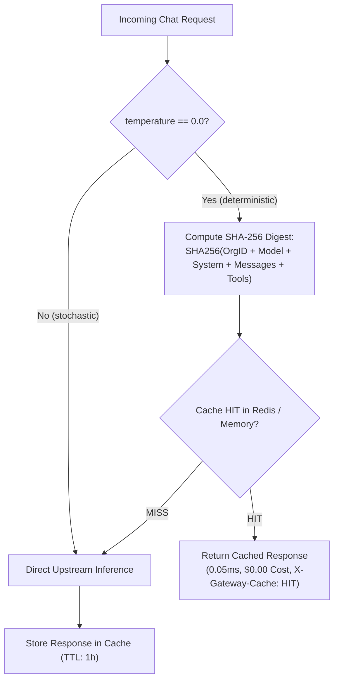

# Deterministic Exact-Match Response Caching

GoRoute AI Gateway embeds a tenant-isolated, deterministic exact-match response cache that serves identical queries in **0.05 milliseconds** with **zero upstream token spend**.



---

## 1. Deterministic Hashing Key

To guarantee tenant isolation and safety, the cache key is constructed using a cryptographic SHA-256 digest over normalized request fields:

```text
CacheKey = SHA256(OrgID || Model || SystemPrompt || Messages || Tools)
```

- **Tenant Isolation**: An identical prompt submitted by Org A will never be returned to Org B.
- **Deterministic Only**: Requests with `temperature > 0.0` or non-zero randomness bypass the cache to preserve LLM creativity and variance.

---

## 2. Benchmark Comparison

| Metric | Upstream Model Call | GoRoute Cached Hit |
| :--- | :--- | :--- |
| **Response Latency** | 450 ms – 1,800 ms | **0.05 ms (50 µs)** |
| **Cost Incurred** | Full token billing ($0.001 – $0.05) | **$0.00 (Zero tokens)** |
| **Upstream Network I/O** | 100% | **0% (Bypassed)** |
| **Telemetry Header** | `X-Gateway-Cache: MISS` | `X-Gateway-Cache: HIT` |
