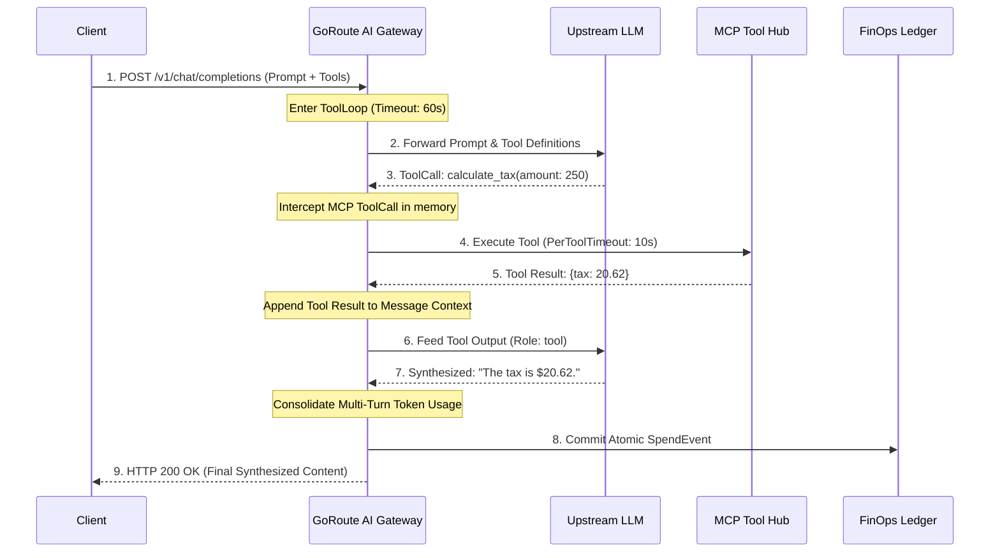

import Tabs from '@theme/Tabs';
import TabItem from '@theme/TabItem';

# Server-Side Autonomous Tool Loop Orchestrator

GoRoute AI Gateway features a built-in server-side tool execution engine (`internal/orchestrator`). When a model responds with tool calls matching registered Model Context Protocol (MCP) servers or local functions, the orchestrator intercepts the call, executes the tool in-process, feeds the output back to the model, and recursively loops until a final synthesized answer is produced.

The client receives the final completed response in a **single HTTP turn**, eliminating network roundtrips between the client and gateway.

---

## Architectural Sequence Diagram



---

## Safety Boundaries & Execution Budget Policy

To protect systems from infinite recursion, runaway token usage, and unresponsive tool integrations, the orchestrator enforces strict budget boundaries (`ExecutionBudgetPolicy`):

| Boundary Parameter | Default Value | Description |
| :--- | :--- | :--- |
| `MaxLoopRounds` | `5` | Maximum number of recursive LLM tool-calling roundtrips before forcing termination. |
| `CumulativeTimeout` | `60s` | Absolute wall-clock timeout for the entire multi-turn orchestration loop. |
| `PerToolTimeout` | `10s` | Maximum execution duration allocated to an individual MCP tool execution. |
| `MaxToolOutputBytes` | `512 KB` | Truncation limit on tool output strings, preventing accidental context window blowouts. |
| `MaxSpendMicros` | `0` (unlimited) | Micro-dollar financial ceiling. Aborts execution if accumulated token cost exceeds threshold. |

> [!IMPORTANT]
> If `MaxLoopRounds` is reached without a terminal completion, the gateway returns the last model response with metadata header `goroute.orchestrator/budget_exhausted: true`, enabling clients to gracefully handle incomplete agentic iterations.

---

## Anti-Double-Billing FinOps Ledger

In traditional client-orchestrated agent loops, each turn requires a distinct HTTP request (`Turn 1: user prompt`, `Turn 2: user prompt + assistant tool call + tool result`, etc.). This causes severe FinOps challenges:
- Prompt tokens for earlier turns are re-sent repeatedly and billed multiple times across disconnected HTTP records.
- Distributed network failures between client turns leave billing ledgers in desynchronized states.

### Atomic Consolidation Mechanism

GoRoute completely resolves double billing through atomic accumulation:

```go
// internal/orchestrator/tool_loop.go
accumulatedUsage.PromptTokens += resp.Usage.PromptTokens
accumulatedUsage.CompletionTokens += resp.Usage.CompletionTokens
accumulatedUsage.TotalTokens += resp.Usage.TotalTokens
```

1. **Exact-Once Ledger Commitment**: Intermediate turns do not generate separate billing transactions.
2. **Atomic SpendEvent**: Only after the orchestrator exits the loop (either upon final answer or budget exhaustion) does it commit a single consolidated `SpendEvent` to the PostgreSQL ledger.
3. **Accurate Budget Decrement**: Virtual key limits and team allocations are decremented atomically, ensuring ledger accuracy.

---

## Tool Partitioning: Server-Side vs Client-Side

When a model requests multiple tools in a single turn, the orchestrator inspects each call against the authorized MCP tool registry (`mcpToolMap`):

- **Server-Side MCP Calls**: Tools registered with the gateway or prefixed with `mcp_` / `mcp__` are executed server-side.
- **Client-Side Calls**: If any tool calls cannot be executed server-side (e.g. client UI navigation, local device APIs), the orchestrator immediately halts the loop and returns the unexecuted tool calls to the client with `finish_reason: "tool_calls"`.

### Self-Correcting JSON Recovery

If a model produces malformed JSON arguments for a server-side tool:
1. On the first failure, the orchestrator feeds the JSON parser error back to the model as a `tool` error message (`"Invalid JSON arguments for tool X: ... Please format arguments as valid JSON"`).
2. The model uses its next reasoning turn to self-correct and re-emit valid arguments.
3. If JSON parsing fails a second time, the tool is marked persistently failed, preventing infinite recovery loops.

---

## Streaming with Lookahead Buffering (`ExecuteStreamLoop`)

Streaming responses when an autonomous tool loop is active requires lookahead buffering:
- Intermediate reasoning turns and tool invocations are withheld from the client's SSE connection.
- Once the final synthesized pure-text answer is produced, the orchestrator streams the final completion tokens word-by-word or in real-time chunks, accompanied by final usage telemetry.

---

## Configuration Example (`configs/config.yaml`)

```yaml
orchestrator:
  enabled: true
  max_loop_rounds: 5
  cumulative_timeout: 60s
  per_tool_timeout: 10s
  max_tool_output_bytes: 524288 # 512 KB
```

## Response Metadata Headers

Responses executed through the autonomous loop include tracking metadata:
- `goroute.orchestrator/loop_rounds`: Number of recursive turns completed (e.g. `"2"`)
- `goroute.orchestrator/total_tool_calls`: Cumulative number of tools executed (e.g. `"3"`)
- `goroute.orchestrator/budget_exhausted`: `"true"` if loop halted due to round limits
