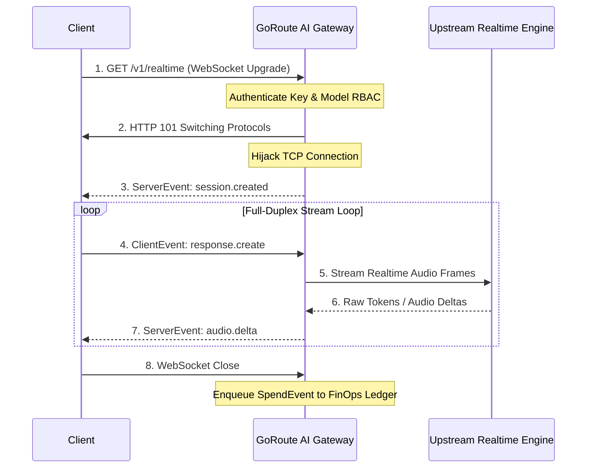

import Tabs from '@theme/Tabs';
import TabItem from '@theme/TabItem';

# OpenAI Realtime WebSocket API (`GET /v1/realtime`)

GoRoute AI Gateway supports the **OpenAI Realtime API** protocol over bidirectional WebSockets. Realtime enables low-latency, full-duplex conversational sessions supporting streaming text and audio with sub-second voice interactions.

---

## Endpoint Specification

- **HTTP Method**: `GET` (WebSocket Upgrade Handshake)
- **Supported Paths**:
  - `/v1/realtime` (Standard data plane endpoint)
  - `/realtime` (Unversioned compatibility alias)
  - `/openai/v1/realtime` (OpenAI wire compatibility alias)
- **Subprotocol**: `realtime` (passed via `Sec-WebSocket-Protocol: realtime`)
- **Authentication**: `Bearer sk-gw-...` passed in the `Authorization` header during the WebSocket upgrade handshake
- **Default Model**: `gpt-4o-realtime-preview` (configurable via `?model=...` query parameter)

---

## Architecture: Zero-Allocation Connection Hijacking

GoRoute utilizes [`nhooyr.io/websocket`](https://github.com/nhooyr/websocket) for RFC 6455 compliance without external daemon processes. When a client initiates the handshake:



1. **In-Flight Authentication**: Handshake requests pass through `auth.DataPlaneMiddleware`, verifying the virtual key and validating model access permissions before the TCP connection is hijacked.
2. **Session State Isolation**: Each active WebSocket maintains its own isolated message history, active tools, and audio buffer frames.
3. **Session FinOps Ledger**: When the session closes, the gateway aggregates all tokens and audio duration generated throughout the session and records a single consolidated spend transaction.

---

## Realtime Event Protocol

Communication occurs via JSON-formatted frames over text message blocks.

### 1. Client Events (Inbound)

| Event Type | Description |
| :--- | :--- |
| `session.update` | Modifies active session parameters (modalities, voice, temperature, instructions). |
| `conversation.item.create` | Appends a new user message or tool result to conversation history. |
| `input_audio_buffer.append` | Appends base64-encoded PCM16 audio bytes to the input buffer. |
| `input_audio_buffer.commit` | Commits pending audio and triggers automatic turn detection. |
| `response.create` | Instructs the model to generate an assistant turn immediately. |
| `response.cancel` | Interrupts current streaming generation (e.g. user barge-in). |

### 2. Server Events (Outbound)

| Event Type | Description |
| :--- | :--- |
| `session.created` | Emitted immediately upon connection with active session configuration. |
| `session.updated` | Acknowledges receipt and application of `session.update`. |
| `conversation.item.created` | Confirms item addition to session context. |
| `response.created` | Signals that a new response generation run has begun. |
| `response.text.delta` | Incremental text token delta from the assistant. |
| `response.audio.delta` | Incremental base64-encoded PCM16 audio chunks. |
| `response.done` | Signals completion of the response turn with final usage metadata. |
| `error` | Emitted if an invalid event, schema mismatch, or budget error occurs. |

---

## Session Configuration (`session.created`)

Immediately upon upgrading the connection, GoRoute dispatches the initial session configuration:

```json
{
  "event_id": "event_88fa2b10-2180-4ce9-9f01-38290fa1b203",
  "type": "session.created",
  "session": {
    "id": "sess_1189ac02-990a-412e-b998-382910fa8821",
    "object": "realtime.session",
    "model": "gpt-4o-realtime-preview",
    "modalities": ["text"],
    "instructions": "You are a helpful AI assistant.",
    "voice": "alloy",
    "input_audio_format": "pcm16",
    "output_audio_format": "pcm16"
  }
}
```

---

## Code Examples

<Tabs>
<TabItem value="python" label="Python (WebSockets)" default>

```python
import asyncio
import json
import websockets

GATEWAY_WS_URL = "ws://localhost:8080/v1/realtime?model=gpt-4o-realtime-preview"
API_KEY = "sk-gw-prod-7f9a2b8c4d1e"

async def realtime_chat():
    headers = {"Authorization": f"Bearer {API_KEY}"}
    async with websockets.connect(GATEWAY_WS_URL, extra_headers=headers, subprotocols=["realtime"]) as ws:
        # 1. Wait for session.created
        init_event = json.loads(await ws.recv())
        print(f"Session established: {init_event['session']['id']}")

        # 2. Send user text message
        await ws.send(json.dumps({
            "type": "conversation.item.create",
            "item": {
                "type": "message",
                "role": "user",
                "content": [{"type": "input_text", "text": "What is connection hijacking in HTTP servers?"}]
            }
        }))

        # 3. Request response generation
        await ws.send(json.dumps({"type": "response.create"}))

        # 4. Stream response events
        while True:
            msg = json.loads(await ws.recv())
            event_type = msg.get("type")
            if event_type == "response.text.delta":
                print(msg.get("delta", ""), end="", flush=True)
            elif event_type == "response.done":
                print("\n[Turn completed]")
                break

asyncio.run(realtime_chat())
```

</TabItem>
<TabItem value="ts" label="TypeScript / Browser">

```typescript
const ws = new WebSocket(
  "ws://localhost:8080/v1/realtime?model=gpt-4o-realtime-preview",
  ["realtime"]
);

ws.onopen = () => {
  console.log("WebSocket connected to GoRoute Gateway");
};

ws.onmessage = (event) => {
  const data = JSON.parse(event.data);
  switch (data.type) {
    case "session.created":
      console.log("Session ID:", data.session.id);
      // Send a user prompt
      ws.send(
        JSON.stringify({
          type: "conversation.item.create",
          item: {
            type: "message",
            role: "user",
            content: [{ type: "input_text", text: "Explain WebSockets vs SSE." }],
          },
        })
      );
      ws.send(JSON.stringify({ type: "response.create" }));
      break;

    case "response.text.delta":
      process.stdout.write(data.delta);
      break;

    case "response.done":
      console.log("\nFinished turn.");
      ws.close();
      break;
  }
};
```

</TabItem>
<TabItem value="go" label="Go">

```go
package main

import (
	"context"
	"encoding/json"
	"fmt"
	"net/http"
	"time"

	"nhooyr.io/websocket"
)

func main() {
	ctx, cancel := context.WithTimeout(context.Background(), 30*time.Second)
	defer cancel()

	opts := &websocket.DialOptions{
		Subprotocols: []string{"realtime"},
		HTTPHeader: http.Header{
			"Authorization": []string{"Bearer sk-gw-prod-7f9a2b8c4d1e"},
		},
	}

	conn, _, err := websocket.Dial(ctx, "ws://localhost:8080/v1/realtime?model=gpt-4o-realtime-preview", opts)
	if err != nil {
		panic(err)
	}
	defer conn.Close(websocket.StatusNormalClosure, "done")

	// Read initial session.created
	_, data, err := conn.Read(ctx)
	if err != nil {
		panic(err)
	}
	var sessEv map[string]interface{}
	_ = json.Unmarshal(data, &sessEv)
	fmt.Printf("Connected: Event %s\n", sessEv["type"])
}
```

</TabItem>
</Tabs>
