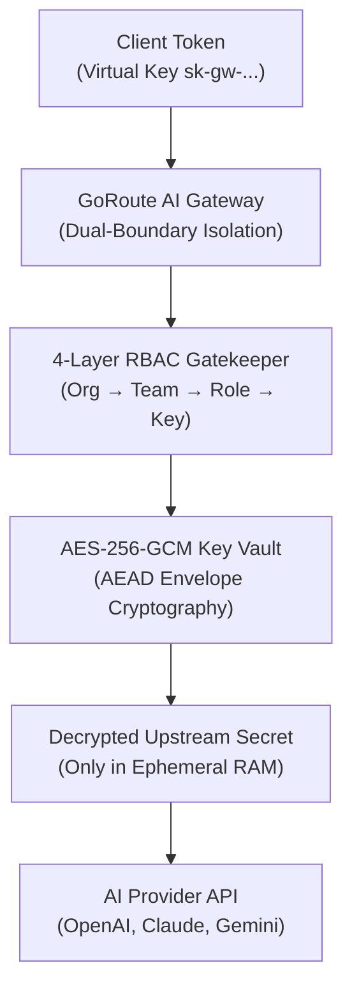

# 4-Layer RBAC & Key Vault Architecture

GoRoute AI Gateway implements a dual-boundary security architecture ensuring cryptographic separation between client virtual keys and upstream provider credentials.

---

## 1. 4-Layer RBAC Hierarchy

1. **Organization Layer (`OrgID`)**: Enforces strict multi-tenant boundary. Telemetry, logs, and spend queries are strictly isolated to the organization.
2. **Team Layer (`TeamID`)**: Sub-divides organizations into business units (e.g. `checkout`, `fraud`, `analytics`) with allocated monthly budgets.
3. **Role-Based Permissions (`Role`)**:
   - `org_admin`: Manage organization settings, issue admin keys, query cross-team spend.
   - `team_admin`: Manage team keys, view team spend, adjust team rate limits.
   - `developer`: Execute chat completions, stream tokens, call permitted MCP tools.
   - `service_account`: High-throughput machine-to-machine integrations.
4. **Key-Level Allowlists (`AllowedModels`) & Fail-Closed Team Allowlists**: Restricts individual keys and teams to specific models, MCP servers, A2A agents, and client apps (`allowed_models`, `allowed_mcp_servers`, `allowed_a2a_agents`, `allowed_client_apps` persisted in PostgreSQL). Team lookup errors fail closed rather than falling back to permissive defaults.

---

## 1a. Control-Plane Operator RBAC & Inbound JWT/OIDC

Control-plane endpoints (`/admin/v1/*`) enforce separate operator authorization from data-plane virtual keys:
- **Operator Roles**: `platform_admin` (full cross-organization administration, required for master admin key), `org_admin` (scoped to a single organization), and `org_viewer` (read-only access within a single organization).
- **Inbound JWT/OIDC**: Operators can authenticate with signed HMAC/OIDC JWTs alongside the Master Admin Key (`platform_admin`).
- **Data-Plane Isolation**: The Master Admin Key cannot be used as a fallback credential on data-plane inference routes (`/v1/*`).
- **Production Secret Validation**: When `server.environment`, `ENV`, or `GATEWAY_ENV` is set to `production` (or `prod`), startup fails immediately if `auth.master_admin_key`, `auth.master_encryption_key`, or `auth.jwt_secret` retains a default value.
- **HTTP Security Headers & CORS**: `SecurityHeadersMiddleware` sets `X-Content-Type-Options`, `X-Frame-Options`, `Referrer-Policy`, `Content-Security-Policy`, and opt-in `Strict-Transport-Security` (`server.enable_hsts`), while `CORSMiddleware` disables cross-origin headers unless `server.cors_allowed_origins` is explicitly configured.

---

## 2. AES-256-GCM Envelope Encryption

All upstream provider credentials (e.g. OpenAI API keys, Anthropic secrets) stored in PostgreSQL are encrypted at rest using **AES-256-GCM AEAD (Authenticated Encryption with Associated Data)**:

- Keys are encrypted using a 256-bit Master Encryption Key (`master_encryption_key`).
- A cryptographically random 12-byte initialization vector (nonce) is generated for each record.
- Authentication tags prevent tampering or ciphertext modification.
- Keys are decrypted exclusively in ephemeral RAM during the outbound HTTP request dispatch and immediately zeroed from memory buffers.

---

## 3. Secret Masking in Telemetry & Logs

GoRoute automatically scrubs API keys, bearer tokens, and credentials from all log outputs, error messages, and OpenTelemetry trace attributes:
- `Authorization: Bearer sk-gw-45dd...` -> Masked to `sk-gw-45dd****`
- Upstream provider keys never appear in log statements or JSON payloads.
