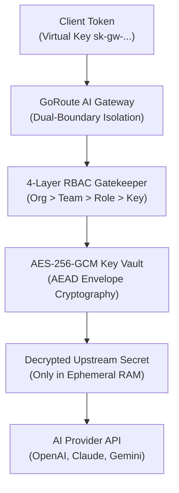

# 4-Layer RBAC & Key Vault Architecture

GoRoute AI Gateway implements a dual-boundary security architecture ensuring cryptographic separation between client virtual keys and upstream provider credentials.

---

## 1. 4-Layer RBAC Hierarchy

1. **Organization Layer (`OrgID`)**: Enforces strict multi-tenant boundary. Telemetry, logs, and spend queries are strictly isolated to the organization.
2. **Team Layer (`TeamID`)**: Sub-divides organizations into business units (e.g. `checkout`, `fraud`, `analytics`) with allocated monthly budgets.
3. **Role-Based Permissions (`Role`)**:
   - `org_admin`: Manage organization settings, issue admin keys, query cross-team spend.
   - `team_admin`: Manage team keys, view team spend, adjust team rate limits.
   - `developer`: Execute chat completions, stream tokens, call permitted MCP tools.
   - `service_account`: High-throughput machine-to-machine integrations.
4. **Key-Level Allowlists (`AllowedModels`)**: Restricts individual keys to specific models or aliases (e.g. key `sk-gw-123` can only execute `gemini-2.5-flash`).

---

## 2. AES-256-GCM Envelope Encryption

All upstream provider credentials (e.g. OpenAI API keys, Anthropic secrets) stored in PostgreSQL are encrypted at rest using **AES-256-GCM AEAD (Authenticated Encryption with Associated Data)**:

- Keys are encrypted using a 256-bit Master Encryption Key (`master_encryption_key`).
- A cryptographically random 12-byte initialization vector (nonce) is generated for each record.
- Authentication tags prevent tampering or ciphertext modification.
- Keys are decrypted exclusively in ephemeral RAM during the outbound HTTP request dispatch and immediately zeroed from memory buffers.

---

## 3. Secret Masking in Telemetry & Logs

GoRoute automatically scrubs API keys, bearer tokens, and credentials from all log outputs, error messages, and OpenTelemetry trace attributes:
- `Authorization: Bearer sk-gw-45dd...` -> Masked to `sk-gw-45dd****`
- Upstream provider keys never appear in log statements or JSON payloads.
