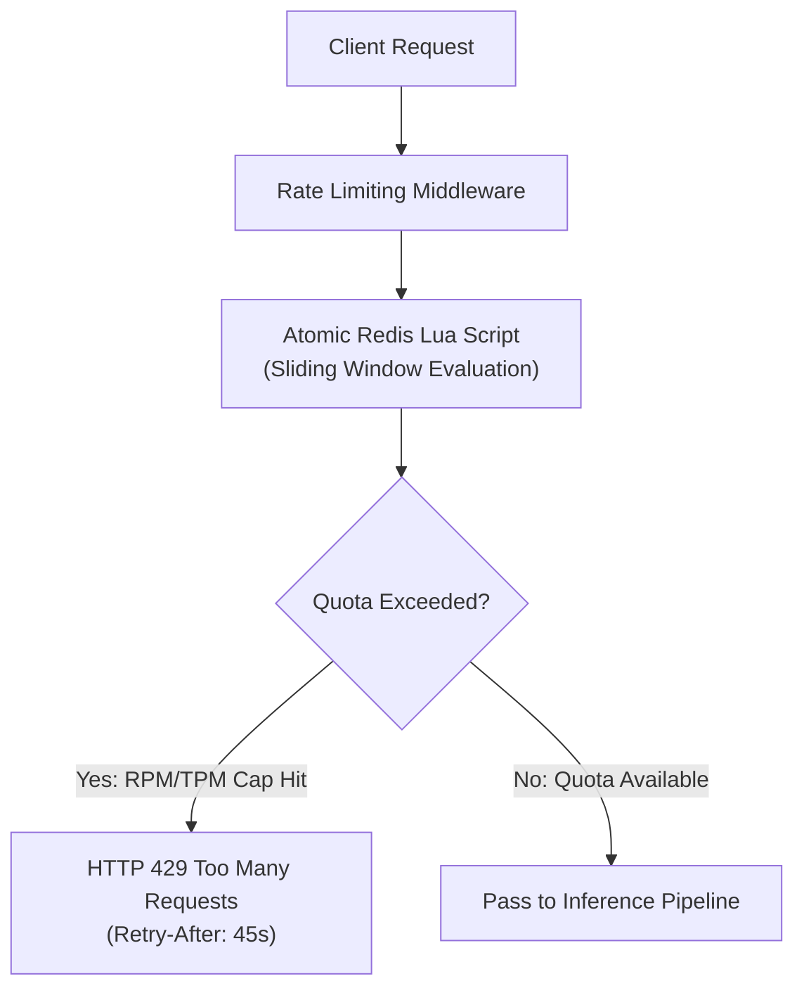

# Distributed Rate Limiting (RPM & TPM)

GoRoute AI Gateway implements an atomic, distributed rate limiter using Redis Lua scripts and a sliding-window counter algorithm. It enforces both **Requests Per Minute (RPM)** and **Tokens Per Minute (TPM)** across multiple gateway pods with microsecond synchronization.



---

## Sliding Window Lua Algorithm

Unlike fixed-window counters that permit 2x traffic bursts across window boundaries, GoRoute's sliding-window algorithm evaluates consumption across a continuously moving 60-second window:

1. Removes expired request timestamps (`ZREMRANGEBYSCORE key 0 (now - window)`).
2. Calculates current usage count within the active window (`ZCARD key`).
3. If current usage exceeds `rpm_limit`, returns remaining cooldown seconds.
4. Otherwise, registers the new request timestamp (`ZADD key now requestId`) and grants access.

---

## Redis Cluster, Hash Tags & Fail-Closed Behavior

- **Redis Cluster & Sentinel (`UniversalClient`)**: `RedisFabric` supports standalone Redis (`storage.redis_addr`), Redis Cluster (`storage.redis_addrs`), and Redis Sentinel (`storage.redis_master_name`). Multi-key Lua scripts use `{org:<org_id>}` hash tags so all keys for an organization map to the same Redis Cluster slot.
- **Fail-Closed Quota Enforcement**: When distributed Redis quota state is unavailable or exceeds `rate_limit.redis_timeout`, the limiter fails closed rather than allowing unbounded traffic.

---

## HTTP 429 Rate Limit Response

When quota is exceeded, GoRoute returns an informative HTTP 429 response:

```http
HTTP/1.1 429 Too Many Requests
Content-Type: application/json
Retry-After: 42
X-RateLimit-Limit-Requests: 100
X-RateLimit-Remaining-Requests: 0
X-RateLimit-Reset-Requests: 42

{
  "error": {
    "type": "rate_limit_error",
    "code": "key_rpm_exceeded",
    "message": "Rate limit or quota exceeded (KEY_RPM_EXCEEDED)"
  }
}
```
