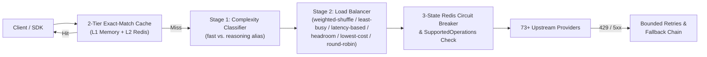

# AI Gateway: Traffic Management & Model Routing

The **AI Gateway** module is GoRoute's high-throughput, zero-allocation data plane for routing inference traffic across **73 `ProviderType` profiles** (8 native adapters, 60+ built-in/extended OpenAI-compatible profiles, and `CustomOpenAICompatible`) through a single unified API.

---

## Core Capabilities

| Capability | Implementation | Guide |
| :--- | :--- | :--- |
| **Unified Data Plane (24 `/v1` Paths)** | OpenAI-compatible `/v1/*` & `/openai/v1/*`, plus native Anthropic `/anthropic/v1/messages` & `count_tokens`, Responses API, Realtime WebSockets, `POST /v1/guardrails/apply`, Audio, Images, Files, Batches, Rerank, and Moderations. | [Chat Completions](/docs/gateway/endpoints/chat-completions) · [Messages](/docs/gateway/endpoints/messages) · [Responses](/docs/gateway/endpoints/responses) · [Realtime](/docs/gateway/endpoints/realtime) |
| **73+ Provider Profiles & `SupportedOperations`** | Native adapters for OpenAI, Anthropic, Azure OpenAI, AWS Bedrock, Google Gemini, Google Vertex, Cohere, Mistral, Ollama, plus 60+ OpenAI-compatible profiles with `SupportedOperations` enforcement (`OperationSupportChecker`). | [Providers Overview](/docs/providers/overview) · [OpenAI-Compatible](/docs/providers/openai-compatible) |
| **Stage 1 Complexity Classifier** | Heuristic prompt complexity scoring routes simple requests to fast/low-cost tiers and complex tasks to reasoning models automatically. | [Routing & Load Balancing](/docs/gateway/routing-and-load-balancing) |
| **Stage 2 Load Balancers** | Six strategies across sibling deployments: `weighted-shuffle`, `least-busy`, `latency-based` (EWMA), `usage-based-headroom`, `lowest-cost`, and `round-robin`. | [Routing & Load Balancing](/docs/gateway/routing-and-load-balancing) |
| **3-State Redis Circuit Breakers** | Shared `Closed → Open → Half-Open` state in Redis across gateway replicas with atomic half-open probe leases. | [Resiliency & Fallbacks](/docs/gateway/resiliency-and-fallbacks) |
| **Bounded Fallback Chains** | Configurable intra-group exponential retries and cross-model failover chains for 429/5xx/503 resilience. | [Resiliency & Fallbacks](/docs/gateway/resiliency-and-fallbacks) |
| **2-Tier Exact-Match Cache** | L1 in-process memory + L2 Redis SHA-256 exact-match response caching for sub-millisecond cache hits. | [Exact-Match Caching](/docs/gateway/caching) |

---

## Request Routing Pipeline

---

## Explore Data Plane & Routing Guides

- **Data Plane Endpoints**: [Chat Completions](/docs/gateway/endpoints/chat-completions) · [Embeddings](/docs/gateway/endpoints/embeddings) · [Audio](/docs/gateway/endpoints/audio) · [Images](/docs/gateway/endpoints/images) · [Rerank](/docs/gateway/endpoints/rerank) · [Files](/docs/gateway/endpoints/files) · [Batches](/docs/gateway/endpoints/batches)
- **Providers**: [Providers Overview](/docs/providers/overview) · [Custom Provider](/docs/providers/custom-provider)
- **Routing & Resiliency**: [Routing & Load Balancing](/docs/gateway/routing-and-load-balancing) · [Resiliency & Fallbacks](/docs/gateway/resiliency-and-fallbacks) · [Exact-Match Caching](/docs/gateway/caching)
