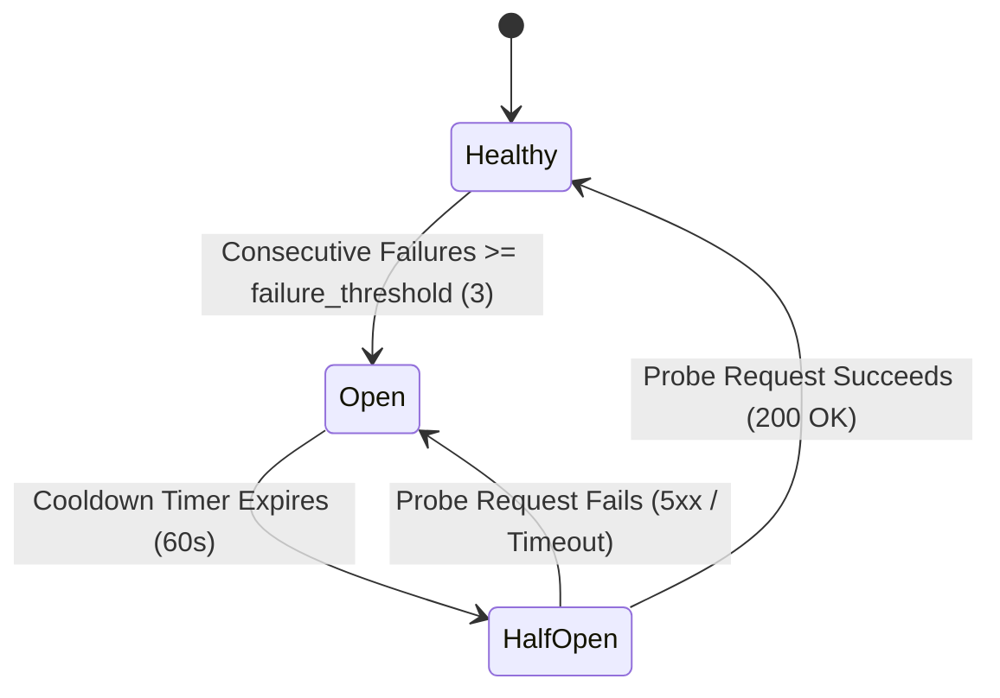
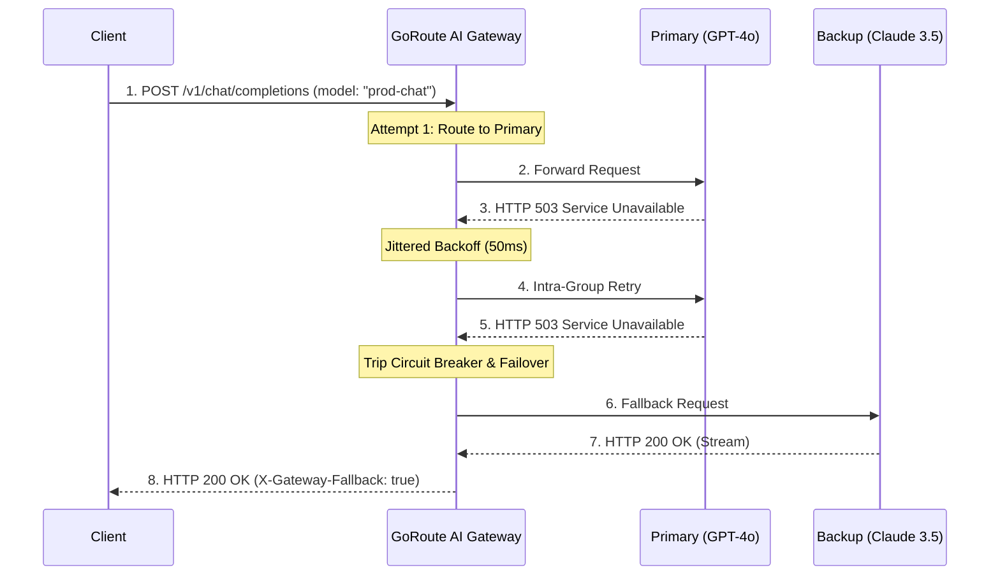

# Resiliency, Circuit Breakers & Fallbacks

GoRoute AI Gateway protects inference availability during regional outages, HTTP 429 rate limits, and upstream 5xx failures by pairing **3-state circuit breakers** with **jittered intra-group retries** and **cross-provider fallback cascades**.

---

## 1. 3-State Circuit Breakers & Outage Isolation

GoRoute embeds a state machine based on the classic **3-State Circuit Breaker Pattern** (`healthy`, `open`, `half-open`) to automatically isolate unhealthy upstream deployments and prevent cascading failures.



### State Transitions

1. **`Healthy` (Closed)**: Normal operational state. All traffic passes through to the selected deployment. Successes and latencies are tracked for EWMA calculations.
2. **`Open` (Tripped)**: When a deployment accumulates `failure_threshold` (default: 3) consecutive 5xx errors or timeouts within `failure_window` (default: 30s), the breaker trips to **OPEN**.
   - All subsequent requests targeting this deployment are **immediately diverted** to the next deployment in the fallback chain without attempting network I/O.
   - The deployment enters a quarantine cooldown (default: `default_cooldown: 60s`).
3. **`Half-Open` (Probing)**: When the cooldown timer expires, the breaker transitions to **HALF-OPEN**.
   - A single canary request is allowed through to test upstream health.
   - If the probe succeeds with HTTP 200, the breaker resets to **HEALTHY** and resumes full traffic.
   - If the probe fails, the breaker trips back to **OPEN** and resets the quarantine cooldown.

### Cluster-Wide Redis Coordination

When running multiple gateway replicas behind a load balancer with Redis configured:
- **Shared Failure State**: Deployment failure counts and open states are synchronized via Redis so all replicas isolate an unhealthy upstream together.
- **Half-Open Probe Leases**: Replicas coordinate half-open canary probes through a Redis lease so only a single pod sends a probe request when cooldown expires, preventing probe storms.

### Circuit Breaker Configuration (`configs/config.yaml`)

```yaml
router:
  failure_threshold: 3      # Consecutive errors required to trip breaker
  failure_window: 30s        # Sliding time window for failure counts
  default_cooldown: 60s      # Quarantine duration before half-open probe
```

---

## 2. Retries & Cross-Provider Fallback Cascades

When cloud AI providers experience regional outages, rate limits (HTTP 429), or internal server errors (HTTP 500, 502, 503), GoRoute AI Gateway automatically executes intra-group retries and cross-provider fallback cascades.



### Intra-Group Retries with Full Jitter

Before abandoning a model deployment, GoRoute executes automated retries with exponential backoff and randomized decorrelated jitter to prevent thundering herd spikes on recovered upstreams:

```text
Delay = min(max_retry_delay, base_retry_delay * 2^attempt) * Uniform(0.5, 1.5)
```

```yaml
router:
  default_max_retries: 2
  base_retry_delay: 50ms
  max_retry_delay: 2s
```

- **Streaming Pre-First-Token Retries**: Streaming endpoints (`/v1/chat/completions`, `/v1/messages`, `/v1/responses`) apply exponential backoff retries if an upstream fails *before* emitting the first output token, then stream directly once bytes begin flowing.
- **Multi-Modal Reliability**: `ExecuteEmbeddings` (`/v1/embeddings`) and audio/image endpoints share the same retry, circuit-breaker, and fallback pipeline as chat completions.
- **Bounded Fallback Graph Traversal**: Fallback group chains enforce explicit cycle detection and maximum depth limits to prevent infinite failover loops.

### Declarative Cross-Provider Fallback Chains

Configure fallback cascades in `configs/config.yaml`:

```yaml
model_list:
  # Primary Group: OpenAI GPT-4o
  - model_name: prod-chat
    routing_strategy: weighted-shuffle
    model_params:
      model: openai/gpt-4o
      api_key: os.environ/OPENAI_API_KEY
      fallbacks: ["backup-claude", "backup-gemini"]

  # Secondary Fallback: Anthropic Claude Sonnet
  - model_name: backup-claude
    model_params:
      model: anthropic/claude-sonnet-4-20250514
      api_key: os.environ/ANTHROPIC_API_KEY

  # Tertiary Emergency Fallback: Google Gemini Flash
  - model_name: backup-gemini
    model_params:
      model: gemini/gemini-2.5-flash
      api_key: os.environ/GEMINI_API_KEY
```

If OpenAI experiences an outage, GoRoute seamlessly falls back to Anthropic Claude. If Anthropic also fails, traffic transparently cascades to Google Gemini Flash.
