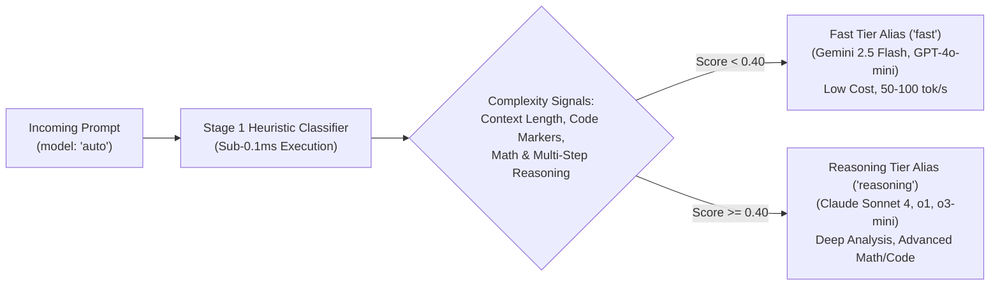
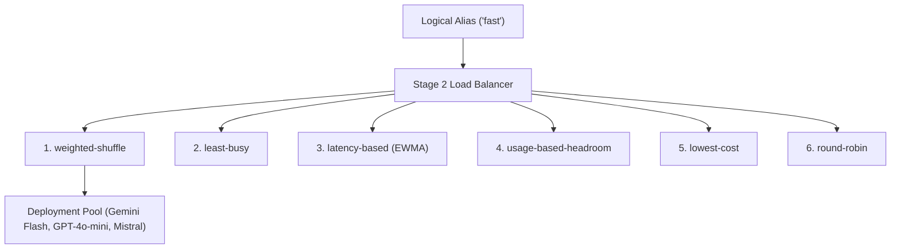

# Routing & Load Balancing

GoRoute combines a **Stage 1 zero-LLM heuristic complexity classifier** (`model: "auto"`) with **Stage 2 lock-free load balancing** across model deployments so every request lands on the optimal upstream tier with sub-millisecond routing overhead.

---

## Stage 1: Zero-LLM Heuristic Complexity Classifier

When clients request `model: "auto"`, GoRoute AI Gateway evaluates the prompt using a zero-LLM heuristic complexity classifier that executes in **under 0.1 milliseconds (&lt; 100 µs)** without invoking any auxiliary LLMs or consuming external API tokens.



### Classification Scoring Model

The classifier computes a normalized complexity score between `0.0` and `1.0` based on 4 primary signal vectors:

```text
Complexity Score = (w_tokens * S_tokens) + (w_code * S_code) + (w_math * S_math) + (w_reasoning * S_reasoning)
```

1. **Context & Token Volume (`S_tokens`)**: Evaluates conversation history length, message turn count, and token volume against configurable thresholds (default: `long_context_tokens: 32000`).
2. **Code & Syntax Indicators (`S_code`)**: Detects triple-backtick markdown blocks, programming keywords (`func`, `class`, `import`, `def`, `interface`), stack traces, and SQL schemas.
3. **Mathematical & Algorithmic Markers (`S_math`)**: Identifies equations, statistical formulas, and computational notation.
4. **Multi-Step Reasoning Keywords (`S_reasoning`)**: Scans for semantic reasoning triggers such as *"prove step by step"*, *"distributed consensus"*, *"edge cases"*, and *"formal verification"*.

### Classifier Configuration (`configs/config.yaml`)

```yaml
router:
  default_fast_alias: "fast"
  default_reasoning_alias: "reasoning"
  default_coding_alias: "coding"
  complexity_threshold: 0.40      # Prompts >= 0.40 route to reasoning tier
  long_context_tokens: 32000      # Prompts exceeding 32k tokens route to reasoning
```

> [!NOTE]
> `model: "auto"` runs the two-tier `classifyPrompt` cascade (Tier 1 deterministic `long_context_tokens` / `reasoning_effort` check, followed by the Tier 2 multi-feature scorer) and routes between `default_fast_alias` (`"fast"`) and `default_reasoning_alias` (`"reasoning"`). Requesting `"coding"` directly resolves the configured `coding` model group by alias.

### Benchmark Overhead

| Evaluation Method | Added Latency | Token Cost | Reliability |
| :--- | :--- | :--- | :--- |
| **GoRoute Stage 1 Heuristic** | **&lt; 0.012 ms (12 µs)** | **$0.00 (Zero tokens)** | **100% Deterministic** |
| LLM-as-a-Router (e.g. GPT-4o-mini classifier) | 350 ms – 700 ms | $0.0002 per prompt | Subject to hallucination / timeouts |
| Embedding Distance Classifier | 45 ms – 90 ms | Vector search lookup overhead | Requires embeddings vector database |

---

## Stage 2: Load Balancing Strategies

Once a model group or alias is resolved, the load balancer selects an active upstream deployment using one of **six** `domain.RoutingStrategy` values (`weighted-shuffle`, `least-busy`, `latency-based`, `usage-based-headroom`, `lowest-cost`, `round-robin`). Note that the latency strategy constant is **`latency-based`** (not `lowest-latency`). When Redis is configured, adaptive strategies (`least-busy`, `latency-based`, `usage-based-headroom`) read shared telemetry across pods.



### Selection Algorithms

#### 1. `weighted-shuffle`
Selects deployments randomly in proportion to their configured integer weights. A weight of zero or less is treated as the default weight of 100.

#### 2. `least-busy`
Tracks active in-flight requests (including Redis-shared reservation signals in multi-replica deployments) and selects a deployment with the smallest observed count.

#### 3. `latency-based` (EWMA)
Computes an exponentially weighted moving average of observed response latency:

```text
EWMA_t = alpha * Latency_t + (1 - alpha) * EWMA_(t-1)
```

The deployment with the lowest observed moving average is preferred. New deployments use a default baseline until latency has been observed.

#### 4. `usage-based-headroom`
Estimates remaining token capacity from request and token usage tracked by the gateway. It does not use this strategy as a guarantee against provider rate limits.

#### 5. `lowest-cost`
Selects the candidate with the lowest sum of configured input and output pricing values in the model catalogue. This does not evaluate every request parameter or provider's live price; keep catalogue data current.

#### 6. `round-robin`
Cycles deterministically across healthy candidate deployments using a lock-free per-`ModelGroupID` atomic counter (`selectRoundRobin`). Useful for uniform distribution across homogeneous endpoints when weights or adaptive telemetry are not needed.

### YAML Configuration

```yaml
model_list:
  - model_name: fast
    routing_strategy: weighted-shuffle
    model_params:
      model: gemini/gemini-2.5-flash
      weight: 80

  - model_name: fast
    routing_strategy: weighted-shuffle
    model_params:
      model: openai/gpt-4o-mini
      weight: 20

  - model_name: compute-heavy
    routing_strategy: least-busy
    model_params:
      model: anthropic/claude-sonnet-4-20250514
```
