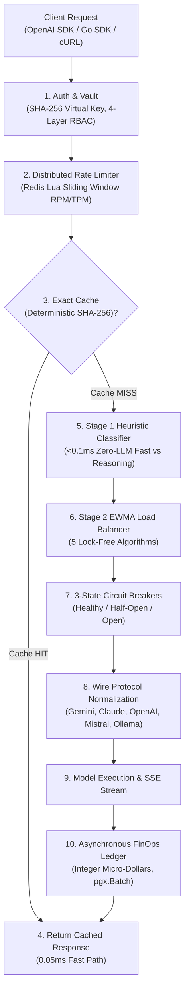

# System Architecture & Topology

GoRoute AI Gateway is engineered as an ultra-high-throughput, low-overhead AI data plane and agentic protocol router written in pure Go. It delivers sub-2ms hot-path routing overhead, multi-tenant isolation, and resilient upstream execution.


> [!NOTE]
> GoRoute's architecture eliminates synchronous PostgreSQL queries on the inference hot path using an L1 In-Memory + L2 Redis caching topology, single-roundtrip Redis Lua rate limiters, and asynchronous batched PostgreSQL spend pipelines.

---

## Quick Installation & Operator Console

You can install and spin up the complete GoRoute AI Gateway binary in seconds:

```bash
# 1. Download and install the precompiled binary
curl -fsSL https://raw.githubusercontent.com/goroute-ai/ai-gateway-go/main/install.sh | bash

# 2. Run the gateway with your configuration
ai-gateway --config config/gateway.yaml
```

Once running, access the embedded visual administration dashboard:

```text
http://localhost:8080/ui/
```

The Operator UI lets you observe real-time inference latency, view active deployment health states, configure virtual keys, simulate guardrails, and run interactive streaming sessions.

---

## The 10-Step Execution Lifecycle

Every inference request traversing GoRoute undergoes a deterministic 10-step lifecycle:



### 1. Dual-Boundary Authentication & Identity Resolution
- The incoming Bearer token (`sk-gw-...`) is hashed using SHA-256.
- The token digest is verified against an in-memory L1 cache (15-second TTL) or Redis L2 cache.
- The gateway resolves the caller's multi-tenant context: Organization ID, Team ID, User ID, Virtual Key scopes, and micro-dollar budget balances.
- Outbound upstream provider credentials remain strictly isolated inside the AES-256-GCM encrypted credentials vault.

### 2. Distributed Rate Limiting & Quotas
- Executes an atomic Redis Lua script implementing a sliding-window counter.
- Enforces both Requests Per Minute (RPM) and preflight estimated Tokens Per Minute (TPM).
- If limits are reached, immediately returns `HTTP 429 Too Many Requests` with a precise `Retry-After` header.

### 3. Deterministic Response Caching
- Computes a deterministic SHA-256 cache key across `{TenantID, Model, SystemPrompt, Messages, Tools}`.
- Deterministic queries (`temperature: 0.0`) resulting in a cache hit bypass the router and upstream providers entirely, returning in `<0.05ms` with zero token cost.

### 4. Stage 1 Heuristic Complexity Classification
- When the logical model alias `model: "auto"` is requested, GoRoute evaluates prompt complexity in under 0.1ms without invoking costly secondary LLMs:
  - Measures token volume and conversational turn depth.
  - Detects programming language keywords (`func`, `class`, `import`, SQL statements, backticks).
  - Scans for algorithmic, logical, and mathematical reasoning terms.
- Simple tasks route to lightweight aliases (`fast` → Gemini 2.5 Flash, GPT-4o-mini); complex tasks route to reasoning tiers (`reasoning` → Claude 3.5 Sonnet, o1/o3-mini).

### 5. Stage 2 EWMA Load Balancing
- Selects the target provider deployment using one of five lock-free algorithms:
  - `weighted-shuffle`: Proportional weighted random distribution.
  - `least-busy`: Routes to the deployment with the fewest active in-flight requests.
  - `latency-based`: Routes based on exponentially weighted moving average (EWMA) latency.
  - `usage-based-headroom`: Dynamically shifts traffic based on remaining RPM/TPM headroom.
  - `lowest-cost`: Prioritizes deployments with the lowest micro-dollar unit cost.

### 6. 3-State Circuit Breakers
- Tracks upstream health through a finite state machine: `CLOSED` (Healthy), `OPEN` (Tripped), and `HALF_OPEN` (Trial).
- Three consecutive 5xx errors or network timeouts trip the circuit breaker, diverting subsequent requests immediately without waiting for timeouts.

### 7. Cross-Provider Fallback Cascade
- When an upstream fails, GoRoute automatically traverses configured fallback model groups (e.g., Primary OpenAI → Secondary Anthropic Claude → Tertiary Google Gemini).
- Requests are retried with exponential backoff and decorrelated jitter.

### 8. Wire Protocol Normalization & Reasoning Adaptation
- Translates canonical gateway request schemas into vendor-specific payloads:
  - **OpenAI**: Maps developer/system messages and tool schemas.
  - **Anthropic Claude**: Consolidates parallel tool calls into strict alternating `user`/`assistant` turns and maps thinking token budgets.
  - **Google Gemini**: Converts message arrays into Gemini `contents` with `thinkingConfig`.
  - **Ollama**: Generates local JSON payloads.

### 9. Zero-Buffer SSE Streaming
- Server-Sent Events (SSE) emitted by upstream models are parsed on the fly.
- Chunks are forwarded directly to the HTTP response flusher with zero memory buffering, maintaining real-time Time-To-First-Token (TTFT).

### 10. Asynchronous FinOps Micro-Dollar Ledger
- Token usage is priced using integer micro-dollars ($1.00 USD = 1,000,000 µ$) to eliminate floating-point rounding errors.
- Spend events are placed onto a lock-free in-memory ring buffer.
- A background worker flushes events to PostgreSQL in batched `pgx.Batch` transactions, keeping the data plane latency unaffected.

---

## 4-Layer Model Access Control Hierarchy

GoRoute implements enterprise governance across 4 hierarchical evaluation layers:

```
[Layer 1: Public Model Catalogue]
         │ (4,627+ models with verified pricing provenance)
         ▼
[Layer 2: Organization Subscriptions]
         │ (Admin enables specific cloud providers: OpenAI, Anthropic, Gemini)
         ▼
[Layer 3: Organization Model Policies]
         │ (Org-wide availability overrides and max token ceilings)
         ▼
[Layer 4: Virtual Key Allowlists]
         │ (Scoped API key model permissions: e.g. ["fast", "gemini-2.5-flash"])
         ▼
    [Execution Allowed]
```

> [!IMPORTANT]
> If a model is not permitted at any of the 4 layers, GoRoute fails closed with an explicit `HTTP 403 Forbidden` or `HTTP 404 Model Not Found`.

---

## Multi-Protocol Architecture

GoRoute provides unified routing across three core protocols:

1. **OpenAI-Compatible Data Plane (`/v1/*`)**: Supports standard chat completions, embeddings, audio, images, files, batches, and realtime WebSockets.
2. **Model Context Protocol (`/mcp/*`, `/mcp-rest/*`)**: Serves as a central virtual hub aggregating distributed MCP tool servers with schema validation and progressive discovery.
3. **Agent-to-Agent Protocol (`/a2a/v1/*`)**: Provides RFC 8785 JCS canonicalized and RFC 7515 JWS signed Agent Cards, asynchronous task state machines, and native gRPC streaming.

Access all configured protocols and live health metrics via the [Operator Web UI](http://localhost:8080/ui/).
