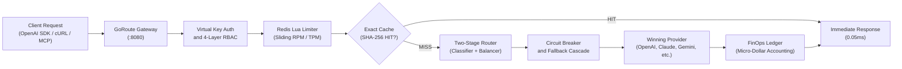

# GoRoute AI Gateway Overview

GoRoute AI Gateway is a high-throughput, low-overhead enterprise AI control plane and multi-protocol gateway engineered in pure Go. It unifies 42+ upstream model providers and agentic execution standards into an OpenAI-compatible API, a Linux Foundation Agent-to-Agent (A2A v1.0) bridge, and a Model Context Protocol (MCP 2026-07-28) virtual hub.


> [!NOTE]
> GoRoute compiles into a single, self-contained static binary with zero external runtime dependencies. An embedded Operator Web UI is served directly from the gateway at `http://localhost:8080/ui/`.

---

## One-Line Universal Installation

Install the latest precompiled GoRoute binary for your OS (macOS, Linux, Windows) and architecture (`amd64`, `arm64`) using the universal shell installer:

```bash
curl -fsSL https://raw.githubusercontent.com/goroute-ai/ai-gateway-go/main/install.sh | bash
```

To install a specific version pin (such as `v1.5.0`):

```bash
curl -fsSL https://raw.githubusercontent.com/goroute-ai/ai-gateway-go/main/install.sh | bash -s -- v1.5.0
```

> [!TIP]
> The installer automatically verifies SHA-256 checksums, selects `/usr/local/bin` (or `~/.local/bin`), and validates executable permissions.

---

## Deployment Modes

Choose the deployment architecture that fits your infrastructure requirements:

| Deployment Mode | Description | Best Suited For | Quickstart Guide |
| :--- | :--- | :--- | :--- |
| **Standalone CLI Service** | Pre-compiled binary running as an independent HTTP/gRPC daemon. | Microservices, Kubernetes pods, multi-language stacks (Python, Node.js, Rust). | [CLI Quickstart](/docs/getting-started/quickstart-cli) |
| **Docker Compose** | Orchestrated local stack including PostgreSQL 16+ and Redis 7+. | Local development, staging clusters, production container environments. | [Docker Quickstart](/docs/getting-started/quickstart-docker) |
| **Embedded Go SDK** | Direct in-process integration using `pkg/gateway` without network hops. | High-performance Go services requiring zero-latency IPC inference. | [Go SDK Quickstart](/docs/getting-started/quickstart-sdk) |

---

## Interactive Operator Web UI

GoRoute embeds a rich single-page management application directly inside the binary. Once the gateway is running, navigate to:

```text
http://localhost:8080/ui/
```

Authenticate using your Master Admin Key (`GATEWAY_MASTER_ADMIN_KEY`). The Operator UI provides real-time access to:
- **Streaming Chat Playground**: Test model groups, dynamic routes, and reasoning parameters with live token metrics.
- **Model Catalogue & Routing**: Inspect the models available to your deployment, configure aliases (`fast`, `reasoning`), and tune load balancers. Model availability depends on provider access, catalog sync, organization policy, and key permissions.
- **Virtual API Keys**: Issue tenant-scoped keys with RPM/TPM rate limits, budget caps, and model allowlists.
- **FinOps Ledger**: Monitor micro-dollar expenditure, token breakdowns, and team cost attribution.
- **Guardrails Simulator**: Interactively evaluate regex PII redaction and secret scanning rules without model invocations.
- **Credentials Vault**: Securely manage and test encrypted provider API credentials.
- **Agentic Hub**: Audit active MCP servers, progressive tool catalogs, and A2A agents.

---

## Request Lifecycle & System Flow



Every inference request traversing GoRoute undergoes sub-2ms processing on the hot path:
1. **Dual-Boundary Authentication**: Caller credentials (`sk-gw-...`) are resolved via L1/L2 caches and strictly separated from outbound provider API keys.
2. **Distributed Rate Limiting**: Atomic Redis Lua sliding windows enforce per-key RPM and estimated TPM limits before reaching upstreams.
3. **Deterministic Exact-Match Caching**: Zero-cost, sub-millisecond responses for cached deterministic prompts (`temperature: 0.0`).
4. **Intelligent Model Selection**: Heuristic Stage 1 classification and Stage 2 load balancing choose the fastest, most cost-effective deployment.
5. **Resilient Execution**: 3-state circuit breakers divert traffic on upstream failure, walking configured fallback cascades automatically.
6. **FinOps Micro-Dollar Ledger**: Asynchronous token and cost accounting persists to PostgreSQL via batch pipelines without delaying the client stream.

---

## Core Capabilities

- **21 Multi-Modal Data Plane Routes**: Unified endpoints for Chat Completions, Text Completions, Vector Embeddings, Reranking, Moderation, Anthropic Messages, Tokenization, Audio (STT & TTS), Image Generation/Edits/Variations, Stateful Tenant Files, Asynchronous Batches, Responses API, and Realtime WebSockets.
- **42+ Provider Integrations**: Native support for dedicated cloud providers (OpenAI, Anthropic Claude, Google Gemini, AWS Bedrock, Azure OpenAI, Google Vertex AI, Cohere, Mistral, Ollama) and certified dialect profiles.
- **Agentic Protocols Built-In**: Native Model Context Protocol (MCP) virtual hub with tool deduplication and progressive discovery, alongside Linux Foundation Agent-to-Agent (A2A) cryptographic cards, message dispatch, and gRPC streaming.
- **Enterprise FinOps**: Real-time micro-dollar ledger ($1 = 1,000,000 µ$) with multi-tenant budgeting, spend summaries, and immutable audit logs.
- **Multi-Tenant Security**: 4-layer access hierarchy (public catalogue → org subscriptions → org model policy → virtual key allowlist) with automated PII masking and secret redaction.

---

## Next Steps

- [Quickstart: Standalone CLI](/docs/getting-started/quickstart-cli) — Launch GoRoute locally in 2 minutes.
- [Quickstart: Docker Compose](/docs/getting-started/quickstart-docker) — Spin up the gateway with PostgreSQL and Redis.
- [Quickstart: Go SDK](/docs/getting-started/quickstart-sdk) — Embed GoRoute directly in your Go applications.
- [System Architecture & Topology](/docs/getting-started/architecture) — Deep dive into the 10-step request lifecycle.
- [API Reference Overview](/docs/api-reference/overview) — Explore data plane and control plane endpoints.
