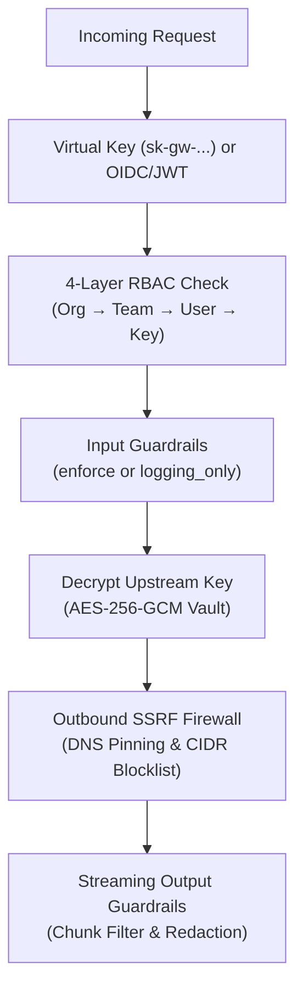

# AI Governance: Security, Policies & Compliance

GoRoute governance gives teams control over who can use AI, which models they can reach, and how requests are checked. It also protects provider credentials and limits where the gateway can send traffic. The guides below explain the safeguards and show how to configure them.

---

## Core Capabilities

| Capability | Implementation | Guide |
| :--- | :--- | :--- |
| **4-Layer Policy Model** | Hierarchical fail-closed scoping across **Organization → Team → User → Virtual Key** for model allowlists, budgets, and rate limits. | [RBAC & Credential Vault](/docs/governance/rbac-and-vault) |
| **Operator RBAC & OIDC/JWT** | Role-based access control for `/admin/v1/*` and `/ui/*` supporting Master Admin Keys as well as OIDC/JWT identity mapping. | [RBAC & Credential Vault](/docs/governance/rbac-and-vault) |
| **AES-256-GCM Credentials Vault** | Upstream provider API keys, MCP credentials, and guardrail secrets are encrypted at rest and in transit via `internal/storage/vault.go` with DEK rotation. | [RBAC & Credential Vault](/docs/governance/rbac-and-vault) |
| **Virtual Keys (`sk-gw-...`)** | Scoped, revocable data-plane tokens accepted via `Authorization: Bearer` or `x-api-key` (with conflict rejection on mismatched dual headers). | [Virtual Keys](/docs/governance/virtual-keys) |
| **Two-Layer Guardrails Engine (19 Drivers)** | Pipeline v2 with 7 hooks (`pre_call`, `during_call`, `post_call`, `logging_only`, `pre_mcp_call`, `during_mcp_call`, `post_mcp_call`), `POST /v1/guardrails/apply`, Starlark `custom_code`, `WithGuardrailScanner`, streaming windowing, and hierarchical bindings (`Org` → `Team` → `VirtualKey` → `EndUser` → `ModelGroup` → `Tag`). | [Guardrails Engine](/docs/governance/guardrails) |
| **Outbound SSRF Firewall** | `internal/security/network` `SafeTransport` enforces DNS pinning, private-IP/loopback blocking, and link-local address protection on all provider, OTLP, and MCP egress. | [SSRF & Network Security](/docs/governance/network-and-ssrf) |
| **Security Headers & CORS** | Strict HTTP security headers, configurable CORS origins, and production secret validation before startup. | [Production Readiness Checklist](/docs/deploy/production-checklist) |

---

## Fail-Closed Enforcement Flow

---

## Explore Governance Guides

- [Virtual Keys](/docs/governance/virtual-keys)
- [RBAC & Credential Vault](/docs/governance/rbac-and-vault)
- [Guardrails Engine](/docs/governance/guardrails)
- [SSRF & Network Security](/docs/governance/network-and-ssrf)
- [Production Readiness Checklist](/docs/deploy/production-checklist)
