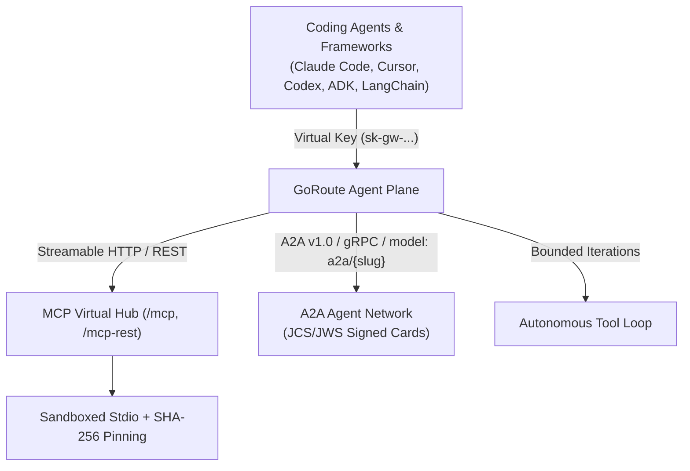

# 5. AI Agent Management — MCP, Tools & Agent Access

The **AI Agent Management** module turns GoRoute into a governed control plane for **tools**, **multi-agent networks**, and **autonomous coding agents** — enforcing Virtual Key RBAC, cryptographic identity, and execution sandboxing across MCP and A2A protocols.

---

## Core Capabilities

| Capability | Implementation | Guide |
| :--- | :--- | :--- |
| **MCP 2026-07-28 Virtual Hub & REST Bridge** | Aggregates upstream MCP servers into `/mcp`, scoped `/mcp/{serverSlug}`, curated `/mcp/toolsets/{toolsetSlug}`, and REST endpoints (`/mcp-rest/tools/list`, `/mcp-rest/tools/call`). | [MCP Overview](/docs/protocols/mcp-overview) · [MCP Hub & REST](/docs/protocols/mcp-hub-and-rest) |
| **Progressive Tool Discovery** | Serves `/v1/goroute/mcp/registry` so agents load only relevant tool schemas on demand, preventing context-window bloat. | [Progressive Discovery](/docs/protocols/mcp-progressive-discovery) |
| **Sandboxed Stdio & SHA-256 Tool Pinning** | Runs local Stdio MCP servers in isolated subprocess sandboxes and pins tool definitions via SHA-256 hashes to prevent rug-pull schema mutations. | [Stdio Sandboxing](/docs/protocols/mcp-stdio-sandboxing) |
| **MRTR AEAD Tokens** | Multi-hop tool routing tokens encrypted with AEAD preserve caller identity and permissions across delegated MCP invocations. | [MCP Overview](/docs/protocols/mcp-overview) |
| **A2A v1.0 Signed Agent Cards & gRPC** | Serves JCS/JWS-signed Agent Cards (`/.well-known/agent-card.json`), task lifecycle endpoints (`/a2a/v1/agents/{agentSlug}/tasks*`), native gRPC (`server.grpc_port`), and OpenAI bridge (`model: "a2a/{slug}"`). | [A2A Overview](/docs/protocols/a2a-overview) · [Agent Cards](/docs/protocols/a2a-agent-cards) · [Bridge & gRPC](/docs/protocols/a2a-bridge-and-grpc) |
| **Autonomous Multi-Turn Tool Loop** | Executes server-side multi-turn tool-calling loops with bounded iteration budgets and guardrail inspection on every turn. | [Autonomous Tool Loop](/docs/data-plane/autonomous-tool-loop) |
| **Coding-Agent & Framework Governance** | Connects Claude Code (`/anthropic`), Cursor, Continue, Cline, Codex CLI, Gemini CLI, OpenWebUI, LangChain, OpenAI Agents SDK, and Google ADK under Virtual Key RBAC. | [Integrations Overview](/docs/integrations/overview) · [Coding Agents Guide](/docs/operations/claude-code-and-agents) |

---

## Agent & Tool Execution Plane

---

## Explore Agent Management Guides

- **MCP**: [MCP Overview](/docs/protocols/mcp-overview) · [MCP Hub & REST](/docs/protocols/mcp-hub-and-rest) · [Progressive Discovery](/docs/protocols/mcp-progressive-discovery) · [Stdio Sandboxing](/docs/protocols/mcp-stdio-sandboxing)
- **A2A**: [A2A Overview](/docs/protocols/a2a-overview) · [Agent Cards](/docs/protocols/a2a-agent-cards) · [Bridge & gRPC](/docs/protocols/a2a-bridge-and-grpc)
- **Autonomous Execution & Coding Agents**: [Autonomous Tool Loop](/docs/data-plane/autonomous-tool-loop) · [Engineering Guide for Coding Agents](/docs/operations/claude-code-and-agents) · [Integrations Overview](/docs/integrations/overview)
