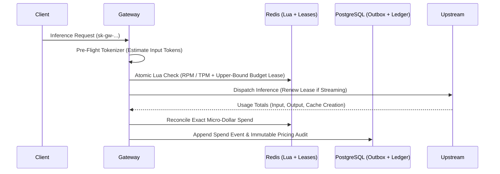

# 3. AI FinOps — Cost Management & Optimization

The **AI FinOps** module eliminates floating-point billing drift and race-condition overspends by combining **64-bit integer micro-dollar arithmetic**, **pre-flight budget reservations**, and **atomic Redis Lua rate limiting**.

---

## Core Capabilities

| Capability | Implementation | Guide |
| :--- | :--- | :--- |
| **64-Bit Integer Micro-Dollar Ledger** | All costs are computed in integer micro-dollars (`1 USD = 1,000,000 micro-dollars`) with intermediate pico-dollar precision — zero `float32`/`float64` accounting. | [Micro-Dollar Ledger](/docs/finops-and-security/micro-dollar-ledger) |
| **Cache-Write & Modality Pricing** | Supports prompt-cache write pricing (`CacheCreationTokens` / `cache_write_cost_micros_per_1m`), audio/image/video modality rates (`0007`/`0012`), and immutable `model_pricing_history`. | [Micro-Dollar Ledger](/docs/finops-and-security/micro-dollar-ledger) |
| **Unpriced Usage Tracking** | Tracks `unpriced_requests` and `unpriced_tokens` explicitly so custom or uncatalogued models never silently report `$0.00` without visibility. | [Micro-Dollar Ledger](/docs/finops-and-security/micro-dollar-ledger) |
| **Pre-Flight Reservations & Lease Renewal** | Reserves upper-bound estimated cost before upstream dispatch, renews leases during long streams, and reconciles exact token spend on completion. | [Micro-Dollar Ledger](/docs/finops-and-security/micro-dollar-ledger) |
| **Durable PostgreSQL Outboxes** | Persistent spend (`0008`) and budget-reset (`0011`) outbox tables ensure zero lost accounting events across restarts or transient DB blips. | [Deployment & Storage](/docs/operations/deployment-and-storage) |
| **Single-Roundtrip Redis Lua Rate Limits** | Atomic sliding-window RPM and TPM enforcement in Redis with fail-closed behavior and `{org:<id>}` hash-tag compatibility for Redis Cluster. | [Sliding-Window Rate Limits](/docs/finops-and-security/sliding-window-ratelimit) |
| **Pre-Flight Tokenizer** | Local zero-network token estimation (`POST /v1/tokenize`, `POST /anthropic/v1/messages/count_tokens`) to enforce TPM/context budgets before dispatch. | [Pre-Flight Tokenizer](/docs/finops-and-security/preflight-tokenizer) |

---

## FinOps Accounting Lifecycle

---

## Explore FinOps Guides

- [Micro-Dollar Ledger](/docs/finops-and-security/micro-dollar-ledger)
- [Sliding-Window Rate Limits](/docs/finops-and-security/sliding-window-ratelimit)
- [Pre-Flight Tokenizer](/docs/finops-and-security/preflight-tokenizer)
- [Virtual Keys & Budgets Demo](/docs/demos/virtual-keys-and-budgets)
