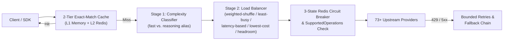

# 1. AI Gateway — Traffic Management & Model Routing

The **AI Gateway** module is GoRoute's high-throughput, zero-allocation data plane for routing inference traffic across **73 `ProviderType` profiles** (8 native adapters, 60+ built-in/extended OpenAI-compatible profiles, and `CustomOpenAICompatible`) through a single unified API.

---

## Core Capabilities

| Capability | Implementation | Guide |
| :--- | :--- | :--- |
| **Unified Data Plane (23 `/v1` Paths)** | OpenAI-compatible `/v1/*` & `/openai/v1/*`, plus native Anthropic `/anthropic/v1/messages` & `count_tokens`, Responses API, Realtime WebSockets, Audio, Images, Files, Batches, Rerank, and Moderations. | [Chat Completions](/docs/data-plane/chat-completions) · [Messages](/docs/data-plane/messages) · [Responses](/docs/data-plane/responses) · [Realtime](/docs/data-plane/realtime) |
| **73+ Provider Profiles & `SupportedOperations`** | Native adapters for OpenAI, Anthropic, Azure OpenAI, AWS Bedrock, Google Gemini, Google Vertex, Cohere, Mistral, Ollama, plus 60+ OpenAI-compatible profiles with `SupportedOperations` enforcement (`OperationSupportChecker`). | [Providers Overview](/docs/providers/overview) · [OpenAI-Compatible](/docs/providers/openai-compatible) |
| **Stage 1 Complexity Classifier** | Heuristic prompt complexity scoring routes simple requests to fast/low-cost tiers and complex tasks to reasoning models automatically. | [Complexity Classifier](/docs/routing-resiliency/complexity-classifier) |
| **Stage 2 Load Balancers** | Five strategies across sibling deployments: `weighted-shuffle`, `least-busy`, `latency-based` (EWMA), `lowest-cost`, and `usage-based-headroom`. | [Load Balancing](/docs/routing-resiliency/load-balancing) |
| **3-State Redis Circuit Breakers** | Shared `Closed → Open → Half-Open` state in Redis across gateway replicas with atomic half-open probe leases. | [Circuit Breakers](/docs/routing-resiliency/circuit-breakers) |
| **Bounded Fallback Chains** | Configurable intra-group exponential retries and cross-model failover chains for 429/5xx/503 resilience. | [Fallbacks & Retries](/docs/routing-resiliency/fallbacks-and-retries) |
| **2-Tier Exact-Match Cache** | L1 in-process memory + L2 Redis SHA-256 exact-match response caching for sub-millisecond cache hits. | [Exact-Match Cache](/docs/finops-and-security/exact-match-cache) |

---

## Request Routing Pipeline

---

## Explore Data Plane & Routing Guides

- **Data Plane Endpoints**: [Chat Completions](/docs/data-plane/chat-completions) · [Embeddings](/docs/data-plane/embeddings) · [Audio](/docs/data-plane/audio) · [Images](/docs/data-plane/images) · [Rerank](/docs/data-plane/rerank) · [Files](/docs/data-plane/files) · [Batches](/docs/data-plane/batches)
- **Providers**: [Providers Overview](/docs/providers/overview) · [Custom Provider](/docs/providers/custom-provider)
- **Routing & Resiliency**: [Load Balancing](/docs/routing-resiliency/load-balancing) · [Fallbacks & Retries](/docs/routing-resiliency/fallbacks-and-retries) · [Circuit Breakers](/docs/routing-resiliency/circuit-breakers)
