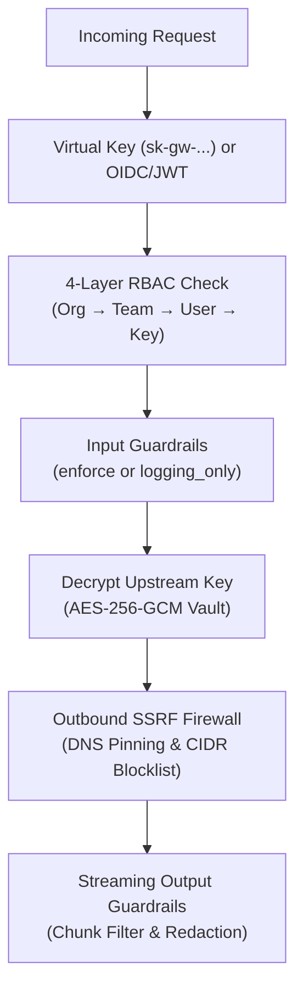

# 2. AI Governance — Security, Policies & Compliance

The **AI Governance** module enforces fail-closed identity, credential isolation, content safety, and network egress boundaries across every inference, tool, and control-plane request.

---

## Core Capabilities

| Capability | Implementation | Guide |
| :--- | :--- | :--- |
| **4-Layer Policy Model** | Hierarchical fail-closed scoping across **Organization → Team → User → Virtual Key** for model allowlists, budgets, and rate limits. | [RBAC & Credential Vault](/docs/finops-and-security/rbac-and-vault) |
| **Operator RBAC & OIDC/JWT** | Role-based access control for `/admin/v1/*` and `/ui/*` supporting Master Admin Keys as well as OIDC/JWT identity mapping. | [RBAC & Credential Vault](/docs/finops-and-security/rbac-and-vault) |
| **AES-256-GCM Credentials Vault** | Upstream provider API keys and MCP credentials are encrypted at rest and in transit via `internal/storage/vault.go`. | [RBAC & Credential Vault](/docs/finops-and-security/rbac-and-vault) |
| **Virtual Keys (`sk-gw-...`)** | Scoped, revocable data-plane tokens accepted via `Authorization: Bearer` or `x-api-key` (with conflict rejection on mismatched dual headers). | [Virtual Keys](/docs/finops-and-security/virtual-keys) |
| **Streaming & `logging_only` Guardrails** | All-role input scanning, PII/secret redaction, streaming output chunk filtering (`stream_filter.go`), and `enforce` vs. `logging_only` policy modes. | [Guardrails Engine](/docs/finops-and-security/guardrails) |
| **Outbound SSRF Firewall** | `internal/security/network` `SafeTransport` enforces DNS pinning, private-IP/loopback blocking, and link-local address protection on all provider, OTLP, and MCP egress. | [SSRF & Network Security](/docs/finops-and-security/ssrf-and-network) |
| **Security Headers & CORS** | Strict HTTP security headers, configurable CORS origins, and production secret validation before startup. | [Production Readiness Checklist](/docs/operations/production-checklist) |

---

## Fail-Closed Enforcement Flow

---

## Explore Governance Guides

- [Virtual Keys](/docs/finops-and-security/virtual-keys)
- [RBAC & Credential Vault](/docs/finops-and-security/rbac-and-vault)
- [Guardrails Engine](/docs/finops-and-security/guardrails)
- [SSRF & Network Security](/docs/finops-and-security/ssrf-and-network)
- [Production Readiness Checklist](/docs/operations/production-checklist)
