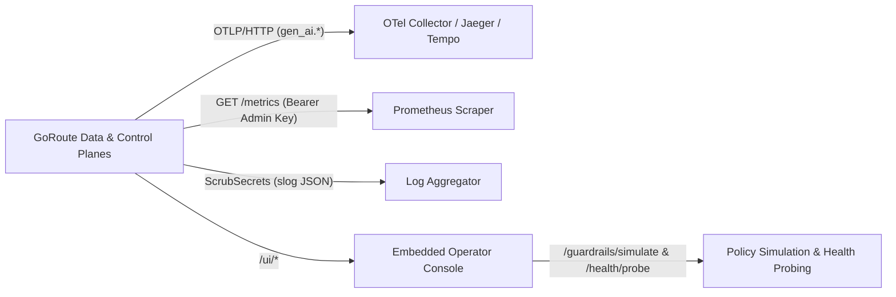

# 4. AI Observability — Monitoring, Tracing & Evaluation

The **AI Observability** module gives platform teams end-to-end visibility across every inference call, routing decision, guardrail evaluation, and upstream deployment health check.

---

## Core Capabilities

| Capability | Implementation | Guide |
| :--- | :--- | :--- |
| **OTLP/HTTP Distributed Tracing** | Exports `gen_ai.client` spans (`gen_ai.operation.name`, `gen_ai.system`, `gen_ai.request.model`, `gen_ai.usage.*`) via `tracing.otlp_endpoint` and `tracing.headers` through the outbound SSRF policy. | [OpenTelemetry & Prometheus](/docs/integrations/otel-and-prometheus) |
| **W3C `traceparent` Propagation** | `TraceMiddleware` extracts or generates `00-{traceID}-{spanID}-01` (`traceparent` and `X-Trace-Id`), echoing headers to callers and propagating context upstream. | [Observability Guide](/docs/operations/observability) |
| **Prometheus `/metrics` & Vitter Reservoirs** | Protected `GET /metrics` (Master Admin Key) exports bounded-cardinality metrics using Vitter Algorithm R uniform reservoir sampling (`1,024` samples) for P50/P95/P99 latency, TTFT, and routing overhead. | [Observability Guide](/docs/operations/observability) |
| **Embedded Operator Console (`/ui/*`)** | Single-binary React UI served at `/ui/` with a live Streaming Chat Playground, Model Catalogue, Virtual Key manager, and FinOps views. | [Operator Web UI](/docs/operations/operator-ui) |
| **Continuous Evaluation & Probing** | Stateless Guardrails Policy Simulator (`POST /admin/v1/organizations/{orgID}/guardrails/simulate`) for testing policy rules without live traffic, paired with active deployment health probing (`/admin/v1/health/probe`). | [Admin API](/docs/api-reference/admin-api) · [Observability Guide](/docs/operations/observability) |
| **Secret-Scrubbed `slog` Logs** | `internal/logger/scrub.go` (`ScrubSecrets`) masks API keys, bearer tokens, and credential patterns before structured logs are emitted. | [Observability Guide](/docs/operations/observability) |

---

## Telemetry & Evaluation Architecture

---

## Explore Observability Guides

- [Observability, Metrics & Health Probes](/docs/operations/observability)
- [OpenTelemetry & Prometheus Integration](/docs/integrations/otel-and-prometheus)
- [Embedded Operator Web UI](/docs/operations/operator-ui)
- [Troubleshooting](/docs/operations/troubleshooting)
