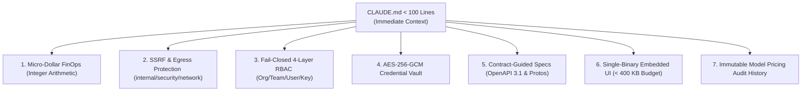

# Engineering Guide for Coding Agents

GoRoute AI Gateway is engineered from the ground up to be maintainable, verifiable, and extensible by both human software engineers and autonomous AI coding agents (such as **Claude Code**, **Cursor**, **GitHub Copilot**, and **Google Antigravity**).

To guarantee that agent-generated pull requests maintain architectural invariants, code quality, and security boundaries, the codebase incorporates a hierarchical context architecture consisting of:
1. **Root `CLAUDE.md`**: Compact project instructions and essential commands (under 100 lines).
2. **Modular `.claude/rules/`**: Scoped sub-domain guidelines (`go-backend.md`, `frontend-web.md`, `api-contracts.md`).
3. **Universal `AGENTS.md`**: Portable repository guidance for all autonomous agent engines.
4. **Deterministic Verification Loops**: Non-interactive commands to validate syntax, typing, static analysis, race conditions, contracts, and frontend bundle budgets.

---

## 1. Root `CLAUDE.md` Architectural Invariants

The root `CLAUDE.md` file serves as the immediate instruction entrypoint for Claude Code sessions. To ensure high token efficiency, it is maintained under a strict 100-line limit while establishing the 7 core repository invariants:



### The 7 Non-Negotiable Invariants

1. **Integer Micro-Dollar FinOps**: All financial and spend calculations must use 64-bit integer micro-dollars (1 USD = 1,000,000 micro-dollars) with intermediate pico-dollar precision. Never use floating-point types (`float32` / `float64`) for money.
2. **SSRF & Outbound Egress Protection**: Outbound network requests must use `internal/security/network` safe HTTP transport (`SafeTransport`, `DialContext`). Never use raw unvalidated `http.DefaultClient` or unpinned IPs for provider egress.
3. **Fail-Closed RBAC & Auth**: Multi-tenant authorization (`internal/auth/rbac.go`) is strictly fail-closed across all 4 tiers (Organization → Team → User → Virtual Key).
4. **Credential Vault**: Upstream provider API keys and secrets must remain encrypted via AES-256-GCM (`internal/storage/vault.go`) at rest and in transit.
5. **Contract-Guided Architecture**: API and wire contracts are defined in `docs/openapi/gateway.openapi.yaml`, `docs/specs/mcp/`, and `docs/specs/a2a/`. Verify contracts with `go run ./cmd/specgen`.
6. **Single-Binary Web UI Embedding**: The Operator UI in `web/` compiles into `internal/ui/dist/` and is embedded via Go `embed.FS` (`//go:embed all:dist`). Total frontend bundle size must strictly respect budget constraints (under 400 KB total; verified via `web/scripts/check-budget.mjs`).
7. **Immutable Pricing History**: Model pricing updates must append an immutable audit record to `model_pricing_history`.

---

## 2. Modular Rules: `.claude/rules/`

Rather than crowding the root prompt with domain-specific rules, the repository utilizes modular rule definitions located in `.claude/rules/`. AI agents activate these instructions dynamically based on the files they touch.

### `go-backend.md`: Pure Go Backend Architecture

Located at `.claude/rules/go-backend.md`, this guide enforces Go idioms and safety standards:

- **Strict Dependency Direction**: Package dependencies point strictly inward toward domain definitions in `internal/domain`:
  - `cmd/`: Application entrypoints (`cmd/gateway`, `cmd/specgen`, `cmd/catalog-sync`).
  - `pkg/`: Public, stable, embeddable SDKs (`pkg/gateway`).
  - `internal/`: Private implementation packages (`internal/server`, `internal/router`, `internal/adapter`, etc.).
  - `internal/domain/`: Foundational domain types, interfaces, request/response models, and error codes.
- **Chi Router Conventions**:
  - Handlers follow standard `http.HandlerFunc` signatures: `func (s *GatewayServer) handleX(w http.ResponseWriter, r *http.Request)`.
  - Path parameters extracted via `chi.URLParam(r, "paramName")`.
  - Query parameters extracted via `r.URL.Query().Get("key")`.
  - JSON serialization via `writeJSON(w, statusCode, data)`.
  - Unified error serialization via `domain.WriteHTTPError(w, err)`.
- **Zero-Allocation Hot Path**: Hot inference routes (`POST /v1/chat/completions`) must avoid unnecessary heap allocations, redundant JSON reflection, or blocking synchronous database writes.
- **Safe Network Egress**: Direct instantiation of `&http.Client{}` is prohibited. All outbound requests must use `network.NewSafeTransport` with DNS pinning, private IP filtering, and link-local address blocking.

### `frontend-web.md`: Operator Web UI Invariants

Located at `.claude/rules/frontend-web.md`, this guide establishes rules for modifying the Operator Web UI:

- **Technology Stack**: React 19 + TypeScript + Vite + Tailwind CSS v3 (dark mode enabled via slate/zinc palette).
- **Icon Imports**: Use `lucide-react` with tree-shaking named imports (e.g. `import { Activity, Shield } from 'lucide-react'`). Avoid importing the entire library to prevent bundle bloat.
- **Bundle Budget Verification**: Every pull request modifying `web/` must pass `check-budget.mjs` with uncompressed size under 380 KB and gzip under 110 KB.
- **Distribution Synchronization**: When frontend source files are changed, `make ui-build` must be executed to rebuild the bundle and sync artifacts to `internal/ui/dist/` before committing.

### `api-contracts.md`: Protocol & Contract Specifications

Located at `.claude/rules/api-contracts.md`, this rule governs wire formats and backwards compatibility:

- **Authoritative Contract Files**:
  - Gateway OpenAPI: `docs/openapi/gateway.openapi.yaml` (OpenAPI 3.1.0).
  - MCP OpenAPI & Schema: `docs/openapi/mcp.openapi.yaml` and `docs/specs/mcp/2026-07-28/schema.json`.
  - A2A OpenAPI & Protobuf: `docs/openapi/a2a.openapi.yaml` and `docs/specs/a2a/v1.0/a2a.proto`.
- **Validation Utility**: Agents must execute `go run ./cmd/specgen` to ensure that route schemas, protobuf definitions, and documentation match the Go code.
- **Attribution Headers**: Responses must include standard attribution telemetry (`X-Gateway-Request-Id`, `X-Gateway-Provider`, `X-Gateway-Model`, `X-Gateway-Cost-Micros`, `X-Gateway-Routing-Time`, `X-Gateway-Cache`).

---

## 3. Universal Portable Guide: `AGENTS.md`

`AGENTS.md` is the cross-engine specification file designed for tools like Cursor, Copilot Workspace, Antigravity, and autonomous agent loops. It emphasizes:

- **Codebase Mapping**: Directs agents to read `docs/CODEBASE_MAP.md` before exploring code.
- **Change Expectations**: Agents must state the exact commands executed and tests run in their change summaries.
- **Preservation of Unrelated Work**: Agents must not revert, rewrite, or touch unrelated code or user changes.
- **Self-Correction Strategy**: When a test fails or `go vet` produces warnings, agents must inspect the failure, apply the minimal targeted fix, and rerun the test suite rather than disabling tests.

---

## 4. Deterministic Verification Loops

Autonomous agents must execute the deterministic verification pipeline before declaring any task complete. The commands below are fast, reproducible, and runnable locally or in CI:

| Step | Verification Goal | Command | Success Criteria |
| :--- | :--- | :--- | :--- |
| **1. Formatting** | Check Go code formatting | `gofmt -l .` | Output must be empty (0 files listed). |
| **2. Static Analysis** | Go type and idiom validation | `go vet ./...` | Exits with return code 0; zero warnings. |
| **3. API Specs** | Validate OpenAPI & Protobuf contracts | `go run ./cmd/specgen` | Passes contract validation without errors. |
| **4. Unit Tests** | Concurrent race detection | `go test -race -count=1 ./internal/... ./pkg/...` | All package unit tests pass under Go race detector. |
| **5. Focused Test** | Rapid feedback during edits | `go test -v -race -run <TestName> ./internal/<pkg>/...` | Specified unit test passes cleanly. |
| **6. Frontend Build** | Build UI & verify bundle budget | `make ui-build` | Passes Vite build and `check-budget.mjs` threshold. |
| **7. UI Dist Sync** | Confirm embedded dist is mirrored | `make ui-check-dist` | `git status` shows zero uncommitted diffs in `internal/ui/dist`. |
| **8. Binary Build** | Compile production executable | `go build ./cmd/gateway` | Produces executable binary `gateway`. |
| **9. Full Check** | Comprehensive pre-flight check | `make release-check` | All verification checks pass end-to-end. |

### Example Agent Loop Script

Agents can run this one-line verification recipe to confirm entire repository integrity:

```bash
gofmt -l . && go vet ./... && go test -race -count=1 ./internal/server ./internal/router ./internal/auth && go build ./cmd/gateway
```

> [!TIP]
> When testing data plane changes without running live upstream providers, use the built-in mock provider adapter (`internal/adapter/mock.go`) or the lightweight local test server (`configs/config.yaml`) to achieve 100% deterministic test coverage without network dependencies.
