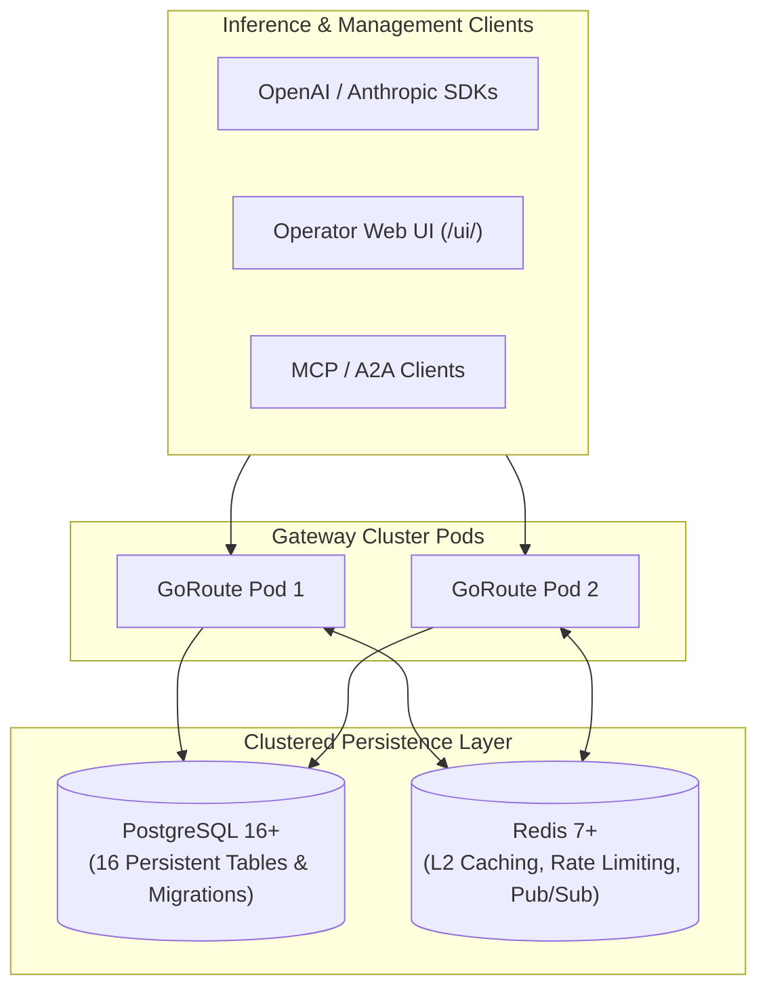

# Deployment and Storage Architecture

GoRoute AI Gateway supports two operational storage modes:
1. **In-Memory Mode (`storage.mode: memory`)**: Zero external dependencies. Ideal for local unit testing, CI pipelines, and ephemeral container runs. Secrets are kept in-process in an AES-256-GCM vault, but state does not survive process restarts.
2. **Clustered PostgreSQL + Redis (`storage.mode: postgres`)**: The enterprise production topology. PostgreSQL provides ACID durability for multi-tenant organizations, model catalogs, encrypted credentials, virtual keys, audit trails, stateful files, and asynchronous batch jobs. Redis provides distributed L2 key caching, atomic sliding-window rate limiting, response caching, circuit breaker state, and real-time Pub/Sub streams.



---

## 1. PostgreSQL Schema Migrations (0001 to 0007)

The gateway automatically manages its database schema at startup using embedded SQL migration scripts located in `migrations/`. Migrations are applied sequentially inside an atomic transaction.

| Migration File | Description | Core Operations |
| :--- | :--- | :--- |
| **`0001_init_schema.up.sql`** | Core Schema Initialization | Enables `pgcrypto`. Creates base multi-tenant tables (`global_models`, `organizations`, `org_provider_subscriptions`, `org_model_policies`, `teams`, `users`, `virtual_keys`, `provider_credentials`, `model_groups`, `model_deployments`, `spend_logs`, `audit_logs`). |
| **`0002_add_platform_modules.up.sql`** | Platform Governance & Guardrails | Introduces `model_pricing_history` (immutable audit log of token pricing changes) and `guardrail_policies` (PII masking and prompt injection rules). |
| **`0003_add_mcp_and_a2a.up.sql`** | MCP Hub & A2A Network Tables | Creates MCP entity tables (`mcp_servers`, `mcp_tools`, `mcp_toolsets`, `mcp_user_credentials`) and A2A tables (`a2a_agents`, `a2a_tasks`, `a2a_task_events`, `a2a_stream_publications`, `a2a_outbox_events`, `a2a_push_notification_configs`). |
| **`0004_add_pricing_status.up.sql`** | Pricing Provenance & Azure Fields | Adds `pricing_status`, `pricing_provenance_source`, and `pricing_effective_date` to `global_models` and `spend_logs`. Adds `azure_deployment_name` and `api_version` to `provider_credentials`. Backfills audited seed models. |
| **`0005_add_model_capabilities.up.sql`** | Persistent Capabilities & Provenance | Adds `capabilities` JSONB column to `global_models` for tri-state capabilities tracking. Adds `pricing_status` and `pricing_provenance_source` to `model_pricing_history`. |
| **`0006_add_supports_inference.up.sql`** | Non-Inference Product Segregation | Adds `supports_inference` boolean flag to `global_models` to distinguish callable LLM deployments from ancillary catalog products. |
| **`0007_add_modality_pricing_and_spend.up.sql`** | Multi-Modal Spend & Batch Assets | Adds modality pricing columns (`rerank_cost_micros_per_search_unit`, `image_cost_micros_base`, `audio_stt_cost_micros_per_second`, etc.) to `global_models`, adds `modality` and `modality_units` JSONB to `spend_logs`, and creates `files` and `batches` tables. |

---

## 2. The 16 Persistent Table Schemas

### 1. `global_models`
Stores the unified catalog of all discovered and manually registered LLMs across providers.
```sql
CREATE TABLE global_models (
    id                              VARCHAR(128) PRIMARY KEY, -- e.g. "openai/gpt-4o", "gemini/gemini-2.5-flash"
    provider                        VARCHAR(32)  NOT NULL,
    model_name                      VARCHAR(128) NOT NULL,
    display_name                    VARCHAR(255) NOT NULL,
    max_input_tokens                INTEGER      NOT NULL DEFAULT 128000,
    max_output_tokens               INTEGER      NOT NULL DEFAULT 16384,
    supports_streaming              BOOLEAN      NOT NULL DEFAULT TRUE,
    supports_tools                  BOOLEAN      NOT NULL DEFAULT TRUE,
    supports_vision                 BOOLEAN      NOT NULL DEFAULT FALSE,
    supports_reasoning              BOOLEAN      NOT NULL DEFAULT FALSE,
    supports_embeddings             BOOLEAN      NOT NULL DEFAULT FALSE,
    supports_inference              BOOLEAN      NOT NULL DEFAULT TRUE,
    capabilities                    JSONB        NOT NULL DEFAULT '{}'::jsonb,
    input_cost_micros_per_1m        BIGINT       NOT NULL DEFAULT 0,
    output_cost_micros_per_1m       BIGINT       NOT NULL DEFAULT 0,
    cached_input_cost_micros_per_1m BIGINT       NOT NULL DEFAULT 0,
    reasoning_cost_micros_per_1m    BIGINT       NOT NULL DEFAULT 0,
    rerank_cost_micros_per_search_unit BIGINT    DEFAULT 0,
    image_cost_micros_base          BIGINT       DEFAULT 0,
    image_cost_micros_hd            BIGINT       DEFAULT 0,
    audio_stt_cost_micros_per_second BIGINT      DEFAULT 0,
    audio_tts_cost_micros_per_1k_chars BIGINT    DEFAULT 0,
    modality_pricing_json           JSONB        DEFAULT '{}'::jsonb,
    pricing_status                  VARCHAR(32)  NOT NULL DEFAULT 'unknown',
    pricing_provenance_source       VARCHAR(255),
    pricing_effective_date          VARCHAR(64),
    lifecycle_status                VARCHAR(32)  NOT NULL DEFAULT 'active',
    deprecation_date                TIMESTAMPTZ,
    metadata                        JSONB        NOT NULL DEFAULT '{}'::jsonb,
    discovered_at                   TIMESTAMPTZ  NOT NULL DEFAULT NOW(),
    updated_at                      TIMESTAMPTZ  NOT NULL DEFAULT NOW(),
    UNIQUE (provider, model_name)
);
```

### 2. `organizations`
Multi-tenant root container managing corporate spend caps, RPM/TPM ceilings, and billing cycles.
```sql
CREATE TABLE organizations (
    id                  VARCHAR(64)  PRIMARY KEY DEFAULT gen_random_uuid()::text,
    name                VARCHAR(255) NOT NULL,
    slug                VARCHAR(128) NOT NULL UNIQUE,
    max_budget_micros   BIGINT       NOT NULL DEFAULT 0, -- 0 = unlimited
    spent_micros        BIGINT       NOT NULL DEFAULT 0,
    budget_reset_period VARCHAR(32)  NOT NULL DEFAULT 'monthly', -- 'daily', 'monthly', 'never'
    budget_reset_at     TIMESTAMPTZ,
    rpm_limit           INTEGER      NOT NULL DEFAULT 0,
    tpm_limit           INTEGER      NOT NULL DEFAULT 0,
    is_active           BOOLEAN      NOT NULL DEFAULT TRUE,
    metadata            JSONB        NOT NULL DEFAULT '{}'::jsonb,
    created_at          TIMESTAMPTZ  NOT NULL DEFAULT NOW(),
    updated_at          TIMESTAMPTZ  NOT NULL DEFAULT NOW()
);
```

### 3. `org_provider_subscriptions`
Layer 2 governance controlling which upstream cloud providers an organization is permitted to call.
```sql
CREATE TABLE org_provider_subscriptions (
    org_id          VARCHAR(64) NOT NULL REFERENCES organizations(id) ON DELETE CASCADE,
    provider        VARCHAR(32) NOT NULL,
    is_enabled      BOOLEAN     NOT NULL DEFAULT TRUE,
    auto_enable_new BOOLEAN     NOT NULL DEFAULT FALSE,
    subscribed_at   TIMESTAMPTZ NOT NULL DEFAULT NOW(),
    PRIMARY KEY (org_id, provider)
);
```

### 4. `org_model_policies`
Layer 3 governance allowing or forbidding specific catalog models within an organization.
```sql
CREATE TABLE org_model_policies (
    org_id          VARCHAR(64)  NOT NULL REFERENCES organizations(id) ON DELETE CASCADE,
    global_model_id VARCHAR(128) NOT NULL REFERENCES global_models(id) ON DELETE CASCADE,
    is_enabled      BOOLEAN      NOT NULL DEFAULT TRUE,
    approved_by     VARCHAR(255) NOT NULL DEFAULT 'system',
    approved_at     TIMESTAMPTZ  NOT NULL DEFAULT NOW(),
    PRIMARY KEY (org_id, global_model_id)
);
```

### 5. `teams`
Sub-organizational entities representing engineering squads, divisions, or departments.
```sql
CREATE TABLE teams (
    id                  VARCHAR(64)  PRIMARY KEY DEFAULT gen_random_uuid()::text,
    org_id              VARCHAR(64)  NOT NULL REFERENCES organizations(id) ON DELETE CASCADE,
    name                VARCHAR(255) NOT NULL,
    max_budget_micros   BIGINT       NOT NULL DEFAULT 0,
    spent_micros        BIGINT       NOT NULL DEFAULT 0,
    budget_reset_period VARCHAR(32)  NOT NULL DEFAULT 'monthly',
    budget_reset_at     TIMESTAMPTZ,
    rpm_limit           INTEGER      NOT NULL DEFAULT 0,
    tpm_limit           INTEGER      NOT NULL DEFAULT 0,
    allowed_models      TEXT[]       NOT NULL DEFAULT '{}',
    is_active           BOOLEAN      NOT NULL DEFAULT TRUE,
    created_at          TIMESTAMPTZ  NOT NULL DEFAULT NOW(),
    updated_at          TIMESTAMPTZ  NOT NULL DEFAULT NOW(),
    UNIQUE (org_id, name)
);
```

### 6. `users`
Individual human operators or service accounts bound to organizations and teams.
```sql
CREATE TABLE users (
    id         VARCHAR(64)  PRIMARY KEY DEFAULT gen_random_uuid()::text,
    org_id     VARCHAR(64)  NOT NULL REFERENCES organizations(id) ON DELETE CASCADE,
    team_id    VARCHAR(64)  REFERENCES teams(id) ON DELETE SET NULL,
    email      VARCHAR(255) NOT NULL,
    role       VARCHAR(32)  NOT NULL DEFAULT 'member', -- 'admin', 'member', 'read_only'
    is_active  BOOLEAN      NOT NULL DEFAULT TRUE,
    created_at TIMESTAMPTZ  NOT NULL DEFAULT NOW(),
    updated_at TIMESTAMPTZ  NOT NULL DEFAULT NOW(),
    UNIQUE (org_id, email)
);
```

### 7. `virtual_keys`
Client authentication bearer tokens with rate limits, budgets, and model allowlists.
```sql
CREATE TABLE virtual_keys (
    id                VARCHAR(64)  PRIMARY KEY DEFAULT gen_random_uuid()::text,
    org_id            VARCHAR(64)  NOT NULL REFERENCES organizations(id) ON DELETE CASCADE,
    team_id           VARCHAR(64)  REFERENCES teams(id) ON DELETE SET NULL,
    user_id           VARCHAR(64)  REFERENCES users(id) ON DELETE SET NULL,
    name              VARCHAR(255) NOT NULL,
    key_hash          VARCHAR(64)  NOT NULL UNIQUE, -- SHA-256 hash of secret part
    key_prefix        VARCHAR(16)  NOT NULL,        -- Display prefix e.g. "sk-gw-a1b2"
    allowed_models    TEXT[]       NOT NULL DEFAULT '{"*"}',
    allowed_endpoints TEXT[]       NOT NULL DEFAULT '{"*"}',
    max_budget_micros BIGINT       NOT NULL DEFAULT 0,
    spent_micros      BIGINT       NOT NULL DEFAULT 0,
    rpm_limit         INTEGER      NOT NULL DEFAULT 0,
    tpm_limit         INTEGER      NOT NULL DEFAULT 0,
    expires_at        TIMESTAMPTZ,
    is_active         BOOLEAN      NOT NULL DEFAULT TRUE,
    metadata          JSONB        NOT NULL DEFAULT '{}'::jsonb,
    created_at        TIMESTAMPTZ  NOT NULL DEFAULT NOW(),
    updated_at        TIMESTAMPTZ  NOT NULL DEFAULT NOW()
);
```

### 8. `provider_credentials`
AES-256-GCM encrypted storage for upstream provider API keys and cloud service account credentials.
```sql
CREATE TABLE provider_credentials (
    id                     VARCHAR(64)  PRIMARY KEY DEFAULT gen_random_uuid()::text,
    org_id                 VARCHAR(64)  NOT NULL REFERENCES organizations(id) ON DELETE CASCADE,
    provider               VARCHAR(32)  NOT NULL,
    name                   VARCHAR(255) NOT NULL,
    encrypted_api_key      TEXT         NOT NULL,
    key_nonce              VARCHAR(64)  NOT NULL,
    key_hash               VARCHAR(64)  NOT NULL,
    aws_access_key_id      VARCHAR(128),
    encrypted_aws_secret   TEXT,
    aws_region             VARCHAR(32),
    encrypted_gcp_sa_json  TEXT,
    gcp_project_id         VARCHAR(128),
    gcp_region             VARCHAR(32),
    azure_deployment_name  VARCHAR(255),
    api_version            VARCHAR(64),
    custom_endpoint_url    TEXT,
    is_active              BOOLEAN      NOT NULL DEFAULT TRUE,
    expires_at             TIMESTAMPTZ,
    created_at             TIMESTAMPTZ  NOT NULL DEFAULT NOW(),
    updated_at             TIMESTAMPTZ  NOT NULL DEFAULT NOW(),
    UNIQUE (org_id, provider, name)
);
```

### 9. `model_groups`
Logical routing targets aggregating sibling deployments under a shared virtual alias (`"fast"`, `"reasoning"`).
```sql
CREATE TABLE model_groups (
    id               VARCHAR(64)  PRIMARY KEY DEFAULT gen_random_uuid()::text,
    org_id           VARCHAR(64)  NOT NULL REFERENCES organizations(id) ON DELETE CASCADE,
    name             VARCHAR(128) NOT NULL,
    routing_strategy VARCHAR(32)  NOT NULL DEFAULT 'weighted_shuffle',
    fallback_group_id VARCHAR(64) REFERENCES model_groups(id) ON DELETE SET NULL,
    created_at       TIMESTAMPTZ  NOT NULL DEFAULT NOW(),
    updated_at       TIMESTAMPTZ  NOT NULL DEFAULT NOW(),
    UNIQUE (org_id, name)
);
```

### 10. `model_deployments`
Individual physical provider routing targets bound to credentials with health and circuit breaker tracking.
```sql
CREATE TABLE model_deployments (
    id                   VARCHAR(64)  PRIMARY KEY DEFAULT gen_random_uuid()::text,
    model_group_id       VARCHAR(64)  NOT NULL REFERENCES model_groups(id) ON DELETE CASCADE,
    global_model_id      VARCHAR(128) NOT NULL REFERENCES global_models(id) ON DELETE CASCADE,
    credential_id        VARCHAR(64)  NOT NULL REFERENCES provider_credentials(id) ON DELETE RESTRICT,
    deployment_name      VARCHAR(255) NOT NULL,
    weight               INTEGER      NOT NULL DEFAULT 100,
    priority             INTEGER      NOT NULL DEFAULT 0,
    rpm_limit            INTEGER      NOT NULL DEFAULT 0,
    tpm_limit            INTEGER      NOT NULL DEFAULT 0,
    circuit_breaker_mode VARCHAR(32)  NOT NULL DEFAULT 'standard',
    status               VARCHAR(32)  NOT NULL DEFAULT 'active', -- 'active', 'degraded', 'cooldown', 'disabled'
    consecutive_failures INTEGER      NOT NULL DEFAULT 0,
    cooldown_until       TIMESTAMPTZ,
    last_failure_at      TIMESTAMPTZ,
    last_success_at      TIMESTAMPTZ,
    created_at           TIMESTAMPTZ  NOT NULL DEFAULT NOW(),
    updated_at           TIMESTAMPTZ  NOT NULL DEFAULT NOW()
);
```

### 11. `spend_logs`
High-throughput FinOps ledger recording every billable inference operation in integer micro-dollars.
```sql
CREATE TABLE spend_logs (
    id                        VARCHAR(64)  PRIMARY KEY DEFAULT gen_random_uuid()::text,
    org_id                    VARCHAR(64)  NOT NULL REFERENCES organizations(id) ON DELETE CASCADE,
    team_id                   VARCHAR(64)  REFERENCES teams(id) ON DELETE SET NULL,
    user_id                   VARCHAR(64)  REFERENCES users(id) ON DELETE SET NULL,
    virtual_key_id            VARCHAR(64)  REFERENCES virtual_keys(id) ON DELETE SET NULL,
    deployment_id             VARCHAR(64)  REFERENCES model_deployments(id) ON DELETE SET NULL,
    global_model_id           VARCHAR(128) NOT NULL,
    provider                  VARCHAR(32)  NOT NULL,
    modality                  VARCHAR(32)  NOT NULL DEFAULT 'chat',
    prompt_tokens             INTEGER      NOT NULL DEFAULT 0,
    completion_tokens         INTEGER      NOT NULL DEFAULT 0,
    cached_prompt_tokens      INTEGER      NOT NULL DEFAULT 0,
    reasoning_tokens          INTEGER      NOT NULL DEFAULT 0,
    total_tokens              INTEGER      NOT NULL DEFAULT 0,
    modality_units            JSONB        DEFAULT '{}'::jsonb,
    cost_micros               BIGINT       NOT NULL DEFAULT 0,
    request_duration_ms       INTEGER      NOT NULL DEFAULT 0,
    status_code               INTEGER      NOT NULL DEFAULT 200,
    error_code                VARCHAR(64),
    pricing_status            VARCHAR(32)  NOT NULL DEFAULT 'unrecorded',
    pricing_provenance_source VARCHAR(255),
    created_at                TIMESTAMPTZ  NOT NULL DEFAULT NOW()
);
```

### 12. `audit_logs`
Tamper-resistant audit log capturing administrative actions, policy mutations, and credential access.
```sql
CREATE TABLE audit_logs (
    id          VARCHAR(64)  PRIMARY KEY DEFAULT gen_random_uuid()::text,
    org_id      VARCHAR(64)  NOT NULL REFERENCES organizations(id) ON DELETE CASCADE,
    user_id     VARCHAR(64),
    actor       VARCHAR(255) NOT NULL,
    action      VARCHAR(128) NOT NULL,
    resource    VARCHAR(128) NOT NULL,
    resource_id VARCHAR(128) NOT NULL,
    changes     JSONB        NOT NULL DEFAULT '{}'::jsonb,
    ip_address  VARCHAR(64),
    user_agent  TEXT,
    created_at  TIMESTAMPTZ  NOT NULL DEFAULT NOW()
);
```

### 13. `model_pricing_history`
Immutable historical log of every catalog token and modality pricing update.
```sql
CREATE TABLE model_pricing_history (
    id                              VARCHAR(64)  PRIMARY KEY DEFAULT gen_random_uuid()::text,
    global_model_id                 VARCHAR(128) NOT NULL REFERENCES global_models(id) ON DELETE CASCADE,
    input_cost_micros_per_1m        BIGINT       NOT NULL,
    output_cost_micros_per_1m       BIGINT       NOT NULL,
    cached_input_cost_micros_per_1m BIGINT       NOT NULL DEFAULT 0,
    reasoning_cost_micros_per_1m    BIGINT       NOT NULL DEFAULT 0,
    pricing_status                  VARCHAR(32)  NOT NULL DEFAULT 'unknown',
    pricing_provenance_source       VARCHAR(255),
    effective_from                  TIMESTAMPTZ  NOT NULL DEFAULT NOW(),
    created_at                      TIMESTAMPTZ  NOT NULL DEFAULT NOW()
);
```

### 14. `guardrail_policies`
Content safety rules, PII detectors, and prompt injection filters attached to tenants.
```sql
CREATE TABLE guardrail_policies (
    id          VARCHAR(64)  PRIMARY KEY DEFAULT gen_random_uuid()::text,
    org_id      VARCHAR(64)  NOT NULL REFERENCES organizations(id) ON DELETE CASCADE,
    name        VARCHAR(255) NOT NULL,
    is_active   BOOLEAN      NOT NULL DEFAULT TRUE,
    rules       JSONB        NOT NULL DEFAULT '[]'::jsonb,
    action      VARCHAR(32)  NOT NULL DEFAULT 'block', -- 'block', 'mask', 'warn'
    created_at  TIMESTAMPTZ  NOT NULL DEFAULT NOW(),
    updated_at  TIMESTAMPTZ  NOT NULL DEFAULT NOW()
);
```

### 15. `files`
Metadata and disk pointers for stateful tenant assets (fine-tuning datasets, Whisper audio, batch inputs).
```sql
CREATE TABLE files (
    id                VARCHAR(64)  PRIMARY KEY,
    org_id            VARCHAR(64)  NOT NULL REFERENCES organizations(id) ON DELETE CASCADE,
    team_id           VARCHAR(64)  REFERENCES teams(id) ON DELETE SET NULL,
    user_id           VARCHAR(64)  REFERENCES users(id) ON DELETE SET NULL,
    bytes             BIGINT       NOT NULL,
    created_at        TIMESTAMPTZ  NOT NULL DEFAULT NOW(),
    filename          VARCHAR(255) NOT NULL,
    purpose           VARCHAR(64)  NOT NULL,
    status            VARCHAR(32)  NOT NULL DEFAULT 'uploaded',
    content_sha256    VARCHAR(64)  NOT NULL,
    storage_path      TEXT         NOT NULL,
    upstream_provider VARCHAR(64),
    upstream_id       VARCHAR(128),
    expires_at        TIMESTAMPTZ
);
```

### 16. `batches`
Asynchronous inference batch requests evaluated within 24-hour turnaround windows for 50% discount.
```sql
CREATE TABLE batches (
    id                VARCHAR(64)  PRIMARY KEY,
    org_id            VARCHAR(64)  NOT NULL REFERENCES organizations(id) ON DELETE CASCADE,
    team_id           VARCHAR(64)  REFERENCES teams(id) ON DELETE SET NULL,
    input_file_id     VARCHAR(64)  NOT NULL REFERENCES files(id),
    output_file_id    VARCHAR(64)  REFERENCES files(id),
    error_file_id     VARCHAR(64)  REFERENCES files(id),
    endpoint          VARCHAR(128) NOT NULL,
    status            VARCHAR(32)  NOT NULL DEFAULT 'validating',
    completion_window VARCHAR(32)  NOT NULL,
    created_at        TIMESTAMPTZ  NOT NULL DEFAULT NOW(),
    completed_at      TIMESTAMPTZ,
    metadata          JSONB        DEFAULT '{}'::jsonb,
    request_counts    JSONB        DEFAULT '{"total":0,"completed":0,"failed":0}'::jsonb,
    upstream_provider VARCHAR(64),
    upstream_id       VARCHAR(128)
);
```

---

## 3. Redis Keyspace and TTL Matrix

Redis acts as the distributed execution fabric for clustered gateway pods. All keys are namespaced with the `gw:` prefix.

| Redis Key Pattern | Type | Configured TTL | Subsystem & Purpose |
| :--- | :--- | :--- | :--- |
| `gw:auth:key:{keyHash}` | String | `auth.l2_cache_ttl` *(default `5m`)* | **Auth L2 Cache**: Serialized `IdentityContext` preventing database lookups on every request. |
| `gw:rl:rpm:key:{keyID}:{minute}` | String (Int) | `window_seconds * 2` *(120s)* | **Rate Limiter**: Sliding-minute requests counter for virtual key. |
| `gw:rl:tpm:key:{keyID}:{minute}` | String (Int) | `window_seconds * 2` *(120s)* | **Rate Limiter**: Sliding-minute tokens counter for virtual key. |
| `gw:rl:conc:{keyID}` | String (Int) | `rate_limit.concurrency_ttl_sec` *(300s)* | **Rate Limiter**: Atomic lease counter tracking concurrent in-flight requests. |
| `gw:spend:key:{keyID}` | String (Int) | None *(Persistent Counter)* | **FinOps**: Fast in-memory spend accumulator for virtual key. |
| `gw:rl:rpm:team:{teamID}:{minute}` | String (Int) | `window_seconds * 2` *(120s)* | **Rate Limiter**: Team-level sliding-minute requests counter. |
| `gw:rl:tpm:team:{teamID}:{minute}` | String (Int) | `window_seconds * 2` *(120s)* | **Rate Limiter**: Team-level sliding-minute tokens counter. |
| `gw:spend:team:{teamID}` | String (Int) | None *(Persistent Counter)* | **FinOps**: Team-level spend accumulator. |
| `gw:rl:rpm:org:{orgID}:{minute}` | String (Int) | `window_seconds * 2` *(120s)* | **Rate Limiter**: Organization-level sliding-minute requests counter. |
| `gw:rl:tpm:org:{orgID}:{minute}` | String (Int) | `window_seconds * 2` *(120s)* | **Rate Limiter**: Organization-level sliding-minute tokens counter. |
| `gw:spend:org:{orgID}` | String (Int) | None *(Persistent Counter)* | **FinOps**: Organization-level spend accumulator. |
| `gw:cache:resp:{sha256(req)}` | String (JSON) | Configured Cache TTL *(default `1h`)* | **Response Cache**: Exact-match cached `CanonicalChatResponse`. |
| `gw:router:cooldown:{depID}` | String | `router.default_cooldown` *(default `60s`)* | **Circuit Breaker**: Cooldown lock asserting deployment is in `OPEN` state. |
| `gw:lock:discovery` | String | `60s` | **Discovery Worker**: Distributed leader election lock preventing duplicate sync sweeps. |
| `gw:mcp:hdl:{handle}` | String (JSON) | `mcp.handle_ttl` *(default `1h`)* | **MCP Discovery**: 256-bit opaque tool handle record binding. |
| `gw:events:invalidation` | Pub/Sub Channel | N/A | **Cluster Invalidation**: Broadcasts L1 cache eviction events when keys or policies mutate. |
| `gw:a2a:events:{taskID}` | Pub/Sub Channel | N/A | **A2A Streaming**: Real-time event bus broadcasting SSE updates to connected subscribers. |

> [!TIP]
> In production environments with multiple gateway pods, always configure Redis so that virtual key revocations and policy modifications broadcast via `gw:events:invalidation` take effect across all pods within milliseconds.
