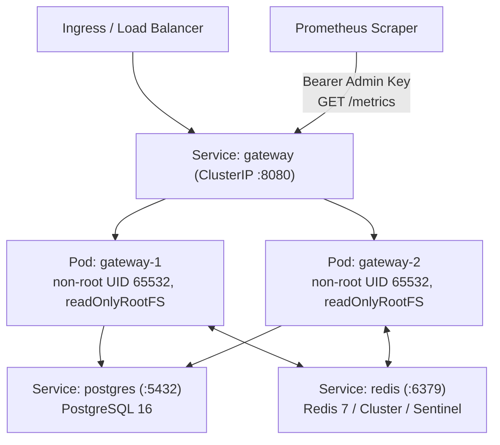

# Kubernetes & Kustomize Deployment

GoRoute AI Gateway ships production-hardened Kubernetes manifests under [`deployments/k8s/`](https://github.com/goroute-ai/ai-gateway-go/tree/main/deployments/k8s) managed via Kustomize. The base overlay deploys a 2-replica stateless gateway tier backed by PostgreSQL 16 and Redis 7, with non-root container hardening, read-only root filesystems, and `/readyz` + `/healthz` probes.



---

## 1. Kustomize Manifest Inventory

The `deployments/k8s/kustomization.yaml` file composes six resource manifests into a single deployable unit:

| File | Kind | Name | Purpose |
| :--- | :--- | :--- | :--- |
| `namespace.yaml` | `Namespace` | `goroute-test` | Isolates gateway, database, and cache resources (override in production overlays). |
| `postgres.yaml` | `Deployment`, `Service` | `postgres` | PostgreSQL 16 (`postgres:16-alpine`) on port `5432` with `pg_isready` readiness probe. |
| `redis.yaml` | `Deployment`, `Service` | `redis` | Redis 7 (`redis:7-alpine`) on port `6379` with `redis-cli ping` readiness probe. |
| `secret.example.yaml` | `Secret` | `gateway-secrets` | Template secret injecting `GATEWAY_POSTGRES_DSN`, `GATEWAY_MASTER_ADMIN_KEY`, and `GATEWAY_MASTER_ENCRYPTION_KEY`. |
| `gateway-deployment.yaml` | `Deployment` | `gateway` | 2-replica GoRoute AI Gateway (`goroute/ai-gateway`) with hardened security context and probes. |
| `service.yaml` | `Service` | `gateway` | Exposes port `8080` (`http`) across the `app: gateway` replica set. |

---

## 2. Applying the Manifests

Preview the rendered manifests before applying:

```bash
kubectl kustomize deployments/k8s/
```

Deploy to your cluster:

```bash
kubectl apply -k deployments/k8s/
kubectl -n goroute-test rollout status deployment/gateway --timeout=120s
```

To verify the multi-replica Kubernetes smoke suite locally against a `kind` or `k3d` cluster, run:

```bash
make test-k8s-smoke
```

:::warning Replace Example Secrets Before Production
`deployments/k8s/secret.example.yaml` contains placeholder test credentials. Never apply example secrets to a production cluster. Use External Secrets Operator, Sealed Secrets, or a Kustomize `secretGenerator` overlay backed by your KMS/Vault.
:::

---

## 3. Container Security Context & Probes

`deployments/k8s/gateway-deployment.yaml` enforces strict pod and container hardening:

- **Pod `securityContext`**: `runAsNonRoot: true`, `runAsUser: 65532` (distroless non-root user).
- **Container `securityContext`**:
  - `allowPrivilegeEscalation: false`
  - `readOnlyRootFilesystem: true`
  - `capabilities.drop: ["ALL"]`
- **Graceful Shutdown**: `terminationGracePeriodSeconds: 30` paired with `server.shutdown_timeout` (`15s` default) to drain active SSE streams.
- **Resource Requests & Limits**: Requests `100m` CPU / `128Mi` memory; limits `500m` CPU / `512Mi` memory (tune upward for high-concurrency streaming or large multipart file uploads).
- **Health Probes**:
  - **Readiness (`GET /readyz` on `:8080`)**: `initialDelaySeconds: 3`, `periodSeconds: 5`. Verifies live PostgreSQL and Redis connectivity before routing traffic.
  - **Liveness (`GET /healthz` on `:8080`)**: `initialDelaySeconds: 5`, `periodSeconds: 10`. Confirms process health without cascading restarts on transient dependency blips.

:::tip Writable Scratch Volume for Multipart File Uploads
If you enable `/v1/files` or audio multipart disk spooling (`POST /v1/audio/transcriptions`) with `readOnlyRootFilesystem: true`, mount an `emptyDir` volume at `/tmp` (or your configured temp/file storage path) so Go's multipart spooled files can write safely.
:::

---

## 4. Production Overlay: Namespace, Secrets & Image Tag

Create a production Kustomize overlay (e.g., `deployments/k8s/overlays/prod/kustomization.yaml`) rather than editing the base manifests directly:

```yaml
apiVersion: kustomize.config.k8s.io/v1beta1
kind: Kustomization
namespace: goroute-prod

resources:
  - ../../

images:
  - name: goroute/ai-gateway
    newTag: v1.6.0

patches:
  - target:
      kind: Namespace
      name: goroute-test
    patch: |-
      - op: replace
        path: /metadata/name
        value: goroute-prod
  - target:
      kind: Deployment
      name: gateway
    patch: |-
      - op: add
        path: /spec/template/spec/containers/0/env/-
        value:
          name: GATEWAY_ENV
          value: "production"
```

---

## 5. PostgreSQL 16 & Redis Cluster / Sentinel

### PostgreSQL 16
The base `postgres.yaml` uses `postgres:16-alpine` with a single replica for smoke testing. For production:
- Use a managed PostgreSQL 16+ service (RDS, Cloud SQL, Neon) or a HA operator (CloudNativePG) with TLS (`?sslmode=verify-full`) in `GATEWAY_POSTGRES_DSN`.
- Embedded SQL migrations (`0001` through `0012`) run automatically at startup inside atomic transactions.

### Redis Cluster & Sentinel
GoRoute's `RedisFabric` uses `go-redis` `UniversalClient` with `{org:<id>}` hash-tagged keys so multi-key Lua scripts for rate limiting and response caching execute atomically on a single slot:

| Topology | Environment Variables |
| :--- | :--- |
| **Standalone** | `GATEWAY_REDIS_ADDR=redis:6379` |
| **Redis Cluster** | `GATEWAY_REDIS_ADDRS=redis-0:6379,redis-1:6379,redis-2:6379` |
| **Redis Sentinel** | `GATEWAY_REDIS_ADDRS=sentinel-0:26379,sentinel-1:26379,sentinel-2:26379` + `GATEWAY_REDIS_MASTER_NAME=mymaster` |
| **Authentication** | `GATEWAY_REDIS_PASS=<password>` |

---

## 6. Prometheus Metrics Scraping

The `GET /metrics` endpoint exposes Prometheus text format `0.0.4` metrics using bounded-cardinality reservoir sampling (`1,024` samples) and requires `Authorization: Bearer <GATEWAY_MASTER_ADMIN_KEY>`.

Configure a Prometheus `ServiceMonitor` or `ScrapeConfig` referencing the admin bearer token secret:

```yaml
apiVersion: monitoring.coreos.com/v1
kind: ServiceMonitor
metadata:
  name: goroute-gateway
  namespace: goroute-prod
spec:
  selector:
    matchLabels:
      app: gateway
  endpoints:
    - port: http
      path: /metrics
      interval: 15s
      bearerTokenSecret:
        name: gateway-secrets
        key: GATEWAY_MASTER_ADMIN_KEY
```

See [Observability, Metrics & Health Probes](./observability.md) for the full exported metric catalog and OTLP tracing configuration.
