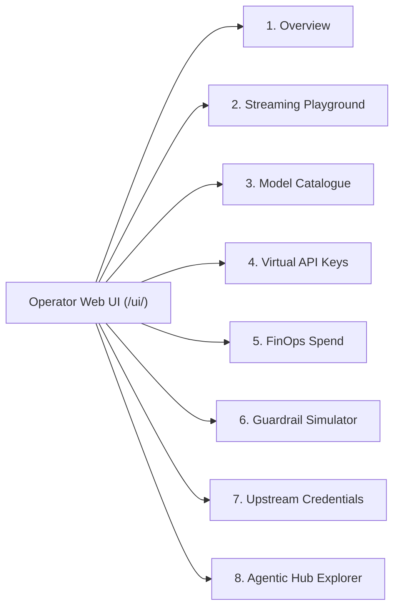

# Embedded Operator Web UI

GoRoute AI Gateway embeds a high-performance **Operator Web UI** compiled with React 19, TypeScript, Vite, and Tailwind CSS. The entire console is bundled directly into the compiled Go binary using Go's `//go:embed` directive, eliminating external frontend hosting, CDN dependencies, or CORS setup.

The console is accessible by default at:
```text
http://localhost:8080/ui/
```

> [!NOTE]
> The gateway automatically redirects non-trailing slash requests (`/ui`) to `/ui/` (HTTP 301) to ensure relative static asset resolution functions properly across reverse proxies and ingress controllers.

---

## 1. Architecture: Single-Binary Go Embedding

The Operator Web UI resides in the repository under `web/`. When built for production, Vite compiles the React SPA into static HTML, JavaScript, and CSS bundles located in `web/dist/`, which are mirrored to `internal/ui/dist/`.

```mermaid
flowchart TD
    subgraph Browser["Browser Client"]
        SPA["React 19 SPA (Vite / Tailwind)"]
    end

    subgraph Binary["Go Single Binary (`cmd/gateway`)"]
        ChiRouter["Chi Router (`/ui/*`)"]
        EmbedFS["//go:embed all:dist<br/>(internal/ui/ui.go)"]
        HTML5Fallback["HTML5 History API Fallback<br/>(index.html)"]
        DataPlane["Data Plane (`/v1/*`)"]
        ControlPlane["Control Plane (`/admin/v1/*`)"]
    end

    SPA -->|HTTP Requests| ChiRouter
    ChiRouter -->|Hashed Asset Request| EmbedFS
    ChiRouter -->|Client Route (e.g. /ui/finops)| HTML5Fallback
    SPA -->|Inference Stream| DataPlane
    SPA -->|Admin Ops & Metrics| ControlPlane
```

### Go `embed.FS` Integration (`internal/ui/ui.go`)

The Go HTTP handler utilizes `embed.FS` and `http.FileServer` with tailored caching headers and HTML5 History API fallback routing:

```go
package ui

import (
	"embed"
	"io"
	"io/fs"
	"net/http"
	"strings"

	"github.com/go-chi/chi/v5"
)

//go:embed all:dist
var embeddedDist embed.FS

// DistFS returns the sub-filesystem for the embedded dist directory.
func DistFS() (fs.FS, error) {
	return fs.Sub(embeddedDist, "dist")
}

// RegisterRoutes mounts the embedded operator dashboard on the Chi router at /ui.
func RegisterRoutes(r chi.Router) {
	distFS, err := fs.Sub(embeddedDist, "dist")
	if err != nil {
		return
	}

	fileServer := http.FileServer(http.FS(distFS))

	// Redirect /ui to /ui/ with trailing slash for proper relative asset resolution
	r.Get("/ui", func(w http.ResponseWriter, r *http.Request) {
		http.Redirect(w, r, "/ui/", http.StatusMovedPermanently)
	})

	// Serve static assets or fallback to index.html for SPA client-side routing
	r.Get("/ui/*", func(w http.ResponseWriter, r *http.Request) {
		trimmedPath := strings.TrimPrefix(r.URL.Path, "/ui")
		if trimmedPath == "" || trimmedPath == "/" {
			trimmedPath = "/index.html"
		}

		cleanPath := strings.TrimPrefix(trimmedPath, "/")

		// If the specific file exists and is not index.html, serve it
		if cleanPath != "index.html" {
			if f, err := distFS.Open(cleanPath); err == nil {
				_ = f.Close()
				if strings.HasPrefix(trimmedPath, "/assets/") {
					// Immutable caching for hashed assets
					w.Header().Set("Cache-Control", "public, max-age=31536000, immutable")
				}
				http.StripPrefix("/ui", fileServer).ServeHTTP(w, r)
				return
			}
		}

		// HTML5 History API fallback: serve index.html for client-side routing
		indexFile, err := distFS.Open("index.html")
		if err != nil {
			http.NotFound(w, r)
			return
		}
		defer indexFile.Close()

		stat, err := indexFile.Stat()
		if err != nil {
			http.NotFound(w, r)
			return
		}

		w.Header().Set("Content-Type", "text/html; charset=utf-8")
		w.Header().Set("Cache-Control", "no-cache")
		http.ServeContent(w, r, "index.html", stat.ModTime(), indexFile.(io.ReadSeeker))
	})
}
```

### HTML5 History API Client-Side Routing

The web application uses client-side routing (`/ui/playground`, `/ui/models`, `/ui/finops`, etc.). When a user bookmarks, reloads, or directly navigates to a deep URL:
1. Chi receives the request at `/ui/{route}`.
2. The router checks if a physical file matches `{route}`. If not, it executes the fallback block.
3. The server responds with `index.html` (HTTP 200, `Cache-Control: no-cache`), allowing the React client router to parse `window.location.pathname` and render the matching view without 404 errors.
4. Assets under `/ui/assets/*` contain cryptographic content hashes generated by Vite (e.g. `index-B1x48z.js`) and are served with `Cache-Control: public, max-age=31536000, immutable`.

---

## 2. Production Bundle Budget Validation

To ensure the embedded gateway binary remains lightweight and does not bloat memory footprint or container images, the frontend build enforces a strict **bundle budget under 400 KB uncompressed** across all compiled files.

Budget enforcement is automated via `web/scripts/check-budget.mjs`:

| Artifact Category | Uncompressed Budget Threshold | Gzip Budget Threshold |
| :--- | :--- | :--- |
| **Max Single JavaScript Chunk** | 150 KB max | 45 KB max |
| **Max Single CSS File** | 35 KB max | 8 KB max |
| **Total Production Distribution** | 380 KB max *(budget ceiling 400 KB)* | 110 KB max |

### Verifying Bundle Budgets

Run the build script from the repository root:

```bash
make ui-build
```

Or execute directly inside `web/`:

```bash
cd web
npm run build
node scripts/check-budget.mjs
```

Sample output:
```text
📊 Checking Production Frontend Bundle Budgets:
────────────────────────────────────────────────────────
 ✅ PASS  assets/index-D7x92A.js              :   142.18 KB (gzip:  41.34 KB)
 ✅ PASS  assets/index-C3y81B.css             :    28.64 KB (gzip:   6.12 KB)
 ✅ PASS  index.html                          :     0.73 KB (gzip:   0.41 KB)
────────────────────────────────────────────────────────
 Total Bundle Size: 171.55 KB (gzipped: 47.87 KB)
✨ All frontend bundle budget constraints satisfied!
```

> [!CAUTION]
> Adding heavy frontend dependencies (such as large component suites, heavy charting libraries, or date manipulation packages) that cause uncompressed bundle size to exceed 380 KB will immediately fail the CI verification pipeline and block release builds.

---

## 3. Deep Dive: 8 Production Views

The Operator Web UI is organized into 8 modular views providing end-to-end administration across data plane inference, routing, multi-tenant governance, and agentic protocols.



### View 1: Overview Dashboard (`OverviewView.tsx`)

The landing view provides real-time system observability and operational telemetry:
- **System Health & Storage Indicators**: Displays active status for PostgreSQL connection pool, Redis cache fabric, and upstream provider availability.
- **Real-Time Inference KPI Counters**: Total inference requests, error rates, cache-hit percentage, and aggregated micro-dollar spend.
- **Deployment Status Grid**: Real-time status badges for all active model deployments (Healthy, Degraded, Tripped / In Cooldown).
- **Recent Audit Trail**: Live log feed of configuration mutations, key creations, and administrative actions with operator attribution.

### View 2: Streaming Playground (`PlaygroundView.tsx`)

An interactive developer testbench for validating models, prompt templates, and streaming reliability without writing code:
- **Interactive Chat Canvas**: Multi-turn conversational interface supporting `user`, `assistant`, and `system` message sequencing.
- **Model Switcher**: Direct selection of model groups (e.g., `"fast"`, `"reasoning"`, `"coding"`) or specific provider deployments (`openai/gpt-4o`, `anthropic/claude-3-5-sonnet`, `gemini/gemini-2.5-flash`).
- **Hyperparameter Controls**: Sliders for temperature ([0.0, 2.0]), max completion tokens, top-p, frequency penalty, and presence penalty.
- **Real-Time Token-by-Token SSE Stream**: Consumes `text/event-stream` chunks via native Fetch API and Web Streams, rendering live markdown tokens.
- **Inference Diagnostics**: Real-time display of Time-To-First-Token (TTFT in milliseconds), total generation time, prompt/completion token counts, and micro-dollar cost.

### View 3: Model Catalogue Browser (`ModelsView.tsx`)

A searchable directory of all frontier LLMs and specialized models registered in the gateway's global catalog:
- **4-Layer Governance Visibility**: Inspects the hierarchical model availability status (Global Discovery -> Org Subscription -> Org Policy Override -> Virtual Key allowlist).
- **Capability Matrix**: Filter models by supported modalities:
  - Streaming, Tool Calling, Vision, Reasoning / Thinking, Structured Outputs (`json_schema`), Dense Embeddings, Reranking, Audio STT / TTS, Stateful Batches, and Realtime WebSockets.
- **Pricing Transparency**: Real-time display of token pricing:
  - Input tokens per 1M (USD per 1M), Output tokens per 1M (USD per 1M), Cached prompt tokens per 1M (USD per 1M), and Reasoning tokens per 1M (USD per 1M).
- **Model Provenance Badges**: Verified pricing provenance indicators (`verified`, `catalog-default`, or `custom-override`).

### View 4: Virtual API Keys (`KeysView.tsx`)

Multi-tenant credential and access governance for engineering teams and client applications:
- **Key Generation & Secret Hashing**: Issues high-entropy client keys (`sk-gw-<prefix>-<secret>`). The gateway stores only the cryptographic SHA-256 hash; the plaintext secret is revealed only once upon creation.
- **Tenant Scoping**: Assign keys to Organizations, Teams, and Users with metadata tags.
- **Rate & Budget Limits**: Configures Requests Per Minute (RPM), Tokens Per Minute (TPM), and hard micro-dollar spending budgets per key.
- **Model Whitelists & Wildcards**: Restricts keys to explicit model aliases (e.g. `["fast", "coding"]`) or wildcards (`["*"]`).
- **Instant Revocation & Rotation**: One-click key disablement or deletion with automated Redis Pub/Sub L1/L2 cache invalidation broadcast across all gateway pods.

### View 5: FinOps Spend Analytics (`FinOpsView.tsx`)

Enterprise cost accounting and budget management powered by the micro-dollar ledger:
- **Organization & Team Spend Aggregation**: Visual breakdown of total incurred spend against defined monthly/daily budgets.
- **Modality Cost Breakdown**: Detailed spend categorization across:
  - `chat` (standard completions & thinking models)
  - `rerank` (search units via Cohere / Jina)
  - `audio` (Whisper STT duration seconds & TTS characters)
  - `image` (DALL-E & Imagen generation units)
  - `batches` (50% discounted batch jobs)
- **Spend Velocity & Projections**: Real-time spend rate monitoring to forecast end-of-month budget utilization.
- **Budget Alerts**: Visual indicators when tenants cross 80% soft warning or 100% hard blocking thresholds.

### View 6: Guardrail Simulator (`GuardrailsView.tsx`)

A staging simulator for testing security policies and content filters before applying them to production traffic:
- **Simulation Canvas**: Enter arbitrary test prompts to evaluate against configured guardrail policies in dry-run mode.
- **Detection Evaluators**:
  - **Prompt Injection & Jailbreak Detection**: Evaluates heuristic scoring and adversarial pattern matching.
  - **PII Redaction**: Regex and entity detectors identifying Social Security Numbers, credit cards, emails, and API keys with preview masking (`[REDACTED_EMAIL]`).
  - **Keyword & Regex Blocklists**: Validates custom enterprise corporate compliance lists.
- **Verdict Breakdown**: Displays pass/block disposition, matched rule IDs, execution latency overhead, and sanitized prompt payloads.

### View 7: Upstream Credentials Vault (`CredentialsView.tsx`)

Secure management of upstream provider API keys and hyperscaler credentials:
- **AES-256-GCM Vault Management**: Providers credentials (`OpenAI`, `Anthropic`, `Google Gemini`, `AWS Bedrock`, `Google Vertex`, `Azure OpenAI`, `Cohere`, `Mistral`) are stored encrypted at rest.
- **Zero-Plaintext Ingress**: Displays masked key previews (e.g. `sk-ant-api03-...ABCD`) without exposing raw secret material to the browser.
- **Active Deployment Association**: Maps each stored credential to its associated upstream model deployments and routing pools.
- **Credential Health Indicators**: Displays active probe status and expiration warnings for cloud hyperscaler service account tokens.

### View 8: Agentic Hub Explorer (`AgenticView.tsx`)

Operational control center for Model Context Protocol (MCP) and Agent-to-Agent (A2A) communications:
- **MCP Server Registry**: Inspects all registered Streamable HTTP, SSE, and Stdio MCP servers, connection statuses, and transport types.
- **Progressive Tool Discovery**: Explores discovered tool definitions, opaque 256-bit handles (`tool_hdl_...`), and input schemas.
- **Curated Toolsets**: Inspects custom tool groupings (e.g., `git-tools`, `analytics-tools`) mapped to tenant teams.
- **A2A Agent Network**: Discovers registered Linux Foundation A2A v1.0 agents, cryptographic Agent Cards (`.well-known/agent-card.json`), JWS signing status, and active task state streams.

---

## 4. Local Development Workflow

When contributing to or customizing the Operator UI, Vite runs in development mode with hot module replacement (HMR) and proxies backend API calls to a running Go gateway:

```bash
# Terminal 1: Run the Go backend
go run ./cmd/gateway -config configs/config.yaml

# Terminal 2: Run Vite Dev Server with HMR
make ui-dev
```

Vite listens on `http://localhost:5173/` and proxies:
- `/v1/*` $\rightarrow$ `http://localhost:8080/v1/*`
- `/admin/v1/*` $\rightarrow$ `http://localhost:8080/admin/v1/*`
- `/mcp/*` and `/a2a/*` $\rightarrow$ `http://localhost:8080/*`

### Synchronizing Distribution Files

Before committing changes to `web/src/`:

```bash
# 1. Compile TypeScript, build production bundle, and verify budget
make ui-build

# 2. Confirm internal/ui/dist is in sync with web/dist
make ui-check-dist

# 3. Execute UI unit and integration tests
go test -v ./internal/ui/...
```
