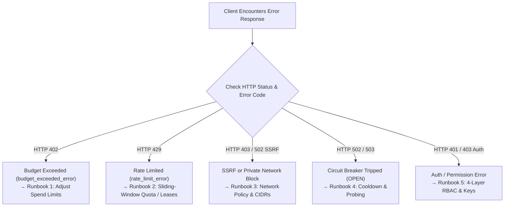
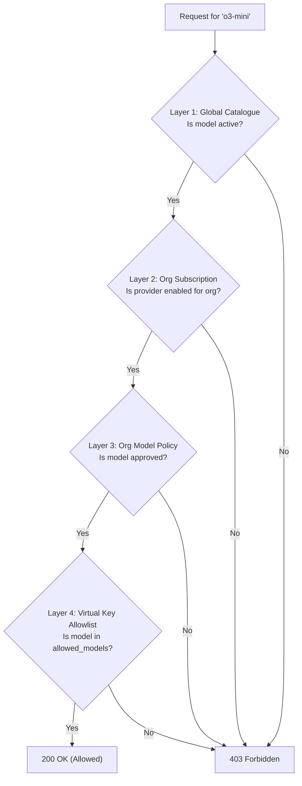

# Troubleshooting & Recovery Runbooks

This guide provides root-cause diagnostic workflows and operational recovery runbooks for common production failure modes in GoRoute AI Gateway.



---

## 1. Unified Error Taxonomy Reference

All data plane errors conform to standard OpenAI error formats with machine-readable `type` and `code` properties:

```json
{
  "error": {
    "type": "rate_limit_error",
    "code": "virtual_key_rpm_limit_exceeded",
    "message": "Virtual key sk-gw-a1b2 has exceeded its limit of 100 requests per minute."
  }
}
```

| HTTP Status | Error `type` | Typical Error `code` | Root Cause |
| :--- | :--- | :--- | :--- |
| **`400 Bad Request`** | `invalid_request_error` | `invalid_json`, `missing_model` | Request body syntax error or unrecognized parameters. |
| **`401 Unauthorized`** | `authentication_error` | `invalid_api_key`, `key_expired` | Missing, malformed, or expired client virtual key. |
| **`402 Payment Required`** | `budget_exceeded_error`| `org_budget_exceeded`, `key_budget_exceeded` | Hard micro-dollar spending limit reached by tenant or key. |
| **`403 Forbidden`** | `permission_error` | `model_forbidden`, `mcp_forbidden` | 4-layer RBAC policy prevents key from accessing target model or server. |
| **`404 Not Found`** | `not_found_error` | `model_not_found`, `task_not_found` | Requested virtual alias or A2A task does not exist. |
| **`429 Too Many Requests`**| `rate_limit_error` | `rate_limit_rpm_exceeded`, `concurrency_limit` | Sliding-window RPM/TPM limit or concurrent in-flight lease limit reached. |
| **`502 Bad Gateway`** | `upstream_provider_error`| `upstream_auth_error`, `upstream_bad_gateway` | Upstream provider rejected credential or failed with 5xx. |
| **`503 Service Unavailable`**| `upstream_provider_error`| `circuit_open`, `all_deployments_down` | Circuit breaker tripped; all primary and fallback deployments offline. |
| **`504 Gateway Timeout`** | `upstream_provider_error`| `upstream_timeout` | Upstream provider exceeded write/read timeout. |

---

## 2. Runbook 1: Financial Spend Budget Exceeded (`HTTP 402`)

### Symptom
Client receives HTTP 402 with error type `budget_exceeded_error`:
```json
{
  "error": {
    "type": "budget_exceeded_error",
    "code": "org_budget_exceeded",
    "message": "Configured financial spend budget exceeded (org_budget_exceeded)"
  }
}
```

### Diagnosis
1. Inspect the caller's virtual key and tenant association:
```bash
curl -X GET "http://localhost:8080/admin/v1/virtual-keys?prefix=sk-gw-a1b2" \
  -H "Authorization: Bearer $GATEWAY_MASTER_ADMIN_KEY"
```
2. Check current accumulated spend vs maximum budget in PostgreSQL:
```sql
SELECT id, name, spent_micros, max_budget_micros, 
       (spent_micros::float / NULLIF(max_budget_micros, 0) * 100) AS pct_used
FROM organizations 
WHERE slug = 'acme-corp';
```

### Remediation
- **Option A: Increase Organization or Key Budget via Admin API**:
```bash
curl -X PATCH "http://localhost:8080/admin/v1/organizations/org_12345" \
  -H "Authorization: Bearer $GATEWAY_MASTER_ADMIN_KEY" \
  -H "Content-Type: application/json" \
  -d '{"max_budget_micros": 500000000}' # $500.00 USD
```
- **Option B: Reset Accumulated Spend for a New Billing Cycle**:
```sql
UPDATE organizations 
SET spent_micros = 0, budget_reset_at = NOW() 
WHERE id = 'org_12345';
```
The gateway will automatically clear the Redis spend accumulator key (`gw:spend:org:org_12345`).

---

## 3. Runbook 2: Rate Limit or Concurrency Rejection (`HTTP 429`)

### Symptom
Requests fail with HTTP 429. The response contains a `Retry-After: <seconds>` header.

### Diagnosis
1. Check gateway logs for rate limiter evaluation messages:
```bash
grep "rate_limit_exceeded" /var/log/goroute/gateway.log
```
2. Check Redis sliding-window counters:
```bash
redis-cli KEYS "gw:rl:*:sk-gw-a1b2:*"
redis-cli GET "gw:rl:conc:sk-gw-a1b2"
```

### Remediation
- **If Requests Per Minute (RPM) or Tokens Per Minute (TPM) are exhausted**:
  Update the virtual key limits:
  ```bash
  curl -X PATCH "http://localhost:8080/admin/v1/virtual-keys/key_12345" \
    -H "Authorization: Bearer $GATEWAY_MASTER_ADMIN_KEY" \
    -H "Content-Type: application/json" \
    -d '{"rpm_limit": 500, "tpm_limit": 100000}'
  ```
- **If Concurrency Locks are Stale**:
  In rare scenarios where client connections abort without cleanly releasing concurrent lease counters, expire the concurrency key:
  ```bash
  redis-cli DEL "gw:rl:conc:key_12345"
  ```

---

## 4. Runbook 3: Outbound SSRF & Private Network Blocks

### Symptom
Requests to self-hosted models (vLLM, Ollama, TGI) or private VPC endpoints fail with errors such as:
```text
[502:upstream_error] network: private/local network address is forbidden by SSRF policy
```
Or:
```text
network: destination IP is in the forbidden list
```

### Root Cause
The gateway enforces a zero-trust outbound security policy (`internal/security/network/policy.go`):
- Prohibits loopback (`127.0.0.0/8`, `::1/128`).
- Prohibits RFC 1918 private subnets (`10.0.0.0/8`, `172.16.0.0/12`, `192.168.0.0/16`).
- Prohibits cloud metadata endpoints (`169.254.169.254`, `fd00:ec2::254`).
- Blocks plaintext `http://` schemes when `allow_insecure_http` is `false`.

### Remediation for Internal Models
If you are hosting private inference engines within a secure VPC, configure explicit CIDR allowlists or enable private network routing in `configs/config.yaml`:

```yaml
security:
  network:
    outbound_ssrf:
      allow_private_networks: true
      allowed_schemes:
        - "https"
        - "http"
      allowed_private_cidrs:
        - "10.240.0.0/16"       # Your internal Kubernetes pod CIDR
        - "192.168.1.0/24"      # On-premise GPU cluster
```

> [!CAUTION]
> Never configure `169.254.169.254` or `0.0.0.0/0` in `allowed_private_cidrs`. Cloud instance metadata must remain permanently blocked to prevent credential theft.

---

## 5. Runbook 4: Tripped Circuit Breakers (`CircuitOpen`)

### Symptom
Inference requests fail immediately with HTTP 503 without reaching the upstream provider:
```json
{
  "error": {
    "type": "upstream_provider_error",
    "code": "circuit_open",
    "message": "Upstream deployment dep_openai_east is isolated in circuit breaker cooldown"
  }
}
```

### Diagnosis
1. Inspect deployment statuses:
```bash
curl -X GET "http://localhost:8080/admin/v1/health/deployments" \
  -H "Authorization: Bearer $GATEWAY_MASTER_ADMIN_KEY"
```
2. Verify if the deployment is in cooldown in Redis:
```bash
redis-cli GET "gw:router:cooldown:dep_openai_east"
```

### Remediation
- **Wait for Cooldown Expiration**: By default, the deployment remains isolated for `router.default_cooldown` (60 seconds). Once expired, the circuit enters `HALF_OPEN` state, allowing a single trial probe to verify recovery.
- **Force Immediate Recovery via Active Probe**:
```bash
curl -X POST "http://localhost:8080/admin/v1/health/probe" \
  -H "Authorization: Bearer $GATEWAY_MASTER_ADMIN_KEY"
```
- **Manual Reset**: Delete the Redis cooldown lock directly:
```bash
redis-cli DEL "gw:router:cooldown:dep_openai_east"
```

---

## 6. Runbook 5: 4-Layer RBAC Authorization Failures (`HTTP 403`)

### Symptom
Client receives HTTP 403:
```json
{
  "error": {
    "type": "permission_error",
    "code": "model_forbidden",
    "message": "Virtual key sk-gw-a1b2 is not authorized to use model \"o3-mini\""
  }
}
```

### Diagnosis: Trace the 4-Layer Hierarchy
The gateway checks 4 hierarchical layers in order. If any layer denies access, the request is rejected fail-closed:



### Remediation Queries
1. **Verify Layer 2 Subscription**:
```sql
SELECT * FROM org_provider_subscriptions 
WHERE org_id = 'org_default' AND provider = 'openai';
```
2. **Verify Layer 3 Model Approval**:
```sql
SELECT * FROM org_model_policies 
WHERE org_id = 'org_default' AND global_model_id = 'openai/o3-mini';
```
3. **Verify Layer 4 Key Allowlists**:
```sql
SELECT allowed_models FROM virtual_keys WHERE key_prefix = 'sk-gw-a1b2';
```
Update the key allowlist to include the requested model or `"*"`.
