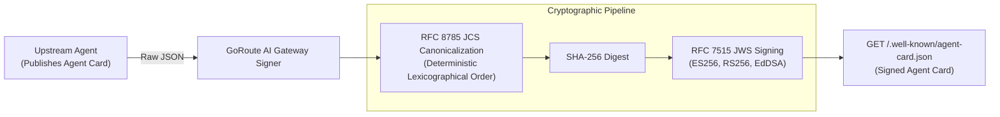

# Cryptographic Agent Cards (RFC 8785 JCS & RFC 7515 JWS)

In autonomous multi-agent networks, agents must be able to discover each other's capabilities dynamically while verifying that an agent's declared schemas, endpoints, and credentials have not been tampered with in transit.

Under the Linux Foundation A2A specification, each autonomous agent publishes an **Agent Card** at a well-known URL. GoRoute AI Gateway acts as a secure identity proxy, enforcing **RFC 8785 JSON Canonicalization Scheme (JCS)** and **RFC 7515 JSON Web Signature (JWS)** signing and verification.



---

## 1. Discovering the Agent Card (`GET /.well-known/agent-card.json`)

Clients and external agent swarms discover agent capabilities via the well-known discovery route:

```bash
# Discover default gateway agent card
curl -X GET "http://localhost:8080/.well-known/agent-card.json"

# Discover a specific registered agent by slug
curl -X GET "http://localhost:8080/.well-known/agent-card.json?agent=risk-analyst"
```

### Agent Card JSON Schema Example

```json
{
  "name": "Risk Analysis Agent",
  "description": "Autonomous financial risk evaluation and stress-testing agent.",
  "version": "1.0.0",
  "supportedInterfaces": [
    {
      "protocolBinding": "HTTP+JSON",
      "url": "http://localhost:8080/a2a/v1/agents/risk-analyst"
    },
    {
      "protocolBinding": "JSON-RPC",
      "url": "http://localhost:8080/a2a/v1/agents/risk-analyst"
    },
    {
      "protocolBinding": "GRPC",
      "url": "localhost:9090"
    }
  ],
  "capabilities": {
    "streaming": true,
    "pushNotifications": true,
    "statePersistence": true
  },
  "signature": {
    "alg": "ES256",
    "kid": "gw-a2a-signer-v1",
    "jws": "eyJhbGciOiJFUzI1NiIsImtpZCI6Imd3LWEyYS1zaWduZXItdjEifQ.eyJjYXBhYmlsaXRpZXMi...signature"
  }
}
```

---

## 2. Deterministic Serialization: RFC 8785 JCS

Standard JSON encoders do not guarantee deterministic serialization: key ordering is arbitrary, whitespace varies, and numeric representations differ across platforms. Without canonical serialization, cryptographic signatures fail.

GoRoute AI Gateway implements **RFC 8785 JSON Canonicalization Scheme (JCS)** (`internal/a2a/card.go`):
1. **Lexicographical Key Sorting**: Object member names are sorted lexicographically by Unicode code point values.
2. **Whitespace Stripping**: Eliminates all non-essential formatting whitespace outside string literals.
3. **Canonical Number Formatting**: Integers and arbitrary-precision floats are represented without exponents when within safe ranges, preserving decimal precision.
4. **UTF-8 Character Escaping**: Only essential control characters (`"`, `\`) are escaped.

```go
// CanonicalizeJCS serializes any JSON-compatible object into RFC 8785 JCS.
func CanonicalizeJCS(v any) ([]byte, error) {
	raw, err := json.Marshal(v)
	if err != nil {
		return nil, err
	}
	var parsed any
	dec := json.NewDecoder(bytes.NewReader(raw))
	dec.UseNumber()
	if err := dec.Decode(&parsed); err != nil {
		return nil, err
	}
	return canonicalizeValue(parsed)
}
```

---

## 3. Cryptographic Signing: RFC 7515 JWS

Once canonicalized, the card payload is signed according to **RFC 7515 JSON Web Signature (JWS)**.

### Supported Cryptographic Algorithms
The gateway supports three standard asymmetric signing algorithms configured in `configs/config.yaml`:
- **`ES256`** (Default): ECDSA with the NIST P-256 curve and SHA-256. Recommended for modern high-performance cloud environments.
- **`RS256`**: RSA signature with SHA-256 (minimum 2048-bit key).
- **`EdDSA`**: Ed25519 high-speed elliptic curve signature scheme.

### Compact JWS Serialization
The signature is formatted in compact 3-part Base64URL notation:
```text
BASE64URL(UTF8(ProtectedHeader)) . BASE64URL(JCS(Payload)) . BASE64URL(SignatureBytes)
```

Where the Protected Header declares the algorithm and key ID:
```json
{
  "alg": "ES256",
  "kid": "gw-a2a-signer-v1"
}
```

---

## 4. Ingress Gateway URL Rewriting & Re-Signing

When GoRoute AI Gateway proxies an external or upstream A2A agent:
1. **Upstream Ingestion**: The gateway fetches the upstream agent card and validates its cryptographic signature against the upstream's published JWKS.
2. **Endpoint Rewriting**: Upstream interface URLs (e.g. `http://internal-agent-host:3000`) are rewritten to point to the gateway's unified ingress proxy (`https://gateway.acme.com/a2a/v1/agents/{slug}`).
3. **Re-Signing**: Because rewriting modifies the payload, the gateway strips the old signature, canonicalizes the updated payload via RFC 8785 JCS, and re-signs the document using the gateway's private key (`a2a.signing_key_id`).

This guarantees that downstream clients can verify the authenticity of the card while directing all live traffic through the gateway's rate limiters, FinOps ledgers, and security guardrails.

---

## 5. Verification Configuration (`configs/config.yaml`)

```yaml
a2a:
  enabled: true
  signing_key_id: "gw-a2a-signer-v1"
  allowed_signing_algs:
    - "ES256"
    - "RS256"
    - "EdDSA"
  # Upstream trusted agent public JWKS keys
  trusted_card_jwks:
    "risk-analyst": "https://risk-agent.partner.com/.well-known/jwks.json"
    "compliance-bot": "https://compliance.internal.bank/.well-known/jwks.json"
```

> [!IMPORTANT]
> In production environments, never set `a2a.allow_legacy_card_discovery: true`. All agent cards must be cryptographically signed and verifiable against approved keys to prevent man-in-the-middle capability spoofing.
