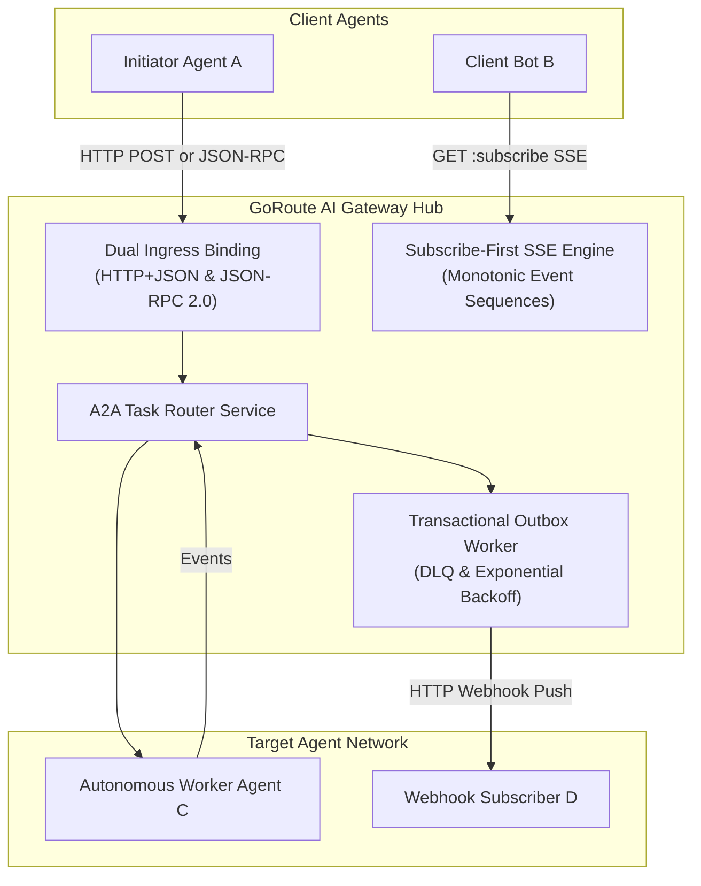
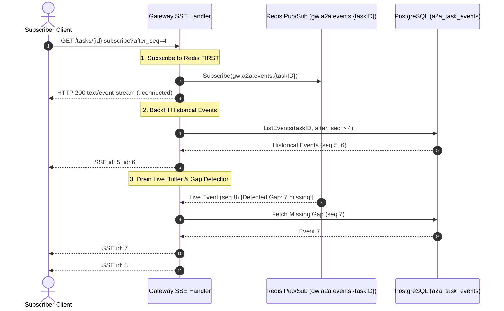
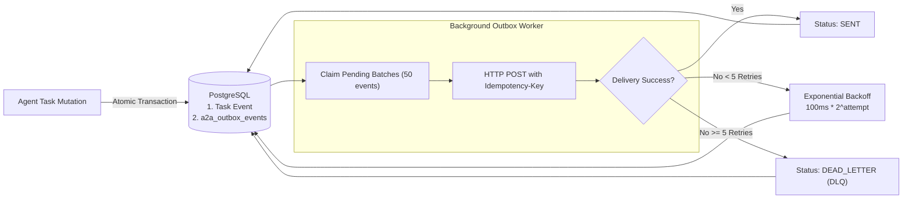

# Agent-to-Agent (A2A) Protocol Overview

The **Linux Foundation Agent-to-Agent Protocol (A2A v1.0)** is an open, vendor-neutral specification governing autonomous multi-agent communication, collaborative task execution, and real-time event distribution.

GoRoute AI Gateway implements an enterprise-grade A2A router and messaging hub, enabling independent agent systems (e.g., LangChain agents, AutoGen swarms, Claude Code, and autonomous background bots) to coordinate tasks securely with enterprise auth, audit trails, and multi-tenant isolation.



---

## 1. Dual Protocol Binding: HTTP+JSON and JSON-RPC 2.0

To ensure compatibility across different software ecosystems, GoRoute AI Gateway exposes identical agent capabilities over two transport bindings:

### 1. HTTP+JSON REST Binding
Idiomatic REST APIs designed for standard HTTP microservices and web clients:

| Operation | Method & Route | Description |
| :--- | :--- | :--- |
| **Send Message** | `POST /a2a/v1/agents/{slug}/messages` | Submits a message to an agent, initializing or continuing a task. |
| **Get Task** | `GET /a2a/v1/agents/{slug}/tasks/{taskID}` | Retrieves current task status, artifacts, and execution state. |
| **List Tasks** | `GET /a2a/v1/agents/{slug}/tasks` | Lists active and historical tasks for the caller. |
| **Cancel Task** | `POST /a2a/v1/agents/{slug}/tasks/{taskID}:cancel` | Signals cancellation to an in-flight agent task. |
| **Subscribe Stream** | `GET /a2a/v1/agents/{slug}/tasks/{taskID}:subscribe` | Opens a real-time SSE stream of task events. |

### 2. JSON-RPC 2.0 Binding
Standardized RPC interface accessible on a single URL (`POST /a2a/v1/agents/{slug}`):

```bash
curl -X POST "http://localhost:8080/a2a/v1/agents/risk-analyst" \
  -H "Authorization: Bearer sk-gw-client-key" \
  -H "Content-Type: application/json" \
  -d '{
    "jsonrpc": "2.0",
    "id": 101,
    "method": "sendMessage",
    "params": {
      "message": {
        "role": "user",
        "content": "Evaluate quarterly exposure to semiconductor supply shocks."
      }
    }
  }'
```

Supported JSON-RPC methods: `sendMessage`, `getTask`, `listTasks`, `cancelTask`, `createPushConfig`, `getPushConfig`, `deletePushConfig`.

---

## 2. Subscribe-First SSE Real-Time Streaming

A common vulnerability in distributed SSE streaming is the "race window": if a client queries the database for past events and then connects to the live stream, any event emitted between the database read and the socket connection is permanently lost.

GoRoute AI Gateway implements the **Subscribe-First SSE Protocol** (`internal/a2a/streams.go`):



### Key Stream Resiliency Features:
1. **Subscribe-First Sequencing**: Connects to the Redis event channel `gw:a2a:events:{taskID}` before fetching database snapshots, buffering live events in a channel.
2. **Monotonic Event Sequencing**: Every task event is assigned an auto-incrementing 64-bit integer sequence number (`id: 1`, `id: 2`, `id: 3`).
3. **Resumption via `Last-Event-ID`**: If a subscriber disconnects, it reconnects with standard `Last-Event-ID: <seq>` or `?after_seq=<seq>`. The gateway replays all missed events seamlessly.
4. **Gap Detection & Deduplication**: If a live buffered event skips a sequence number, the gateway queries PostgreSQL to backfill the missing gap before delivering live events. Duplicate events already delivered during backfill are discarded.
5. **Periodic Keep-Alive**: Emits comment frames (`: keepalive\n\n`) every 15 seconds to prevent intermediate proxy timeout disconnects.

---

## 3. Transactional Outbox Pattern & Webhook Delivery

For asynchronous event delivery to external systems, the gateway implements a **Transactional Outbox Worker** (`internal/a2a/outbox_worker.go`).



### Operational Guarantees:
- **Zero-Loss Transactions**: The task status mutation and the outbound webhook event are written within the same database transaction. Events can never be lost due to process crashes.
- **Idempotency & Attribution Headers**: Outbound webhook POSTs carry strict idempotency and audit metadata:
  ```http
  POST /webhooks/agent-events HTTP/1.1
  Host: client-service.acme.com
  Content-Type: application/json
  Idempotency-Key: evt_01928374-abcd-ef01
  X-Gateway-Event-Id: evt_01928374-abcd-ef01
  X-Gateway-Task-Id: task_98765432-feed-dead
  X-Gateway-Delivery-Attempt: 1
  ```
- **Exponential Backoff**: Failed deliveries back off exponentially (`100ms * 2^attempt`).
- **Dead-Letter Queue (DLQ)**: After 5 consecutive failures (`a2a.max_push_retries: 5`), the event status transitions to `dead_letter` for operator inspection.
- **Emergency Kill-Switch**: Webhook delivery can be deactivated instantly per agent or globally by deleting or toggling push notification configs.
