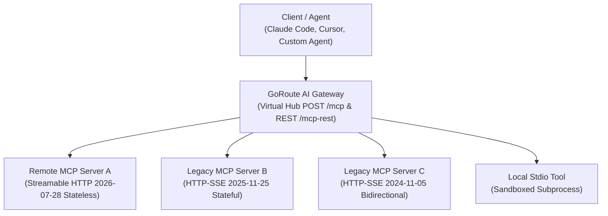

# Model Context Protocol (MCP) Overview

GoRoute AI Gateway is the first enterprise AI data plane with native, multi-version support for the **Model Context Protocol (MCP)** specifications. It unifies distributed tools, databases, APIs, and command-line utilities behind a resilient, high-speed gateway hub.



---

## 1. Multi-Version Protocol Support

The gateway implements a multi-version transport dispatcher that detects and adapts protocol nuances seamlessly across MCP server generations.

| Specification | Transport Layer | Session Model | Key Characteristics |
| :--- | :--- | :--- | :--- |
| **MCP 2026-07-28** | Streamable HTTP (Stateless) | Stateless | Zero initialization handshake, no session affinity or cookie requirements, direct JSON-RPC 2.0 over HTTP POST. |
| **MCP 2025-11-25** | Streamable HTTP (Stateful) | Stateful Session ID | Requires `Mcp-Session-Id` header tracking, Redis session maps, heartbeat keep-alive, 15-minute inactivity TTL. |
| **MCP 2024-11-05** | HTTP + SSE (Legacy) | Long-Lived Stream | Bidirectional Server-Sent Events stream (`GET /sse`) paired with HTTP POST message submission channel. |
| **Stdio Subprocess** | Standard I/O Pipes | Process-Bound | Executes local command-line tools in isolated child processes with environment scrubbing and binary allowlists. |

---

## 2. Modern 2026-07-28 Streamable HTTP Transport

The modern **2026-07-28 Streamable HTTP** specification represents the cloud-native standard for enterprise tool calling:
- **Zero Protocol-Level Handshake**: Eliminates the mandatory `initialize` $\rightarrow$ `initialized` round-trip handshake prior to calling tools.
- **Direct POST Routing**: Every tool execution is an independent HTTP POST request bearing standard JSON-RPC 2.0 payloads.
- **Horizontal Scalability**: Because requests are completely stateless, any gateway pod in a Kubernetes cluster can handle any tool call without sticky sessions or centralized session affinity routing.

### Example Direct Invocation
```bash
curl -X POST "http://localhost:8080/mcp" \
  -H "Authorization: Bearer sk-gw-client-key" \
  -H "Content-Type: application/json" \
  -d '{
    "jsonrpc": "2.0",
    "id": 1,
    "method": "tools/call",
    "params": {
      "name": "postgres__run_query",
      "arguments": {
        "sql": "SELECT COUNT(*) FROM users;"
      }
    }
  }'
```

---

## 3. Legacy 2025 and 2024 Compatibility Adapters

For upstream MCP servers implementing older protocol specifications, the gateway provides automatic backwards-compatibility adapters.

### 2025-11-25 Stateful Adapter (`internal/mcp/adapter_2025.go`)

- **Session Lifecycle Management**: Maps upstream `Mcp-Session-Id` values in Redis with automatic 15-minute inactivity timeouts (`mcp.session_ttl_minutes: 15`).
- **Heartbeat & Keep-Alive Daemon**: Periodically dispatches JSON-RPC ping requests to prevent upstream server timeout disconnects.
- **Principal Digest Validation**: Validates cryptographic hashes of client virtual keys to ensure one client cannot hijack another client's MCP session.

### 2024-11-05 SSE Adapter (`internal/mcp/adapter_2024_sse.go`)

- **Bidirectional SSE Tunneling**: Establishes a persistent `text/event-stream` listener against legacy upstream SSE endpoints, extracting tool emission events into internal Go channels.
- **POST Bridge Routing**: Translates incoming gateway tool calls into upstream SSE postback requests, returning results synchronously to the client.

---

## 4. Virtual Hub Aggregation & Toolsets

Instead of configuring clients with individual URLs for each MCP service, GoRoute AI Gateway acts as an enterprise **Virtual Hub**:
- **Consolidated Endpoint (`POST /mcp`)**: Clients connect to a single gateway endpoint. The gateway queries all registered upstream MCP servers in parallel, merges their tool schemas, and presents a single unified tool manifest.
- **Namespace Collision Prevention**: Avoids naming conflicts across servers by prefixing tool names with the server slug: `{serverSlug}__{toolName}` (e.g. `github__create_issue`, `gitlab__create_issue`).
- **Partial Failure Isolation**: If one upstream MCP server is unreachable or offline, the virtual hub isolates the fault and returns tools from healthy servers without dropping the entire request.
- **Curated Toolsets (`POST /mcp/toolsets/{slug}`)**: Group tools across disparate servers into domain-specific collections (e.g. `devops-tools`, `finance-tools`) restricted by 4-layer RBAC.

---

## 5. Enterprise Reliability & Security Invariants

### Arbitrary Decimal Precision (`big.Rat` & `json.Number`)

Standard JSON parsers convert numeric values into IEEE-754 64-bit floating-point numbers, leading to precision loss in financial transactions, cryptographic IDs, and micro-dollar accounting.

GoRoute AI Gateway parses all MCP tool payloads using Go's `json.Number` and `math/big.Rat`, guaranteeing zero rounding errors or precision drift across high-precision numbers.

### Model-Result-Token-Resumption (MRTR)

For operations returning extensive data sets, the gateway issues single-use, AEAD-encrypted continuation tokens:
- **Identity Bound**: Cryptographically tied to the caller's virtual key and organization ID.
- **TTL Enforced**: Expires automatically after 5 minutes to prevent replay attacks.
- **Memory Optimized**: Large intermediate tool results are spooled to temporary storage rather than held in hot memory.

### Prompt Injection & Tool Pinning Protection

The gateway inspects tool schemas discovered from external servers:
- **Schema Sanitization**: Scans descriptions and parameter names for prompt injection payloads.
- **Cryptographic Tool Pinning**: Computes a SHA-256 fingerprint (`ToolDefHash`) for every registered tool schema. If an upstream server silently mutates its schema without administrative approval, the gateway suspends execution fail-closed.
