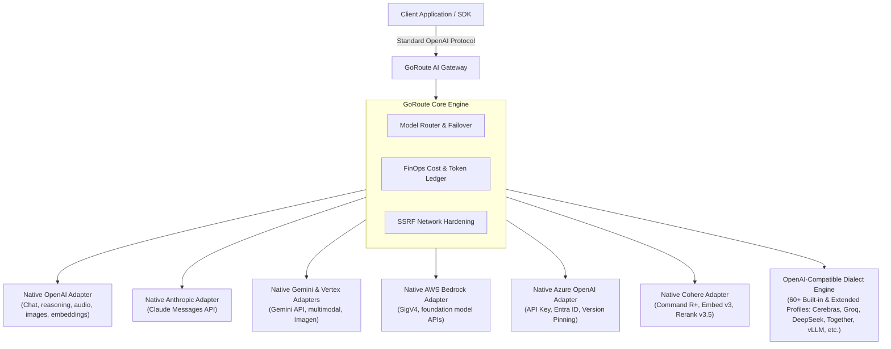

import ProviderCatalog from '@site/src/components/ProviderCatalog';

# Providers Overview

GoRoute provides a unified enterprise data plane connecting your applications to **73 `ProviderType` profiles** (plus `CustomOpenAICompatible` endpoints) through a single, normalized OpenAI-compatible API interface. Applications integrate once against standard endpoints (`/v1/chat/completions`, `/v1/embeddings`, `/v1/rerank`, etc.), while GoRoute manages protocol translation, authentication, streaming SSE normalization, credential vaulting, retries, operation enforcement, and FinOps telemetry. The provider count describes gateway integrations; it is not a fixed list of model IDs.



---

## Interactive Provider Catalog

Filter all **73 `ProviderType` profiles** and `CustomOpenAICompatible` by adapter tier, category, or capability, and click any provider ID to copy it for configuration.

<ProviderCatalog />

---

## Provider Integration Matrix (73 ProviderType Profiles)

GoRoute registers **73 `ProviderType` profiles** in `AllProviders()` (`internal/domain/inference.go`), combining dedicated native protocol adapters (`openai`, `anthropic`, `gemini`, `bedrock`, `vertex`, `azure`, `cohere`, `mistral`, `ollama`), **60+ certified OpenAI-compatible dialect profiles** (`internal/adapter/openaicompat/builtin_profiles.go` and `extended_profiles.go`), and `CustomOpenAICompatible` for arbitrary self-hosted or private endpoints.

This matrix highlights core native adapters and representative dialect integrations. Model IDs change more often than adapters do, so model names shown in this guide and linked provider pages are representative examples, not an exhaustive or guaranteed-current inventory.

| Provider | Adapter Type | Supported Modalities | Streaming | Tools | Auth Strategy | Guide |
| :--- | :--- | :--- | :---: | :---: | :--- | :--- |
| **OpenAI** | Native Adapter | Chat, Embed, Moderation, Audio, Images, Batches, Realtime | Yes | Yes | Bearer Token (`OPENAI_API_KEY`) | [OpenAI](/docs/providers/openai) |
| **Anthropic** | Native Messages | Chat | Yes | Yes | `x-api-key` (`ANTHROPIC_API_KEY`) | [Anthropic Claude](/docs/providers/anthropic-claude) |
| **Google Gemini** | Native Gemini | Chat, Embed, Multimodal Audio/Vision, Imagen | Yes | Yes | `x-goog-api-key` (`GEMINI_API_KEY`) | [Google Gemini](/docs/providers/google-gemini) |
| **AWS Bedrock** | Native Converse | Chat, Embed, Tools | Yes (EventStream) | Yes | AWS SigV4 HMAC-SHA256 | [AWS Bedrock](/docs/providers/aws-bedrock) |
| **Google Vertex AI** | Native Vertex | Chat, Embed, Multimodal | Yes (SSE) | Yes | GCP SA JSON / OAuth2 Bearer | [Google Vertex](/docs/providers/google-vertex) |
| **Azure OpenAI** | Native Azure | Chat, Embed, Vision | Yes | Yes | `api-key` / Entra ID Bearer | [Azure OpenAI](/docs/providers/azure-openai) |
| **Cohere** | Native Cohere v2 | Chat, Embed, Rerank | Yes | Yes | Bearer Token (`COHERE_API_KEY`) | [Cohere](/docs/providers/cohere) |
| **Mistral AI** | Native Adapter | Chat, Embed, Tools | Yes | Yes | Bearer Token (`MISTRAL_API_KEY`) | [Mistral AI](/docs/providers/mistral) |
| **Ollama** | Native Local | Chat, Embed | Yes (NDJSON) | No | None / Base URL (`http://localhost:11434`) | [Ollama](/docs/providers/ollama) |
| **Groq** | Certified Dialect | Chat, Vision | Yes | Yes | Bearer Token | [Dialects](/docs/providers/openai-compatible#1-ultra-fast-wafer-scale--hardware-acceleration) |
| **DeepSeek** | Certified Dialect | Chat, Reasoning | Yes (Reasoning) | Yes | Bearer Token | [Dialects](/docs/providers/openai-compatible#3-search--reasoning) |
| **Together AI** | Certified Dialect | Chat, Embed, Vision | Yes | Yes | Bearer Token | [Dialects](/docs/providers/openai-compatible#2-high-performance-serverless-inference) |
| **Cerebras** | Certified Dialect | Chat | Yes | Yes | Bearer Token | [Dialects](/docs/providers/openai-compatible#1-ultra-fast-wafer-scale--hardware-acceleration) |
| **SambaNova** | Certified Dialect | Chat, Reasoning | Yes (Reasoning) | Yes | Bearer Token | [Dialects](/docs/providers/openai-compatible#1-ultra-fast-wafer-scale--hardware-acceleration) |
| **xAI (Grok)** | Certified Dialect | Chat, Vision, Reasoning | Yes (Reasoning) | Yes | Bearer Token | [Dialects](/docs/providers/openai-compatible#3-search--reasoning) |
| **Fireworks AI** | Certified Dialect | Chat, Embed, Vision | Yes | Yes | Bearer Token | [Dialects](/docs/providers/openai-compatible#2-high-performance-serverless-inference) |
| **Perplexity AI**| Certified Dialect | Chat, Search Citations | Yes | No | Bearer Token | [Dialects](/docs/providers/openai-compatible#3-search--reasoning) |
| **Anyscale** | Certified Dialect | Chat, Embed | Yes | Yes | Bearer Token | [Dialects](/docs/providers/openai-compatible#4-multi-model-aggregators) |
| **DeepInfra** | Certified Dialect | Chat, Embed | Yes | Yes | Bearer Token | [Dialects](/docs/providers/openai-compatible#2-high-performance-serverless-inference) |
| **Novita AI** | Certified Dialect | Chat, Embed, Reasoning | Yes (Reasoning) | Yes | Bearer Token | [Dialects](/docs/providers/openai-compatible#2-high-performance-serverless-inference) |
| **Nebius AI Studio**| Certified Dialect | Chat, Reasoning | Yes (Reasoning) | Yes | Bearer Token | [Dialects](/docs/providers/openai-compatible#2-high-performance-serverless-inference) |
| **Hyperbolic** | Certified Dialect | Chat, Reasoning | Yes (Reasoning) | Yes | Bearer Token | [Dialects](/docs/providers/openai-compatible#2-high-performance-serverless-inference) |
| **Lambda Labs** | Certified Dialect | Chat | Yes | Yes | Bearer Token | [Dialects](/docs/providers/openai-compatible#2-high-performance-serverless-inference) |
| **Friendli AI** | Certified Dialect | Chat | Yes | Yes | Bearer Token | [Dialects](/docs/providers/openai-compatible#2-high-performance-serverless-inference) |
| **OpenRouter** | Certified Dialect | Chat, Vision, Reasoning | Yes (Reasoning) | Yes | Bearer Token | [Dialects](/docs/providers/openai-compatible#4-multi-model-aggregators) |
| **vLLM** | Certified Dialect | Chat, Embed | Yes | Yes | None / Bearer Token | [Dialects](/docs/providers/openai-compatible#5-self-hosted--local-inference-engines) |
| **Cloudflare** | Certified Dialect | Chat, Embed | Yes | Yes | Cloudflare API Token | [Dialects](/docs/providers/openai-compatible#8-global-enterprise--regional-providers) |
| **Databricks** | Certified Dialect | Chat, Embed | Yes | Yes | Databricks Personal Access Token | [Dialects](/docs/providers/openai-compatible#8-global-enterprise--regional-providers) |
| **Snowflake Cortex** | Certified Dialect | Chat, Embed | Yes | Yes | Snowflake JWT / Session Token | [Dialects](/docs/providers/openai-compatible#8-global-enterprise--regional-providers) |
| **DashScope (Qwen)** | Certified Dialect | Chat, Embed, Vision | Yes | Yes | Bearer Token | [Dialects](/docs/providers/openai-compatible#8-global-enterprise--regional-providers) |
| **Volcengine** | Certified Dialect | Chat, Vision, Reasoning | Yes (Reasoning) | Yes | Bearer Token | [Dialects](/docs/providers/openai-compatible#8-global-enterprise--regional-providers) |
| **BigModel (GLM)**| Certified Dialect | Chat, Embed, Vision | Yes | Yes | Bearer Token | [Dialects](/docs/providers/openai-compatible#8-global-enterprise--regional-providers) |
| **Moonshot (Kimi)** | Certified Dialect | Chat | Yes | Yes | Bearer Token | [Dialects](/docs/providers/openai-compatible#8-global-enterprise--regional-providers) |
| **MiniMax** | Certified Dialect | Chat, Reasoning | Yes (Reasoning) | Yes | Bearer Token | [Dialects](/docs/providers/openai-compatible#8-global-enterprise--regional-providers) |
| **SiliconFlow** | Certified Dialect | Chat, Embed, Reasoning | Yes (Reasoning) | Yes | Bearer Token | [Dialects](/docs/providers/openai-compatible#3-search--reasoning) |
| **Voyage AI** | Certified Dialect | Embeddings | No | No | Bearer Token | [Dialects](/docs/providers/openai-compatible#6-specialized-embeddings--reranking) |
| **Jina AI** | Certified Dialect | Embeddings, Rerank | No | No | Bearer Token | [Dialects](/docs/providers/openai-compatible#6-specialized-embeddings--reranking) |
| **Replicate** | Certified Dialect | Chat | Yes | Yes | Bearer Token | [Dialects](/docs/providers/openai-compatible#7-enterprise-foundation-model-platforms) |
| **AI21 Labs** | Certified Dialect | Chat | Yes | Yes | Bearer Token | [Dialects](/docs/providers/openai-compatible#7-enterprise-foundation-model-platforms) |
| **Baseten** | Certified Dialect | Chat | Yes | Yes | Bearer Token | [Dialects](/docs/providers/openai-compatible#5-self-hosted--local-inference-engines) |
| **NVIDIA NIM** | Certified Dialect | Chat, Vision | Yes | Yes | Bearer Token | [Dialects](/docs/providers/openai-compatible#7-enterprise-foundation-model-platforms) |
| **Scaleway** | Certified Dialect | Chat | Yes | Yes | Bearer Token | [Dialects](/docs/providers/openai-compatible#2-high-performance-serverless-inference) |

### Find model IDs available to your key

Use the provider's current model documentation to choose an ID, then check the gateway's tenant-filtered `GET /v1/models` inventory with the same virtual key your application will use. That inventory is the reference for models currently exposed to that caller. Provider access, gateway catalog discovery/sync settings, organization policies, and key allowlists can all affect availability. A model listed by a provider is not by itself confirmation that a particular GoRoute deployment can route it.

When catalog discovery is enabled, the gateway can synchronize models exposed by supported providers. Discovery does not make every provider model universally available: provider credentials, adapter/protocol compatibility, organization policy, and virtual-key permissions still apply. See [Model Management & Access Control](/docs/data-plane/model-management) and [model catalog configuration](/docs/operations/configuration).

### Embedded Model Catalog & Capability Generalizations (v1.6.0)

GoRoute embeds a curated catalog of **4,627 models** (`internal/modelcatalog/catalog.json.gz`) with operation-level support and modality pricing provenance. When a model is not yet in the catalog or has `CapabilityUnknown` fields, `internal/modelcatalog/generalizations.go` (`InferFamilyCapabilities`, `BackfillCapabilities`, `StripRegionalModelPrefix`) supplies explicit heuristic defaults (`Inferred: true`, `Source: "family-pattern-heuristic"`) for context windows and capabilities (tools, streaming, vision, reasoning, structured outputs) without treating unverified catalog rates as verified for budgeted traffic.

### Operation-Level Routing Enforcement (`SupportedOperations`)

In v1.6.0, `checkDeploymentOperation` (`internal/router/reliability.go`) enforces operation compatibility before dispatching a request:
- **Adapter-level check**: Adapters implementing `OperationSupportChecker.SupportsOperation(op)` reject unsupported operations with HTTP `501 Not Implemented` (`<op>_not_supported`).
- **Model-level check**: When `GlobalModel.SupportedOperations` is populated, requests for operations outside that allowlist are rejected with HTTP `400 Bad Request` (`unsupported_operation`).

---

## Authentication Strategies

GoRoute abstracts vendor authentication into four distinct automated mechanisms:

1. **Standard Bearer Authentication (`BearerAuthStrategy`)**: Injects `Authorization: Bearer <token>` automatically for 35+ providers.
2. **Cryptographic AWS SigV4 (`SigV4Signer`)**: Signs requests dynamically using IAM access keys, temporary session tokens, and regional HMAC-SHA256 calculations.
3. **Google OAuth2 Assertion Exchange (`TokenSource`)**: Signs RS256 JWT assertions with GCP Service Account private keys, exchanges them for access tokens with `oauth2.googleapis.com`, and handles background caching.
4. **Microsoft Entra ID & API Key (`AzureAuthStrategy`)**: Automatically distinguishes between standard Azure resource keys (`api-key: <key>`) and Entra ID tokens (`Authorization: Bearer <token>`).

---

## Dynamic Routing & Model Aliases

Configure providers in `configs/config.yaml` using either explicit provider prefixes or virtual alias routing:

### 1. Direct Dynamic Prefix Routing
Call upstream providers directly by prefixing the model parameter:
```bash
# Routes directly to Cerebras Wafer-Scale Engine
curl -X POST http://localhost:8080/v1/chat/completions \
  -H "Authorization: Bearer your-virtual-key" \
  -H "Content-Type: application/json" \
  -d '{"model": "cerebras/llama3.3-70b", "messages": [{"role": "user", "content": "Hello"}]}'

# Routes directly to Anthropic Claude 3.5 Sonnet
curl -X POST http://localhost:8080/v1/chat/completions \
  -H "Authorization: Bearer your-virtual-key" \
  -H "Content-Type: application/json" \
  -d '{"model": "anthropic/claude-sonnet-5-5", "messages": [{"role": "user", "content": "Hello"}]}'
```

### 2. High-Availability Model Groups & Fallback Topologies
Define resilient model aliases in `configs/config.yaml`:

```yaml
model_list:
  # Fast Tier: Gemini 2.5 Flash with fallback to GPT-4o-mini
  - model_name: fast
    routing_strategy: weighted-shuffle
    fallbacks: ["fast-backup"]
    model_params:
      model: gemini/gemini-2.5-flash
      api_key: os.environ/GEMINI_API_KEY
      weight: 100

  - model_name: fast-backup
    model_params:
      model: openai/gpt-4o-mini
      api_key: os.environ/OPENAI_API_KEY

  # Reasoning Tier: Anthropic Claude Sonnet with fallback to Azure GPT-4o
  - model_name: reasoning
    routing_strategy: least-busy
    fallbacks: ["azure-gpt4o"]
    model_params:
      model: anthropic/claude-sonnet-5-5
      api_key: os.environ/ANTHROPIC_API_KEY

  - model_name: azure-gpt4o
    model_params:
      model: azure/gpt-4o
      api_key: os.environ/AZURE_OPENAI_API_KEY
      api_base: "https://my-enterprise.openai.azure.com"
      azure_deployment_name: "gpt-4o-prod"
      api_version: "2024-08-01-preview"
```

---

## Standard Response Telemetry

Every request processed across any of the 73 `ProviderType` profiles includes standardized audit and FinOps telemetry headers:

| Header | Description | Example |
| :--- | :--- | :--- |
| `X-Gateway-Request-Id` | Unique UUID assigned to the client invocation | `req_01h8a...` |
| `X-Trace-Id` | Distributed W3C trace ID for end-to-end tracing | `4bf92f3577b34da6a3ce929d0e0e4736` |
| `X-Gateway-Provider` | The actual upstream provider that fulfilled the request | `bedrock`, `cerebras`, `openai` |
| `X-Gateway-Model` | The upstream foundation model executed | `anthropic.claude-sonnet-5-5` |
| `X-Gateway-Cost-Micros`| Exact cost of the invocation in micro-dollars ($1 = 1,000,000 µ$) | `1250` ($0.001250) |
| `X-Gateway-Routing-Time`| Gateway latency overhead before upstream dispatch | `4.2ms` |
| `X-Gateway-Cache` | Cache hit status (`HIT` or `MISS`) | `HIT` |
| `Retry-After` | Cooldown period emitted during upstream 429 rate limit events | `60` |
