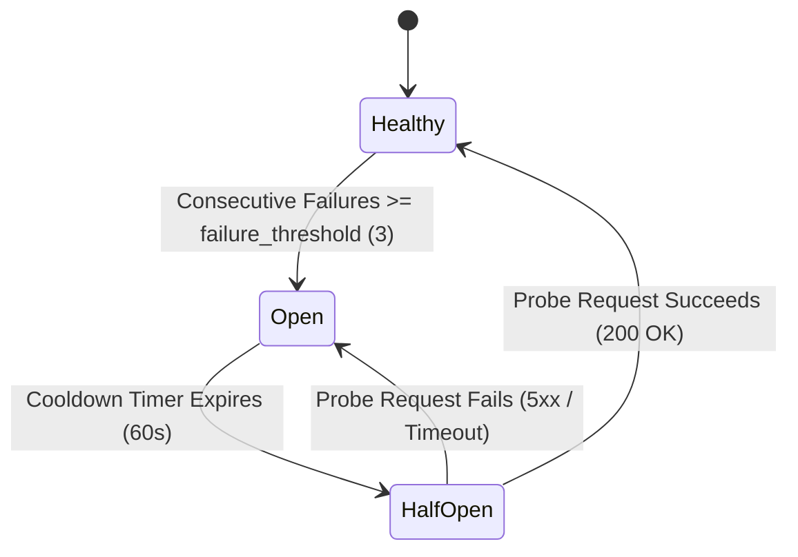

# 3-State Circuit Breakers & Outage Isolation

GoRoute AI Gateway embeds a state machine based on the classic **3-State Circuit Breaker Pattern** (`healthy`, `open`, `half-open`) to automatically isolate unhealthy upstream deployments and prevent cascading failures.



---

## State Transitions

### 1. `Healthy` (Closed)
Normal operational state. All traffic passes through to the selected deployment. Successes and latencies are tracked for EWMA calculations.

### 2. `Open` (Tripped)
When a deployment accumulates `failure_threshold` (default: 3) consecutive 5xx errors or timeouts within `failure_window` (default: 30s), the breaker trips to **OPEN**.
- All subsequent requests targeting this deployment are **immediately diverted** to the next deployment in the fallback chain without attempting network I/O.
- The deployment enters a quarantine cooldown (default: `default_cooldown: 60s`).

### 3. `Half-Open` (Probing)
When the cooldown timer expires, the breaker transitions to **HALF-OPEN**.
- A single canary request is allowed through to test upstream health.
- If the probe succeeds with HTTP 200, the breaker resets to **HEALTHY** and resumes full traffic.
- If the probe fails, the breaker trips back to **OPEN** and resets the quarantine cooldown.

---

## Configuration (`configs/config.yaml`)

```yaml
router:
  failure_threshold: 3      # Consecutive errors required to trip breaker
  failure_window: 30s        # Sliding time window for failure counts
  default_cooldown: 60s      # Quarantine duration before half-open probe
```
