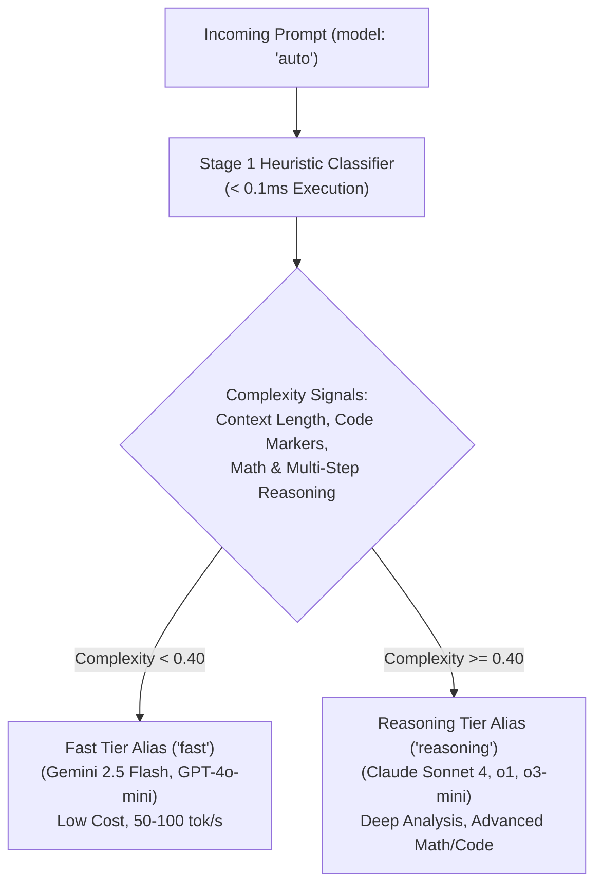

# Stage 1: Zero-LLM Heuristic Complexity Classifier

When clients request `model: "auto"`, GoRoute AI Gateway evaluates the prompt using a zero-LLM heuristic complexity classifier that executes in **under 0.1 milliseconds (&lt; 100 µs)** without invoking any auxiliary LLMs or consuming external API tokens.



---

## Classification Scoring Model

The classifier computes a normalized complexity score between `0.0` and `1.0` based on 4 primary signal vectors:

```text
Complexity Score = (w_tokens * S_tokens) + (w_code * S_code) + (w_math * S_math) + (w_reasoning * S_reasoning)
```

1. **Context & Token Volume (`S_tokens`)**: Evaluates conversation history length, message turn count, and token volume against configurable thresholds (default: `long_context_tokens: 32000`).
2. **Code & Syntax Indicators (`S_code`)**: Detects triple-backtick markdown blocks, programming keywords (`func`, `class`, `import`, `def`, `interface`), stack traces, and SQL schemas.
3. **Mathematical & Algorithmic Markers (`S_math`)**: Identifies equations, statistical formulas, and computational notation.
4. **Multi-Step Reasoning Keywords (`S_reasoning`)**: Scans for semantic reasoning triggers such as *"prove step by step"*, *"distributed consensus"*, *"edge cases"*, and *"formal verification"*.

---

## Configuration (`configs/config.yaml`)

```yaml
router:
  default_fast_alias: "fast"
  default_reasoning_alias: "reasoning"
  complexity_threshold: 0.40      # Prompts >= 0.40 route to reasoning tier
  long_context_tokens: 32000      # Prompts exceeding 32k tokens route to reasoning
```

---

## Benchmark Overhead

| Evaluation Method | Added Latency | Token Cost | Reliability |
| :--- | :--- | :--- | :--- |
| **GoRoute Stage 1 Heuristic** | **&lt; 0.012 ms (12 µs)** | **$0.00 (Zero tokens)** | **100% Deterministic** |
| LLM-as-a-Router (e.g. GPT-4o-mini classifier) | 350 ms – 700 ms | $0.0002 per prompt | Subject to hallucination / timeouts |
| Embedding Distance Classifier | 45 ms – 90 ms | Vector search lookup overhead | Requires embeddings vector database |
