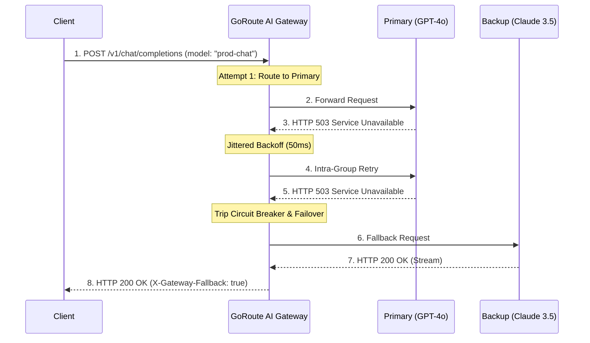

# Retries & Cross-Provider Fallback Cascades

When cloud AI providers experience regional outages, rate limits (HTTP 429), or internal server errors (HTTP 500, 502, 503), GoRoute AI Gateway automatically executes intra-group retries and cross-provider fallback cascades.



---

## 1. Intra-Group Retries with Full Jitter

Before abandoning a model deployment, GoRoute executes automated retries with exponential backoff and randomized decorrelated jitter to prevent thundering herd spikes on recovered upstreams:

```text
Delay = min(max_retry_delay, base_retry_delay * 2^attempt) * Uniform(0.5, 1.5)
```

```yaml
router:
  default_max_retries: 2
  base_retry_delay: 50ms
  max_retry_delay: 2s
```

- **Streaming Pre-First-Token Retries**: Streaming endpoints (`/v1/chat/completions`, `/v1/messages`, `/v1/responses`) apply exponential backoff retries if an upstream fails *before* emitting the first output token, then stream directly once bytes begin flowing.
- **Multi-Modal Reliability**: `ExecuteEmbeddings` (`/v1/embeddings`) and audio/image endpoints share the same retry, circuit-breaker, and fallback pipeline as chat completions.
- **Bounded Fallback Graph Traversal**: Fallback group chains enforce explicit cycle detection and maximum depth limits to prevent infinite failover loops.

---

## 2. Declarative Cross-Provider Fallback Chains

Configure fallback cascades in `configs/config.yaml`:

```yaml
model_list:
  # Primary Group: OpenAI GPT-4o
  - model_name: prod-chat
    routing_strategy: weighted-shuffle
    model_params:
      model: openai/gpt-4o
      api_key: os.environ/OPENAI_API_KEY
      fallbacks: ["backup-claude", "backup-gemini"]

  # Secondary Fallback: Anthropic Claude Sonnet
  - model_name: backup-claude
    model_params:
      model: anthropic/claude-sonnet-4-20250514
      api_key: os.environ/ANTHROPIC_API_KEY

  # Tertiary Emergency Fallback: Google Gemini Flash
  - model_name: backup-gemini
    model_params:
      model: gemini/gemini-2.5-flash
      api_key: os.environ/GEMINI_API_KEY
```

If OpenAI experiences an outage, GoRoute seamlessly falls back to Anthropic Claude. If Anthropic also fails, traffic transparently cascades to Google Gemini Flash.
