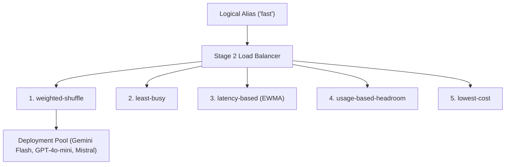

# Stage 2: EWMA Load Balancing (5 Selection Algorithms)

Once a model group or alias is resolved, the load balancer selects an active upstream deployment using the configured strategy. The latency strategy tracks an exponentially weighted moving average (**EWMA**) of observed response latency. The implementation uses synchronization to update and read deployment telemetry.



---

## The 5 Selection Algorithms

### 1. `weighted-shuffle`
Selects deployments randomly in proportion to their configured integer weights. A weight of zero or less is treated as the default weight of 100.

### 2. `least-busy`
Tracks active in-flight requests and selects a deployment with the smallest observed count.

### 3. `latency-based` (EWMA)
Computes an exponentially weighted moving average of observed response latency:

```text
EWMA_t = alpha * Latency_t + (1 - alpha) * EWMA_(t-1)
```

The deployment with the lowest observed moving average is preferred. New deployments use a default baseline until latency has been observed.

### 4. `usage-based-headroom`
Estimates remaining token capacity from request and token usage tracked by the gateway. It does not use this strategy as a guarantee against provider rate limits.

### 5. `lowest-cost`
Selects the candidate with the lowest sum of configured input and output pricing values in the model catalogue. This does not evaluate every request parameter or provider's live price; keep catalogue data current.

---

## YAML Configuration

```yaml
model_list:
  - model_name: fast
    routing_strategy: weighted-shuffle
    model_params:
      model: gemini/gemini-2.5-flash
      weight: 80

  - model_name: fast
    routing_strategy: weighted-shuffle
    model_params:
      model: openai/gpt-4o-mini
      weight: 20

  - model_name: compute-heavy
    routing_strategy: least-busy
    model_params:
      model: anthropic/claude-sonnet-4-20250514
```
