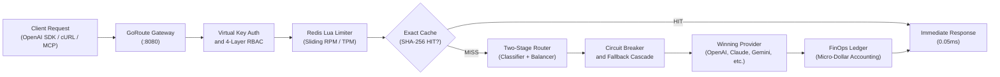

# GoRoute AI Control Plane Overview

GoRoute is a high-throughput, low-overhead **Enterprise AI Control Plane** engineered in pure Go. It unifies **73 `ProviderType` profiles** (plus `CustomOpenAICompatible`), **24 primary `/v1` data plane paths (`73` Unified OpenAPI paths)**, a Model Context Protocol (MCP 2026-07-28) virtual hub, and a Linux Foundation Agent-to-Agent (A2A v1.0) bridge into five integrated control-plane modules:

1. **[AI Gateway: Traffic Management & Model Routing](/docs/gateway)**: Multi-provider `/v1/*` and `/anthropic/v1/*` data plane (24 primary `/v1` paths), `SupportedOperations` enforcement, Stage 1 complexity classifier, Stage 2 load balancers (6 strategies including `round-robin`), 3-state Redis circuit breakers, bounded fallback chains, and 2-tier exact-match caching.
2. **[AI Governance: Security, Policies & Compliance](/docs/governance)**: 4-layer access hierarchy, Operator RBAC + OIDC/JWT, AES-256-GCM Credentials Vault, scoped Virtual Keys (`sk-gw-...`), Two-Layer Guardrails Engine (19 drivers, 7 hooks, Starlark `custom_code`, `WithGuardrailScanner`, `POST /v1/guardrails/apply`), outbound SSRF firewall, and HTTP security headers.
3. **[AI FinOps: Cost Management & Optimization](/docs/finops)**: 64-bit integer micro-dollar ledger (`$1 = 1,000,000 µ$`), cache-write & modality pricing (`0007`/`0012`), `unpriced_requests` tracking, pre-flight upper-bound budget reservations, durable PostgreSQL spend & budget-reset outboxes (`0008`/`0011`/`0014`), Redis Lua rate limits, and pre-flight tokenization.
4. **[AI Observability: Monitoring, Tracing & Evaluation](/docs/deploy/observability)**: OTLP/HTTP distributed tracing (`gen_ai.*`, `guardrail.evaluate`, W3C `traceparent`), Prometheus `/metrics`, Vitter Algorithm R latency reservoirs, Light/Dark Embedded Operator Console (`/ui/`) with 4-Tab Guardrails Console, and secret-scrubbed `slog` logs.
5. **[AI Agent Management: MCP, Tools & Agent Access](/docs/agents)**: MCP Virtual Hub, REST bridge (`/mcp-rest/*`), progressive discovery, sandboxed Stdio & SHA-256 tool pinning, zero-trust tool taint policies, MRTR AEAD tokens, A2A signed Agent Cards (JCS/JWS) & native gRPC, autonomous tool loops, and coding-agent/framework access control.


> [!NOTE]
> GoRoute compiles into a single, self-contained static binary with zero external runtime dependencies. An embedded Operator Web UI is served directly from the gateway at `http://localhost:8080/ui/`.

---

## One-Line Universal Installation

Install the latest precompiled GoRoute binary for your OS (macOS, Linux, Windows) and architecture (`amd64`, `arm64`) using the universal shell installer:

```bash
curl -fsSL https://raw.githubusercontent.com/goroute-ai/ai-gateway-go/main/install.sh | bash
```

To install a specific version pin (such as `v1.8.0`):

```bash
curl -fsSL https://raw.githubusercontent.com/goroute-ai/ai-gateway-go/main/install.sh | bash -s -- v1.8.0
```

> [!TIP]
> The installer automatically verifies SHA-256 checksums, selects `/usr/local/bin` (or `~/.local/bin`), and validates executable permissions.

---

## Deployment Modes

Choose the deployment architecture that fits your infrastructure requirements:

| Deployment Mode | Description | Best Suited For | Quickstart Guide |
| :--- | :--- | :--- | :--- |
| **Standalone CLI Service** | Pre-compiled binary running as an independent HTTP/gRPC daemon. | Microservices, VMs, multi-language stacks (Python, Node.js, Rust). | [Gateway Quickstart](/docs/start/quickstart-gateway) |
| **Docker Compose** | Orchestrated local stack including PostgreSQL 16+ and Redis 7+. | Local development, staging clusters, container environments. | [Docker Quickstart](/docs/start/quickstart-docker) |
| **Kubernetes (Helm & Kustomize)** | Hardened Helm chart (`deployments/helm/goroute/`) and Kustomize manifests (`deployments/k8s/`). | Production multi-replica clusters with HPA, PDB, and NetworkPolicy. | [Helm Chart](/docs/deploy/helm-chart) · [Kustomize](/docs/deploy/kubernetes-kustomize) |
| **Embedded Go SDK** | Direct in-process integration using `pkg/gateway` without network hops. | High-performance Go services requiring in-process gateway orchestration. | [Go SDK Quickstart](/docs/start/quickstart-sdk) |

---

## Interactive Operator Web UI

GoRoute embeds a rich single-page management application directly inside the binary. Once the gateway is running, navigate to:

```text
http://localhost:8080/ui/
```

Authenticate using your Master Admin Key (`GATEWAY_MASTER_ADMIN_KEY`). The Operator UI provides real-time access to:
- **Streaming Chat Playground**: Test model groups, dynamic routes, and reasoning parameters with live token metrics.
- **Model Catalogue & Routing**: Inspect the models available to your deployment, configure aliases (`fast`, `reasoning`), and tune load balancers. Model availability depends on provider access, catalog sync, organization policy, and key permissions.
- **Virtual API Keys**: Issue tenant-scoped keys with RPM/TPM rate limits, budget caps, and model allowlists.
- **FinOps Ledger**: Monitor micro-dollar expenditure, token breakdowns, and team cost attribution.
- **Guardrails Simulator**: Interactively evaluate regex PII redaction and secret scanning rules without model invocations.
- **Credentials Vault**: Securely manage and test encrypted provider API credentials.
- **Agentic Hub**: Audit active MCP servers, progressive tool catalogs, and A2A agents.

---

## Request Lifecycle & System Flow



Every inference request traversing GoRoute undergoes sub-2ms processing on the hot path:
1. **Dual-Boundary Authentication**: Caller credentials (`sk-gw-...`) are resolved via L1/L2 caches and strictly separated from outbound provider API keys.
2. **Distributed Rate Limiting**: Atomic Redis Lua sliding windows enforce per-key RPM and estimated TPM limits before reaching upstreams.
3. **Deterministic Exact-Match Caching**: Zero-cost, sub-millisecond responses for cached deterministic prompts (`temperature: 0.0`).
4. **Intelligent Model Selection**: Heuristic Stage 1 classification and Stage 2 load balancing choose the fastest, most cost-effective deployment.
5. **Resilient Execution**: 3-state circuit breakers divert traffic on upstream failure, walking configured fallback cascades automatically.
6. **FinOps Micro-Dollar Ledger**: Asynchronous token and cost accounting persists to PostgreSQL via batch pipelines without delaying the client stream.

---

## Core Capabilities

- **24 Primary `/v1` Data Plane Paths (`73` Unified OpenAPI Paths)**: Unified endpoints for Chat Completions, Text Completions, Vector Embeddings, Reranking, Moderation, Anthropic Messages, Tokenization, Standalone Guardrails Evaluation (`/v1/guardrails/apply`), Audio (STT & TTS), Image Generation/Edits/Variations, Stateful Tenant Files, Asynchronous Batches, Responses API, and Realtime WebSockets.
- **73 `ProviderType` Profiles**: Native adapters for dedicated cloud providers (OpenAI, Anthropic Claude, Google Gemini, AWS Bedrock, Azure OpenAI, Google Vertex AI, Cohere, Mistral, Ollama), 60+ built-in and extended OpenAI-compatible dialect profiles, and `CustomOpenAICompatible`.
- **Agentic Protocols Built-In**: Native Model Context Protocol (MCP) virtual hub with tool deduplication and progressive discovery, alongside Linux Foundation Agent-to-Agent (A2A) cryptographic cards, message dispatch, and gRPC streaming.
- **Enterprise FinOps**: Real-time micro-dollar ledger ($1 = 1,000,000 µ$) with multi-tenant budgeting, spend summaries, and immutable audit logs.
- **Multi-Tenant Security**: 4-layer access hierarchy (public catalogue → org subscriptions → org model policy → virtual key allowlist) with automated PII masking and secret redaction.

---

## Choose Your Path

Choose the path that matches what you are building: embed GoRoute inside a Go service, run it as a shared HTTP/gRPC gateway, or govern tools and coding agents.

- **Path A: Build a Go Application (`pkg/gateway`)**: Start with the [Go SDK Overview](/docs/sdk/overview) and [Go SDK Quickstart](/docs/start/quickstart-sdk), configure model aliases in [Client Configuration](/docs/sdk/client-configuration), add streaming via [Chat and Streaming](/docs/sdk/chat-and-streaming), and explore [Go Examples](/docs/examples/overview).
- **Path B: Run a Shared Gateway**: Choose between the [Standalone Gateway Quickstart](/docs/start/quickstart-gateway) and [Docker Compose Quickstart](/docs/start/quickstart-docker), tune [Configuration](/docs/deploy/configuration) and [Storage](/docs/deploy/deployment-and-storage), connect [Providers](/docs/providers/overview), and verify [Observability & Health Probes](/docs/deploy/observability) and the [Production Checklist](/docs/deploy/production-checklist).
- **Path C: Connect Tools, Agents & Coding IDEs**: Configure the [MCP Virtual Hub](/docs/agents/mcp-overview) and [A2A Protocol](/docs/agents/a2a-overview), compare with [MCP and A2A in the Go SDK](/docs/sdk/mcp-and-a2a), or point [Integrations](/docs/integrations/overview) (Claude Code, Cursor, OpenAI/Anthropic SDKs) at your gateway.

---

## Next Steps

- [Quickstart: Standalone Gateway](/docs/start/quickstart-gateway): Launch GoRoute locally in 2 minutes.
- [Quickstart: Docker Compose](/docs/start/quickstart-docker): Spin up the gateway with PostgreSQL and Redis.
- [Quickstart: Go SDK](/docs/start/quickstart-sdk): Embed GoRoute directly in your Go applications.
- [System Architecture & Topology](/docs/start/architecture): Deep dive into the 10-step request lifecycle.
- [API Reference Overview](/docs/api/overview): Explore data plane and control plane endpoints.
