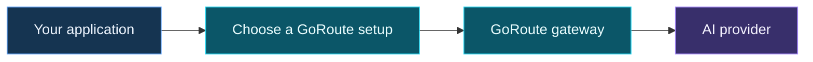
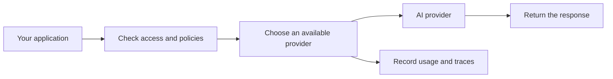

# GoRoute overview

GoRoute sits between an application and the AI services it uses. It gives an application a consistent way to send AI requests, while giving its team a place to choose providers, set access rules, and understand usage.

You can run GoRoute as a shared gateway or embed it directly in a Go application. The same product also includes tools for routing requests, protecting sensitive workflows, and connecting agents to approved tools.

## Choose a way to work

| What you want to do | Start here |
| :--- | :--- |
| Add the gateway inside a Go application | [Go SDK quickstart](/docs/start/quickstart-sdk) |
| Run a gateway that other applications can use | [Standalone gateway quickstart](/docs/start/quickstart-gateway) |
| Run the gateway with its database and cache | [Docker Compose quickstart](/docs/start/quickstart-docker) |
| Understand how requests move through the system | [Architecture and request flow](/docs/start/architecture) |
| Connect a coding tool or existing SDK | [Integrations overview](/docs/integrations/overview) |

## What happens to a request?

Your application sends a request to GoRoute. GoRoute checks the caller's access, applies the configured policies, chooses an available provider, and returns the provider's response. It can also record usage and trace information so your team can inspect what happened.

## Choose a deployment style

| Deployment style | When it fits | Guide |
| :--- | :--- | :--- |
| **Standalone gateway** | Run GoRoute as a service that different applications can call. | [Gateway quickstart](/docs/start/quickstart-gateway) |
| **Docker Compose** | Try a local stack or run the gateway with PostgreSQL and Redis. | [Docker quickstart](/docs/start/quickstart-docker) |
| **Kubernetes** | Operate the gateway in a Kubernetes environment. | [Helm chart](/docs/deploy/helm-chart) · [Kustomize](/docs/deploy/kubernetes-kustomize) |
| **Embedded Go SDK** | Run gateway behavior in the same process as a Go application. | [Go SDK quickstart](/docs/start/quickstart-sdk) |

## Explore by goal

- [Choose and route model providers](/docs/gateway)
- [Protect requests and control access](/docs/governance)
- [Manage cost and request limits](/docs/finops)
- [Connect agents and tools](/docs/agents)
- [Deploy and operate GoRoute](/docs/deploy/configuration)

## Next steps

- [Run a gateway locally](/docs/start/quickstart-gateway)
- [Build with the Go SDK](/docs/start/quickstart-sdk)
- [Browse practical examples](/docs/examples/overview)
